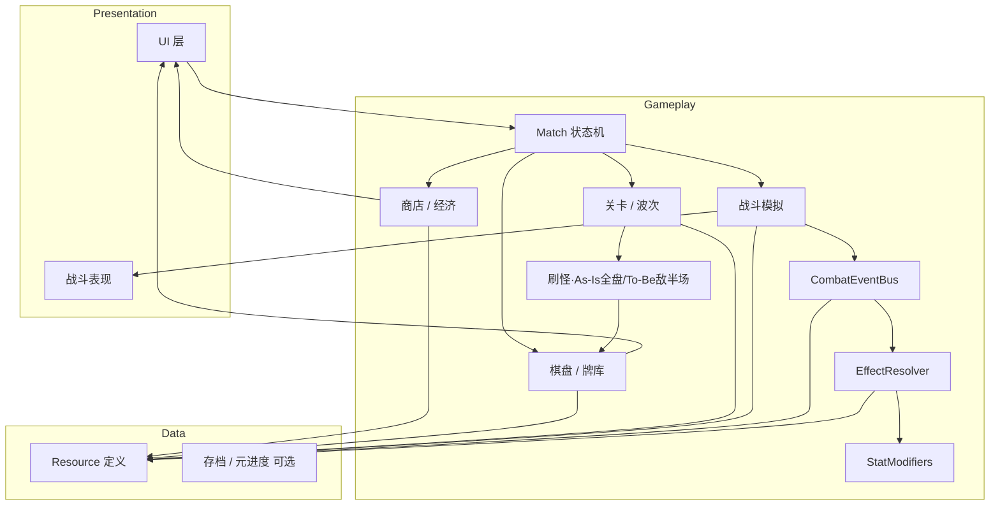
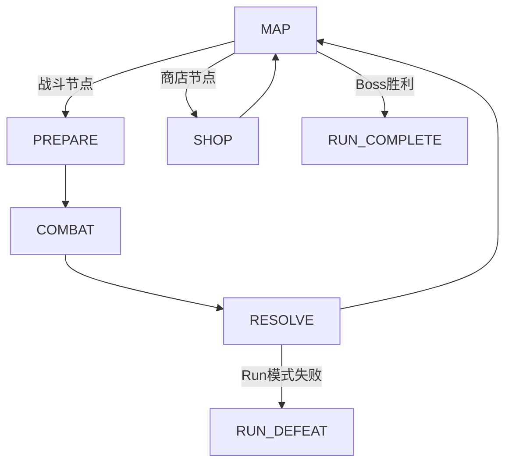
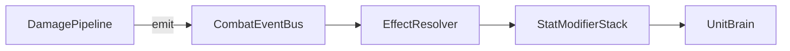

# 架构说明 — Project Autochess

## 1. 当前状态（As-Is）

> **已实现（2026-05）**：商店为 **角色卡 + 增益卡** + Tier 解锁，见 [SHOP_SYSTEM.md](./SHOP_SYSTEM.md)、[BUFF_SYSTEM.md](./BUFF_SYSTEM.md)。

截至文档编写时，仓库为 **Godot 4.6 工程（M2a–M3 已可运行）**：

- **实时战斗（Run 主路径）**：`scenes/combat/realtime/realtime_battle.tscn` + `RealtimeBattleController`；2D 俯视竖屏 18×32，格子只用于投放吸附与半场；开战后 `RealtimeCombatSim` 以固定步长（1/30 秒）在连续坐标上推进移动、攻击、投射物、溅射与推挤（见 §3.4）。角色为 `resources/units/realtime/`（皇室战争式基础单兵占位，无主技能）；地图非战斗节点为占位界面 `scenes/ui/placeholder/`
- **旧网格工具环**：以下 M1–M2 回合制格子战斗、3D `BoardWorld` 仍用于 `main.tscn` 线性开发关与沙盒，不再是 Run 主路径
- **M1**：可变棋盘、玩家布阵
- **M2a–M2c**：`UnitData` / `WaveData`、`SpawnSystem`、`GridMovement`、回合制逐单位行动战斗、`CombatArena` + `CombatEventBus` + `DamagePipeline` + `UnitBrain`、`MatchStateMachine` 多波循环（dev 关卡 **15 波**，通关后循环）
- **M3.5 Effect**：`EffectSpec` / `EffectAction` / `AbilityData`、`EffectResolver`、`StatModifierStack`；样本：受伤+2攻、死亡召唤2HP、移动+1血
- **M3b Deck/Shop**：`DeckState`、`ShopOffer`、双卡种 `ShopService`（角色 + 增益）、手牌布阵、满库替换与增益附加 UI
- **手牌 As-Is**：SHOP 展示整库出售；PREPARE/COMBAT 为本波手牌（`DrawService` 抽 `draw_count`）并可战中补人；冷却队列 / 可见窗 4 **To-Be**
- **M3 Economy（Legacy，已替换）**：原 `BenchState` 备战席流程已由 M3b 替代
- **M2 交互**：进入波次 → 准备布阵 → 开始战斗 → 刷怪（As-Is 全盘空闲格；To-Be 敌半场，见 [Features/COMBATLEVEL.md](./Features/COMBATLEVEL.md)）→ 自动战斗 → 波次结算（发金）→ 商店构筑 → 下一波 PREPARE
- 尚无：商店锁定、牌库内手动合并；冷却队列 / 可见窗 4（cycle 节奏层）
- **已实现 Autoload**：仅 `GameSettings`（主音量、全屏，持久化 `user://settings.cfg`）；主菜单入口 `scenes/main/main_menu.tscn`
- **表现 As-Is**：逻辑网格与像素/世界坐标分离；棋盘主路径为 **3D `BoardWorld` / `BoardScene3D`**（非 Node2D + YSort）
- **未创建** `resources/traits/`（v1 不含羁绊）
- 版本控制忽略 `.godot/`、`android/`、本地 `.artifacts/`、编辑器 `*.tscn*.tmp`

可在编辑器中 F5 验证棋盘。文档中的 **To-Be** 若与 As-Is 冲突，以代码与本节为准。

---

## 2. 目标形态（To-Be）概览



设计原则：

1. **数据驱动**：单位、联动技能用 `Resource`，便于策划迭代与 mod 扩展（**v1 不含 Trait/羁绊**）。
2. **效果描述统一**：所有战斗增益经 `EffectSpec` + `EffectResolver`；`AbilityData` 引用 `Array[EffectSpec]`。远期若加羁绊，须复用同一管线，禁止另写一套 Buff。
3. **战斗事件单一入口**：触发类逻辑只经 `CombatEventBus`；`DamagePipeline` / `UnitBrain` 只 emit，不直接修改其他单位属性。
4. **模拟与表现分离**：战斗结果可先由纯逻辑算出，再由场景播放动画（避免帧率影响平衡）。
5. **信号 / 事件总线**：流程与 UI 用**控制器显式信号**（`BoardController` / `RunGameController`）连接，**不**采用全局 `EventBus` Autoload；**战斗内触发不走全局 Bus**，避免跨局泄漏。
6. **逻辑与表现分离**：逻辑网格与世界坐标分离；主路径战斗舞台为 `BoardWorld`（3D）+ `CombatPresentation`；遗留 2D `BoardView` 不在热路径。

---

## 3. 核心系统

### 3.1 Run / Match 状态机

**宏观 Run**（`RunController`）：`MAP → ENCOUNTER → MAP` … → `RUN_COMPLETE` / `RUN_DEFEAT`。

**微观 Match**（`MatchStateMachine`）：单次遭遇内 `SHOP | PREPARE → COMBAT → RESOLVE`；`current_encounter: EncounterData` 替代线性 `LevelData.waves`。

胜负与主循环对齐 [GAME_VISION.md](./GAME_VISION.md)【设计定稿】：清波制（敌全灭胜 / 己全灭败）。**To-Be**：准备抽本波子集并预布阵；战斗中 cycle 补人 + 人口上限，已上场不可移动。**As-Is**：手牌常为整库展示，仅 PREPARE 可放置。生命周期见 [Features/GAME_LOOP.md](./Features/GAME_LOOP.md)。



| 模块 | 路径 | 职责 |
|------|------|------|
| `RunMapConfig` | `scripts/data/run_map_config.gd` | Act 地图模板、遭遇池、事件池 |
| `MapGenerator` | `scripts/core/run/map_generator.gd` |  procedural 地图 + 节点类型 |
| `RunController` | `scripts/core/run/run_controller.gd` | Run 生命周期、选路 |
| `RunGameController` | `scripts/core/run/run_game_controller.gd` | 场景编排：地图 UI ↔ `RealtimeBattleController`（战斗节点）/ 占位界面（其他节点）；持有本局 `DeckState`、`RunEconomy`。`BoardController` 的 run 模式为遗留、无调用方 |
| `EncounterData` | `scripts/data/encounter_data.gd` | 单节点战斗：`WaveData` + 棋盘覆盖 |

**线性开发关**（`BoardController.linear_dev_mode`）：仍用 `LevelData.waves` 顺序推进，每波战后商店。

PvE 波次循环（对齐 [GAME_VISION.md](./GAME_VISION.md) 六步，线性模式）：

```
LEVEL_LOAD → PREPARE（布阵）→ COMBAT（刷怪 + 自动战斗）→ RESOLVE（结算发金）
           → PREPARE（商店 + 布阵）→ COMBAT → … → LEVEL_COMPLETE
           ↘ DEFEAT → PREPARE
```

| 步骤 | 状态 | 要点 |
|------|------|------|
| 1 进入波次 | PREPARE 入口 | `wave_index` 指向即将战斗的 `WaveData` |
| 2 准备 | PREPARE | As-Is：整库可选放置；To-Be：抽本波子集预布阵；首波前商店已在关卡加载时 roll |
| 3 战斗 | COMBAT | 击杀掉金；自动战斗；线性工具环无 cycle 补人（Run 主路径见 §3.4）；`CombatEventBus` 开战创建、战后销毁 |
| 4 结算 | RESOLVE | 发放 `WaveData.wave_gold_reward`；清敌人；清波制胜负；**不得**直接开下一场战斗 |
| 5 商店 | PREPARE（结算后） | 购买角色卡/增益卡；RESOLVE 点「继续构筑」→ PREPARE + `roll_shop()`（线性工具环） |
| 6 下一波 | PREPARE → COMBAT | 玩家手动点「开始第 N 波」 |

建议实现：

- `MatchStateMachine`（`RefCounted` 或 `Node`）持有当前 `enum State`
- `LevelController` 加载 `LevelData`（棋盘 `W×H`、波次表），驱动当前 wave 索引
- 仅状态机可切换阶段；UI 通过信号请求操作（如「开始战斗」「继续构筑」），由状态机校验

### 3.2 Economy & Shop

完整策划规格见 [SHOP_SYSTEM.md](./SHOP_SYSTEM.md)、增益见 [BUFF_SYSTEM.md](./BUFF_SYSTEM.md)。摘要：

| 概念 | 说明 |
|------|------|
| 金币 | 击杀掉金（战斗中）、波次固定收益（RESOLVE）、**商店出售**（按 `DeckEntry.level`） |
| 波次结算金 | `WaveData.wave_gold_reward`（`-1` 用 `EconomyConfig.default_wave_gold`） |
| 商店商品 | **角色卡**（入牌库）、**增益卡**（附加到牌库条目） |
| 刷新 | 消耗金币刷新（商店锁定非本版范围） |
| 购买限制 | 角色卡：牌库未满直接入队，已满 → 替换流；增益卡不占新槽 |

**Legacy（已移除）**：`BenchState` / 备战席 UI — 见 [SHOP_SYSTEM.md](./SHOP_SYSTEM.md) §6。  

数据：`ShopPoolConfig`（角色池 + 增益池）、`DeckConfig`；运行时 `ShopService` + `DeckState` + `DrawService`（冷却窗仍 **To-Be**）。

#### 3.2.1 Tier 解锁

- **职责**：`TierUnlock.get_max_unlocked_tier(shop_wave)`（见 `scripts/core/tier_unlock.gd`）
- **输入**：`shop_wave`（见 SHOP_SYSTEM §2.6）
- **输出**：`max_unlocked_tier`（1–6）；各槽 roll 时过滤 `tier <= max`
- **默认定价**：`cost == tier`（可 per-resource 覆盖）
- **状态**：**逻辑已实现**；池内容与权重仍可迭代

### 3.3 Board & Deck

- **棋盘**：每关可配置 `width × height` 方格；每格最多一单位。**As-Is**：友方与怪物共享全盘空闲格投放/刷怪。**To-Be（战斗关卡）**：竖屏窄深、我下敌上、偶数行中线硬半场——友方预布阵/cycle 仅我半场，敌一次刷出仅敌半场；开战后天可越半场。见 [Features/COMBATLEVEL.md](./Features/COMBATLEVEL.md)。
- **牌库（Deck）**：Run 内 `DeckEntry` 列表（默认 10 占位、上限 20）；角色卡购买增删；增益卡附加到条目（`attached_buffs`）
- **手牌 / 抽牌**：As-Is 为手牌展示完整牌库；To-Be 为 PREPARE 抽本波子集 → **cycle 手牌**（见愿景 / SHOP §4）
- **布阵规则**：**As-Is** 仅 PREPARE 可放置、开战锁阵；**To-Be** 准备预布阵 + 战斗中 cycle 补人（已上场不可移动，人口上限；落点限我半场）

**Legacy（已移除）**：原备战席点击上场流程 — 见 [SHOP_SYSTEM.md](./SHOP_SYSTEM.md) §6。

**SpawnSystem（刷怪）**：

- **As-Is**：战斗开始时从全盘空闲格采样，按当前 `WaveData` 生成怪物；依赖 `BoardGrid.get_empty_cells()`
- **To-Be**：采样集合改为**敌半场**空闲格（中线划分），不再默认全盘空闲格
- 实际数量 = `min(配置数量, 候选格数)`；不覆盖已占格；采样 RNG 可 seeded

实现提示：

- `BoardGrid`：二维数组或 `Dictionary[Vector2i, UnitInstance]`；区分障碍格与空闲格
- 输入：`Area2D` / 自定义 `Control` 拖拽；坐标 ↔ 格子索引转换集中在一处

### 3.4 Combat Sim

**实时战斗（Run 主路径，`scripts/combat/realtime/`）**：

| 模块 | 职责 |
|------|------|
| `RealtimeCombatSim` | 纯逻辑；固定步长 1/30 秒，`step(dt)` 按累计时长换算步数，结果不依赖帧率；单位按 `instance_id` 迭代 |
| `RtUnit` / `RtProjectile` | 连续坐标（格）、状态（部署中 / 移动 / 攻击 / 阵亡）、计时器；追踪投射物 |
| `RtUnitBrain` | 索敌范围内最近 → 否则全场最近；攻击中锁定目标；只改自身状态 |
| `RealtimeDamagePipeline` | 唯一扣血处；经 `CombatEventBus` 发 `ON_ATTACK_HIT` / `ON_DAMAGE_TAKEN` / `ON_DEATH` 等 |
| `RealtimeBattleController`（`scripts/ui/realtime/`） | 准备 / 战斗 / 结算；抽本场手牌、我半场投放校验、人口、敌半场刷出预览与落点；击杀金与波次金 |

每步顺序：大脑决策 → 移动 → 出手 → 投射物结算 → 按质量反比推挤并钳在边界内 → 移除阵亡 → 胜负。点「开始战斗」时控制器调用 `begin_combat()`；此前在场的单位（预布阵、开战刷出）不走 `deploy_time`，此后投放的都走。属性读 `UnitStats` 的 Realtime 组。新角色无技能，本版未接 `EffectResolver`：实时路径不结算暴击（`crit_rate_percent`）和牌库条目上的附加技能。

`CombatEventBus` 生命周期：进入遭遇（准备阶段）时由控制器创建，准备阶段不发战斗事件；结算后「继续」时随模拟一起释放。

**旧网格回合制（`main.tscn` / 沙盒）** 职责拆分：

| 模块 | 职责 |
|------|------|
| `CombatArena` | 玩家阵容 + 刷怪结果实例化、开战/结束信号 |
| `UnitBrain` | 攻速计时、寻敌、移动（简化可网格邻接） |
| `AbilitySystem` | 主动技调度门面（冷却、施法请求）；效果应用委托 `EffectResolver` |
| `DamagePipeline` | 伤害结算、暴击判定、治疗；结算后向 `CombatEventBus` 派发事件 |
| `CombatEventBus` | 战斗域事件分发（见 §3.7） |
| `EffectResolver` | 匹配 Trigger、解析目标、应用 `EffectSpec` |

**DamagePipeline（暴击）**：

- 默认暴击率 `UnitStats.crit_rate_percent = 5`；`UnitInstance.get_effective_crit_rate()` 含战斗临时加成
- `roll_damage` / `apply_rolled_damage`：暴击倍率 `CRIT_DAMAGE_MULT = 1.5`（150% 伤害）
- `source == null` 的环境伤害（如格子灼烧）**不**暴击
- 暴击成功时额外 emit `OnCrit`；`CombatEventPayload.is_crit` 供表现层（金色跳字、震屏、spark）

**事件派发约定**：伤害结算完成后 `emit OnDamageTaken(target)`、`OnDealDamage(source)` 等，由 §3.7 监听并触发联动技能。

**确定性**（若需回放或联机）：`combat_tick` 为回合序号（刷怪节拍）；回合内各单位按固定顺序逐个行动，`action_interval` 控制行动节奏；RNG 使用 seeded，避免 `delta` 浮点累积差异。

**战斗节奏（tick 加速）**：单波战斗内，`CombatPaceConfig` 按当前 `combat_tick` 缩放 `action_interval` 与全部战斗 Tween 基准时长（`CombatAnimationConfig`）。公式：`pace_scale = clamp(1 - tick × scale_per_combat_tick, min_pace_scale, 1)`；首回合 tick=0 为 100% 基准，新波开战重置。`skill_callout_hold_sec` 保证技能说明 callout 最短可读时间（默认 1.2s），**不受** tick 加速影响。默认资源 `resources/combat/default_combat_pace.tres`。此为自动随战斗推进加速，**非**全局固定提速、**非**玩家手动倍速。

表现层监听 `combat_event`（伤害数字、死亡、技能特效）播放，不改变模拟结果。战斗步进时高亮当前行动单位；`ON_EFFECT_RESOLVED` 时在单位附近弹出对应 `EffectSpec` 技能说明 callout。

### 3.5 Units & Abilities（单位与联动技能）

建议资源类型：

```gdscript
# 伪代码 — 实际实现时放入 scripts/data/
class_name UnitData
extends Resource

@export var id: String
@export var display_name: String
@export var cost: int
@export var tier: int = 1          # 1–6，商店 roll 与默认 cost 对齐
@export var base_stats: UnitStats
@export var tags: Array[StringName] = []  # 技能目标筛选用，非羁绊计数
@export var ability: AbilityData
@export var passives: Array[AbilityData] = []
@export var icon: Texture2D  # UI 头像；留空则色块占位
@export var scene: PackedScene
```

- **牌库等级**：`DeckEntry.level`（1–3）+ `LevelConfig` 经验阈值；商店购买同名合并；升级永久 +1/+1；战斗技能数值 × `UnitInstance.level`
- **牌库永久加成**：`DeckEntry.bonus_attack` / `bonus_max_hp` / `bonus_crit_rate_percent`；`UnitInstance.from_deck_entry()` 将 `bonus_crit_rate_percent` 合并进 `stats.crit_rate_percent`
- **联动技能（Ability）**：`UnitData.ability`（**必填**）+ 可选 `passives`；`AbilityData` 持有 `Array[EffectSpec]`，战斗内由 `CombatEventBus` 驱动
- **增益（Buff） / 事件选项**：商店与事件的**非战斗永久改写**走 `BuffApplicator` / `EventEffectResolver`（自有 `EffectType`），**不**默认并入 `get_all_effect_specs()`。凡会进入战斗触发的效果必须挂 `EffectSpec`（见 BUFF_SYSTEM）
- **tags**：供 `allies_with_tag` 等目标选择使用；**v1 不做**「凑 N 个同 tag 触发团队增益」的 Trait 系统

**远期 Trait（非 v1）**：若加入 `TraitData` / `TraitSystem`，按 [GAME_VISION.md](./GAME_VISION.md) 约定复用 `EffectSpec`，不在 v1 目录与里程碑中实现。

### 3.6 UI Layer

- 场景：`scenes/ui/` 下分 ShopPanel、HandPanel、BoardView、PlayerHUD（v1 无羁绊面板）
- To-Be 弹窗：`DeckReplaceModal`、`BuffAttachModal`（由 `SkillAttachModal` 迁移，见 SHOP_SYSTEM）
- UI 只调用 **Service / Facade**（如 `MatchFacade.buy_unit(slot)`），不直接改棋盘数组
- 单位 tooltip：展示联动技能说明（`EffectSpec` 的 `@export_multiline` 描述或自动生成）
- 主题：`Theme` 资源统一字体与颜色（中世纪幻想：偏石材/羊皮纸/金属色；可读优先。【设定定稿 / UI Theme 待迁移】）

### 3.7 战斗事件与效果系统

对齐 [GAME_VISION.md](./GAME_VISION.md)「流派与联动技能」。数据流：



#### CombatEventBus（战斗域）

- **生命周期**：进入 `COMBAT` 时由 `CombatArena.start_combat` 创建；战斗结束经 `CombatArena.stop_combat` 销毁（主流程与沙盒均须调用）。不注册为 Autoload。
- **v1 战斗事件**（[`CombatEvents`](../scripts/combat/events/combat_events.gd)，`StringName`）：

```
OnCombatStart, OnFriendSummoned, OnSummoned, OnFriendDeath, OnRoundStart,
OnDamageTaken, OnDealDamage, OnCrit, OnKill, OnDeath, OnAttackHit,
OnLineAttack, OnMove, OnEffectResolved, OnEffectFizzled
```

- **商店阶段事件**（`ShopEvents`，由 `ShopEffectResolver` 处理，不走战斗 `CombatEventBus`）：`OnBuy`, `OnSell`, `OnLevelUp`

- **载荷 `CombatEventPayload`**：`event_type`, `source`, `target`, `amount`, `is_crit`, `damage_type`, `grid_pos` 等。

#### EffectResolver

1. 接收 `CombatEvent` + 场上单位的 listener 列表（来自 `unit.ability` / `passives`；增益触发型如亡者遗金可走专用钩子；v1 不含 Trait）。
2. 匹配 `EffectSpec.trigger` → 检查 `ConditionSpec` → 解析 `TargetSelector` → 执行 `EffectAction` 队列。
3. **防循环**：`max_chain_depth`（建议 8–16）；同 tick 去重；内层伤害可标 `silent` 避免再次触发 `OnDamageTaken`。

#### EffectSpec（Resource）

```gdscript
# 伪代码 — scripts/data/effect_spec.gd
class_name EffectSpec
extends Resource

@export var trigger: StringName
@export var conditions: Array[ConditionSpec] = []
@export var target_selector: TargetSelector
@export var effect_actions: Array[EffectAction] = []
```

`EffectAction` 示例：`MODIFY_STAT`（attack / max_hp / crit_rate_percent）、`HEAL`、`DEAL_DAMAGE`、`SPAWN_UNIT`、`PERMANENT_DECK_STAT`、`APPLY_CELL_EFFECT`、`FRIENDS_HURT_AOE`、`SWAP_POSITIONS` 等；字段含 `duration`（秒 / `permanent_combat`）、`stack_rule`（刷新 / 叠加 / 独立实例）。

#### StatModifierStack（运行时，每单位）

- 基础层：`UnitData` + 星级。
- 战斗临时层：联动技能施加的修饰；`OnCombatEnd` 或离开 `COMBAT` 时清空。

#### CellEffectStack（运行时，棋盘格）

- 数据：`CellEffectData`（如 `resources/cell_effects/burn.tres`），字段含 `damage_per_tick`、`duration_rounds`。
- 挂载：`BoardGrid.cell_effects`；`EffectAction.APPLY_CELL_EFFECT` 向格写入效果。
- 时机：每 combat tick **移动阶段开始前**对格上单位结算 `damage_per_tick`，随后递减 `duration_rounds`；**不在**进入格子时重复结算。
- 每格同时仅一种效果；`add_effect` 会**覆盖**旧效果并重置持续回合。
- 表现：主路径由 `BoardScene3D` 同步格子效果着色；遗留 `BoardView.sync_cell_effects()` 仅供对照。

#### AbilityData（v1）

| 字段 | 说明 |
|------|------|
| `effect_specs` | `Array[EffectSpec]`，由 `CombatEventBus` 触发 |
| 挂载 | `UnitData.ability`（主）、`passives[]`（额外被动） |

#### TargetSelector（v1 建议值）

`self`, `adjacent_allies`, `all_allies`, `allies_with_tag`, `event_source`, `event_target`

---

## 4. Autoload（As-Is）

| 名称 | 路径 | 职责 | 状态 |
|------|------|------|------|
| `GameSettings` | `scripts/autoload/game_settings.gd` | 主音量、全屏；`user://settings.cfg` 持久化 | **已实现**（唯一 Autoload） |

**不采用**全局 `EventBus` / `GameState` / `DataRegistry` Autoload：流程状态由 `BoardController` / `RunController` / `MatchStateMachine` 持有，UI 通过显式信号连接；单位与技能数据由场景 `@export` 与 `resources/**/*.tres` 加载。这符合 Godot「少用全局单例」实践，并避免战斗事件跨局泄漏。

---

## 5. 目录与依赖关系

```
scripts/
  autoload/           → 被全局访问，不依赖具体场景
  core/               → match, shop, deck, board（领域逻辑）
  combat/
    events/           → CombatEventBus, payload, enum
    effects/          → EffectResolver, StatModifierStack, conditions
    (其他)            → arena, damage, unit brain
  data/               → EffectSpec, AbilityData, UnitData 等 Resource
scenes/               → 引用 scripts，不反向被 scripts 引用
resources/
  units/ levels/ abilities/ buffs/ effects/  → .tres 数据
assets/               → 仅美术/音频
```

---

## 6. 技术栈与引擎注意点

| 主题 | 建议 |
|------|------|
| 语言 | GDScript 2.0（类型注解、`@export`） |
| 棋盘表现 | 主路径 `BoardScene3D` + 单位卡显示；逻辑仍为矩形网格 `BoardGrid` |
| 物理 | 战斗用网格距离检测，不依赖刚体碰撞结算 |
| 配置 | `project.godot` 使用 **GL Compatibility**（Web / GitHub Pages）；3D 物理引擎为 Jolt（棋盘拾取可另用） |
| 本地化 | 早期用 `StringName` + CSV/PO；`display_name` 走 `tr()` |

---

## 7. 实现顺序建议

与 [GAME_VISION.md](./GAME_VISION.md) 里程碑一致：

1. 可变 `W×H` `BoardGrid` + 玩家布阵 + 格占用（M1）
2. **M2a** `UnitData` / `WaveData` + `SpawnSystem` + `GridMovement` + 回合制逐单位行动最简战斗
3. **M2b** `CombatArena` + `CombatEventBus` + `DamagePipeline` + `UnitBrain`（无 Effect）
4. **M2c** `MatchStateMachine` 多波 `PREPARE → COMBAT → RESOLVE`
5. 商店 → 备战席 → 购买（M3 Legacy，**已由 M3b 替换**）
6. **M3b** 牌库 + 双卡种商店 + 手牌布阵（**已实现**；见 [SHOP_SYSTEM.md](./SHOP_SYSTEM.md)）；本波抽牌 + 战中补人已接 `DrawService`
7. **`EffectResolver` + 样板联动技能** + 增益卡 + Tier（已落地；cycle 补人属后续）
8. 多关卡、多流派样板、tooltip、平衡、美术音效、存档（M5）

---

## 8. 与 INDEX 的同步

文件、目录创建或 Autoload 注册后，请回到 [INDEX.md](./INDEX.md) 更新「仓库文件索引」与「推荐结构」状态表。
