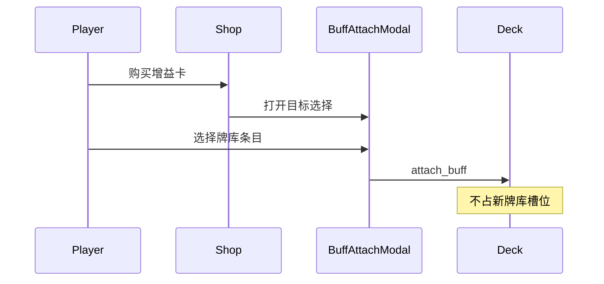

# 增益卡系统

> 策划与程序对齐文档。**已实现**（2026-05）：增益商店、`BuffAttachModal`、`attached_buffs`、Tier roll。

相关文档：[GAME_VISION.md](./GAME_VISION.md) · [ABILITIES.md](./ABILITIES.md)（单位内建联动技能）· [ARCHITECTURE.md](./ARCHITECTURE.md)（模块边界 · 商店摘要）· [Reference/SAP_SHOP_SYSTEM.md](./Reference/SAP_SHOP_SYSTEM.md)（SAP Food 对照）

---

## 1. 概述

**增益卡**是商店可购的强化商品，购买后附加到牌库内某一**角色条目**（`DeckEntry`），在 Run 内持久生效（直至该条目被出售或替换移除）。

与 **技能** 的分工：

| 类型 | 来源 | 作用 |
|------|------|------|
| **技能（Ability）** | 每只 `UnitData` **内建**（`ability` / `passives`） | 战斗内事件联动（受伤、死亡、移动等） |
| **增益卡（Buff）** | 商店购买，挂到 `DeckEntry` | 永久属性、规则标签、或战斗触发的 Run 级效果 |

**商店不再出售技能卡**；原 `skill_pool` / `SkillAttachModal` / `attached_skills` 在文档与后续实现中由增益体系替代。



---

## 2. 购买与附加规则

### 2.1 流程

1. 玩家在 **SHOP** 阶段点击增益槽「购买」
2. 扣费（`BuffCardData.shop_cost`，默认可与 `tier` 对齐）
3. 弹出 **增益附加** UI（文档目标名 `BuffAttachModal`），列出当前牌库全部 `DeckEntry`（显示 Lv、已有增益摘要）
4. 玩家选定目标 → `DeckState.attach_buff(entry_id, buff)`
5. 清空该商店槽位；**不**新增牌库条目

### 2.2 约束

| 规则 | 说明 |
|------|------|
| 牌库满 | **仍允许**购买增益（不占容量） |
| 同条目多张增益 | **允许**叠在同一 `DeckEntry`（用户确认） |
| 同 id 重复购买 | **未决**（默认可叠，实现期可配置） |
| 出售角色 | 该条目上所有增益一并移除；**不**单独退还增益卡金币 |
| 单独卸载增益 | **未决**（远期） |

---

## 3. 数据模型（To-Be）

### 3.1 BuffCardData

```
BuffCardData (Resource)
├── id: String
├── display_name: String
├── tier: int                 # 1–6，参与商店 Tier roll
├── shop_cost: int            # 购买价；默认建议 cost == tier
└── effects: Array[BuffEffectSpec]
```

### 3.2 BuffEffectSpec（To-Be）

实现期可独立资源，或复用 `EffectSpec` + 扩展 `EffectAction` 枚举。文档层效果类型：

| 类型 | 说明 | 示例 |
|------|------|------|
| `PERMANENT_STAT` | 写入 `DeckEntry.bonus_attack` / `bonus_max_hp` / `bonus_crit_rate_percent` | 力量祝福 +1 攻 |
| `RULE_FLAG` | 条目规则标记，战斗逻辑读取 | 沉重脚步：禁止移动 |
| `COMBAT_TRIGGER` | 战斗事件触发，可接 Run 经济 | 亡者遗金：死亡 +1 金 |

### 3.3 DeckEntry（修订）

```
DeckEntry
├── unit: UnitData
├── level, experience, bonus_attack, bonus_max_hp, bonus_crit_rate_percent
├── attached_buffs: Array[BuffCardData]   # 取代 attached_skills
└── rule_flags: Dictionary             # 可选，如 cannot_move: true
```

### 3.4 与 AbilityData 的关系（框架边界）

- **不**将增益卡并入 `UnitInstance.get_all_effect_specs()` 的默认列表（除非 `COMBAT_TRIGGER` 类增益在实现时注册为隐藏监听）
- **永久属性类**增益在 `from_deck_entry` 时合并进 `stats` / `bonus_*`
- **无法行走** 在 `UnitBrain.decide` 或实例 flag 上短路 MOVE，仍可 ATTACK
- **双轨约定（As-Is）**：商店/事件的非战斗永久改写走 `BuffApplicator` / `EventEffectResolver`（自有 `EffectType`）。凡会进入战斗触发的效果必须挂 `EffectSpec`，禁止再长出第三套隐式 DSL。

### 3.5 属性叠加顺序（建议）

实例化上场时有效攻击/生命上限：

1. `UnitData.stats` 基础值  
2. `DeckEntry` 牌库升级永久加成（`bonus_*`，SAP 式 Level up）  
3. 增益卡 `PERMANENT_STAT` 累加  
4. 战斗内 `StatModifierStack`（本场临时，波次结束清空）

---

## 4. 首批增益卡目录（策划）

| id | 显示名 | 类型 | 规则摘要 | 生效域 |
|----|--------|------|----------|--------|
| `buff_perm_atk` | 苹果（攻击） | `PERMANENT_STAT` | **永久 +1** 攻击 | Run → 战斗 |
| `buff_perm_hp` | 苹果（生命） | `PERMANENT_STAT` | **永久 +1** 生命上限 | Run → 战斗 |
| `buff_no_move` | 沉重脚步 | `RULE_FLAG` | **无法行走**（不执行 MOVE，仍可攻击） | 战斗 |
| `buff_death_gold` | 亡者遗金 | `COMBAT_TRIGGER` | **死亡时** Run **+1 金**（友方单位，`ON_DEATH`） | 战斗 → `RunEconomy` |
| `buff_meat_bone` | 肉骨 | `PERMANENT_STAT` | **永久 +3** 攻击（SAP 攻击加伤弱化） | Run → 战斗 |
| `buff_garlic` | 大蒜 | `PERMANENT_STAT` | **永久 +2** 生命上限（SAP 减伤弱化） | Run → 战斗 |
| `buff_pear_atk` | 梨（攻击） | `PERMANENT_STAT` | **永久 +2** 攻击 | Run → 战斗 |
| `buff_pear_hp` | 梨（生命） | `PERMANENT_STAT` | **永久 +2** 生命上限 | Run → 战斗 |

### 4.1 沉重脚步（buff_no_move）

- 附加后：`DeckEntry.rule_flags["cannot_move"] = true`（或等价枚举）
- `UnitBrain`：若持有者带该 flag，跳过 `ActionType.MOVE`，仅尝试攻击
- 与「攻击范围外」.idle 行为一致时可停留原地

### 4.2 苹果 / 梨 / 肉骨 / 大蒜（永久属性）

- 购买并附加瞬间写入 `DeckEntry.bonus_attack` / `bonus_max_hp` / `bonus_crit_rate_percent`（数值见上表 `value`；`crit_rate_percent` 已由 `ShopEffectResolver` 支持）
- UI 手牌/牌库卡面显示合并后的攻血；可与牌库升级 `bonus_*` 叠加

### 4.3 亡者遗金

- 战斗内：持有者死亡时（`ON_DEATH`，`team == PLAYER`）调用 `RunEconomy.grant(1)`
- **不**依赖击杀敌人；与波次结算金、击杀掉金独立
- 实现注意：仅在战斗进行中生效，商店阶段无单位实例

---

## 5. 商店与 Tier

增益卡与角色卡共用 **Tier 解锁** 规则（见 [ARCHITECTURE.md](./ARCHITECTURE.md) §3.2.1 / `TierUnlock`）：

- 每个增益槽从 `tier <= max_unlocked_tier` 的 `buff_pool` 中等权重 roll
- `BuffCardData.tier` 与 `UnitData.tier` 使用同一套 1–6 档位语义

---

## 6. UI 与展示

| 位置 | 展示内容 |
|------|----------|
| 商店增益槽 | 增益名、费用、Tier（可选角标） |
| 增益附加弹窗 | 条目名、Lv、已有增益列表 |
| 手牌 / 牌库列表 | `get_buff_summary()` 取代原技能摘要 |
| Tooltip | 内建技能 + 已附加增益分开展示 |

---

## 7. 模块与资源（To-Be）

| 路径 / 模块 | 职责 |
|-------------|------|
| `scripts/data/buff_card_data.gd` | 增益卡资源 |
| `resources/buffs/*.tres` | 策划配置 |
| `ShopOffer.BUFF` | 商店 Offer 类型 |
| `ShopPoolConfig.buff_pool` | 按 tier 分池或带 tier 字段过滤 |
| `DeckState.attach_buff` | 附加到条目 |
| `scenes/ui/buff_attach_modal.tscn` | 目标选择（由 skill_attach 迁移） |

---

## 8. 未决问题

| 议题 | 说明 |
|------|------|
| 同 id 增益叠加上限 | 是否允许无限叠同一张卡 |
| 增益卸载 | 不出售角色时能否移除单张增益 |
| 条目增益数量上限 | 单角色最多 N 张增益 |
| `COMBAT_TRIGGER` 实现方式 | 独立监听器 vs 注入临时 AbilityData |
| 敌方单位 | 增益仅玩家牌库；敌人不适用 |

---

## 9. 实现对照（2026-05）

| 规格 | 代码 |
|------|------|
| 增益卡 | `BuffCardData` + `ShopPoolConfig.buff_pool` |
| 附加 UI | `BuffAttachModal` |
| 牌库字段 | `DeckEntry.attached_buffs` + `rule_flags` |
| Tier roll | `TierUnlock` + `ShopService.roll_shop(shop_wave)` |

---

## 10. 维护说明

- 新增增益 `.tres` 后更新 §4 目录表
- 平衡调 `shop_cost` / `tier` 时同步商店池资源与 `TierUnlock`
- SAP 食物效果对照见 [SUPER_AUTO_PETS.md](./Reference/SUPER_AUTO_PETS.md) §4（外部参考，非 1:1）
