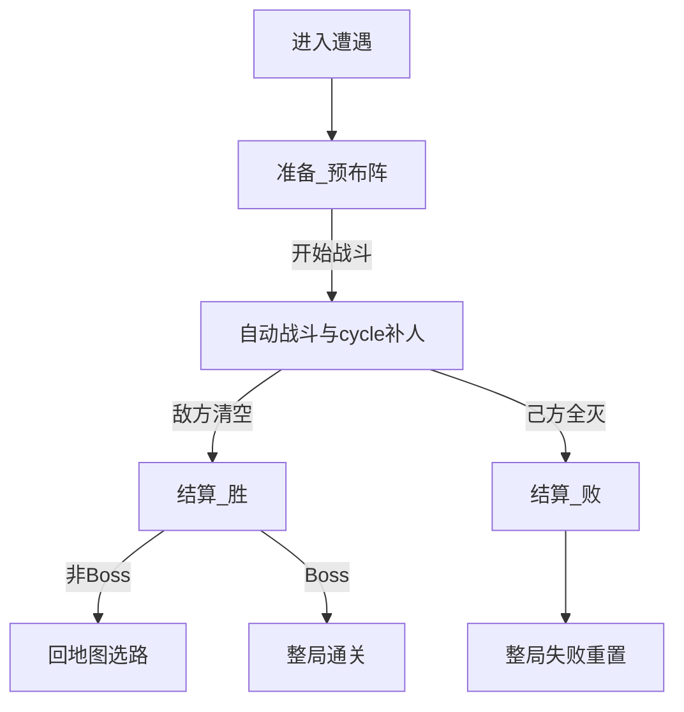

# 战斗

> 功能规格 · 只谈一场遭遇内的流程与职责，不写具体数值 · 2026-10-12  
> 相关文档：[游戏基础循环](./GAME_LOOP.md) · [地图与节点](./MAP.md) · [战斗关卡](./COMBATLEVEL.md) · [游戏愿景](../GAME_VISION.md) · [商店](../SHOP_SYSTEM.md) · [角色单位](./UNITS.md) · [技能目录](../ABILITIES.md) · [增益](../BUFF_SYSTEM.md) · [架构](../ARCHITECTURE.md)  
> **本版不写**：攻防点数、刷怪数量、节奏秒数、掉金点数；技能积木全表；商店购买细则；地图选路。  
> **【循环 To-Be】** 战斗中 cycle 补人 / 人口上限以 [游戏愿景](../GAME_VISION.md) 为准；现状多为「仅准备可放置、开战锁阵」。  
> **【战场 To-Be】** 半场落点与竖屏朝向见 [战斗关卡](./COMBATLEVEL.md)；本篇只定三步流程与刷怪**时机**。

## 1. 这是什么

**战斗**规定：玩家进入战斗类地图节点（战斗 / 精英 / Boss）之后，一场自走棋遭遇怎么从预布阵打到结清。

玩家可见的一轮基础循环是三步：

1. **准备（预布阵）** — 抽本波手牌（To-Be）、预布阵、点开战  
2. **自动战斗 + cycle 补人** — 单位自动推进；玩家可在人口上限内从 cycle 手牌补人（已上场不可移动）  
3. **结算** — 判胜负、发奖励、清场并离开本场  

对应实现阶段：准备 / 战斗 / 结算（`PREPARE` / `COMBAT` / `RESOLVE`）。

| 本篇负责 | 别处负责 |
|----------|----------|
| 进遭遇后的三步怎么玩 | **循环**：何时进遭遇、胜回地图、败整局重置 |
| 行动顺序、刷怪**时机**（功能） | **地图**：点哪个节点进来 |
| 战斗内何时能触发技能/临时层何时清 | **单位 / 技能 / 增益**：属性与效果内容 |
| — | **战斗关卡**：竖屏半场、友方/敌方**落点分区**、开战可否越线 |

---

## 2. 写什么、不写什么

### 2.1 本文要说清的

- 三步循环与玩家 / 系统职责  
- 「布局」相关的三种含义：站位、行动顺序、刷怪时机  
- 准备门槛、自动战斗推进边界、结算与清场  
- 与地图「一节点一战」的衔接  
- 现状：功能已存在 / 部分存在 / 仅愿景  

### 2.2 本版不写

| 内容 | 交给谁 |
|------|--------|
| 一整局生命周期、跨节点持久总表 | 游戏基础循环 |
| 节点种类与选路 | 地图与节点 |
| 生命 / 攻击 / 移动属性骨架 | 角色单位 |
| 技能触发器与效果积木全表 | 技能文档 |
| 增益附加流程 | 增益文档 |
| 具体数值与平衡 | 数值策划 |
| 竖屏朝向、半场落点、开战可否越线 | 战斗关卡 |

第一版边界（一句）：不做单位微操走位、羁绊、基地血条胜负、PvP；主模式商店不并进战斗三步。

---

## 3. 术语

| 说法 | 意思 |
|------|------|
| **遭遇** | 进入一个战斗类节点后的一整场战斗（主模式通常一节点一战） |
| **准备** | 预布阵、尚未开战的阶段 |
| **自动战斗** | 系统推进单位行动的阶段；玩家可 cycle 补人，不点技能/不拖已上场单位 |
| **本波 cycle 手牌** | 准备从牌库抽得的子集；战斗中滚动出牌（见愿景 / 商店 §4） |
| **人口** | 同时上场友方人数上限（默认 5） |
| **结算** | 战斗结束后的胜负与清场处理 |
| **站位布局** | 友方占我半场哪些格子（准备 + cycle；已上场后不可再挪） |
| **行动顺序** | 同一战斗回合里谁先行动（由阵营与站位推导） |
| **刷怪时机** | 敌方角色**何时**出现（落在**哪半场**见战斗关卡） |
| **战斗回合** | 自动战斗的推进节拍（逻辑 tick，不绑帧率） |
| **空闲格** | 当前未被占用、且落在规则允许半场内的可落格 |
| **生成的代理角色** | 技能在战斗中生成的临时角色；占格并参与胜负 |

---

## 4. 玩家可见三步（基础循环）

**保留三步，不拆成玩家必须多记的第四、第五步。**  
「进入遭遇」只是地图 → 棋盘的交接，不算玩家操作步。

| 步骤 | 玩家做什么 | 系统做什么 |
|------|------------|------------|
| **1. 准备（预布阵）** | 从本波手牌向**我半场**预布阵、调整站位、点「开始战斗」 | 抽牌（To-Be）；校验占用、人口与半场；禁止战斗；可预览敌半场落点 |
| **2. 自动战斗 + 补人** | cycle 手牌向**我半场**空格补人（受人口约束）；可暂停/加速观看；**不可**移动已上场单位、不可点技能 | 敌半场刷怪、按序行动、伤害与技能事件、死亡腾人口、判结束 |
| **3. 结算** | 看结果 | 发波次金、清场、清临时状态；胜回地图 / 败整局失败 |

主模式**不要**把商店塞进这三步（商店在地图商店节点）。线性开发关「战后商店」见附录。



---

## 5. 「布局」三义澄清

草稿「根据布局顺序和敌人自动战斗」容易混在一起，规格拆成三件事：

| 概念 | 谁决定 | 第一版约定 |
|------|--------|------------|
| **站位布局** | 玩家 | 我半场预布阵 + cycle 补人；**已上场单位不可再移动/换位**（半场划分见战斗关卡） |
| **行动顺序** | 系统 | 每回合对存活单位排序：**友方先于敌方** → 再按格子行列（及实例编号）→ 逐个行动 |
| **刷怪时机** | 系统 | **开战首个战斗回合**一次刷完；**落点在敌半场**（见战斗关卡） |

**推荐说法**：开战后系统按站位与阵营排出行动顺序并刷怪；玩家用 cycle 决定**何时往我半场增援谁**，不拖已上场棋子、不点技能。

---

## 6. 准备阶段

### 6.1 玩家

- 从**本波 cycle 手牌**（To-Be：抽 5；As-Is：常为整库）选择友方预布阵到**我半场**空格；可调整或收回（若交互已有）。  
- 不必把所有手牌都下场；可留人口给战斗中补人。  
- 确认后点「开始战斗」。

### 6.2 系统

- **抽牌（To-Be）**：每场准备无放回抽子集，形成本波 cycle 牌组（见 [商店 §4](../SHOP_SYSTEM.md)）。  
- **As-Is**：手牌常为整库可选——验收勿把抽牌 / cycle 当已完成。  
- 校验格占用、**人口上限**与**我半场**；准备阶段禁止战斗。  
- 开战前可预览本场敌人在**敌半场**的落点；开战时锁定该批落点。  

### 6.3 开战门槛（定稿）

1. 场上至少 **1** 名友方角色  
2. 未超过场上人数上限  
3. 本场遭遇数据有效  

### 6.4 禁止

准备阶段不跑战斗 AI、不创建战斗事件总线、不造成战斗伤害。

---

## 7. 自动战斗

### 7.1 时间推进

- 以**战斗回合**推进，逻辑结果不依赖帧率。  
- 每回合大致顺序：（首回合）刷怪 → 格子持续效果 → 排出行动队列 → 单位逐个行动 → 回合结束。  
- 单位之间用行动间隔推进；观战节奏可由系统随回合加快（**不是**玩家手动倍速主轴）。

### 7.2 行动顺序（定稿）

1. 收集场上存活单位（含生成的代理角色）。  
2. 排序：友方 → 敌方；同阵营按格子行、列，再比实例编号。  
3. 轮到的单位由大脑决策：移动 / 普通攻击 / 其攻击方式规定的行为等。  
4. 伤害走伤害管线；击杀敌人可即时掉金。

### 7.3 刷怪

- **时机（本篇）**：第一版在开战首个战斗回合**一次刷完**本场计划敌人；延时分批为扩展。  
- **落点（战斗关卡 · To-Be）**：只采样**敌半场**空闲格；不覆盖已占格。实际刷出数不超过敌半场候选数；候选空则少刷或不刷。  
- **As-Is**：仍从全盘空闲格采样刷怪（见架构 / 战斗关卡现状）。  
- 数据可保留「延时刷」字段作扩展；未接好前不作主模式验收。  
- 半场划分、竖屏朝向见 [战斗关卡](./COMBATLEVEL.md)。

### 7.4 单位行为边界

- 寻目标、进入攻击范围则打，否则按移动方式靠近。  
- **普通攻击方式**与**技能**是两套系统（见角色单位文档）。

### 7.5 技能与增益边界

| 可以 | 不可以 |
|------|--------|
| 战斗内事件经战斗事件总线分发 | 伤害管线 / 单位大脑直接改其他单位属性 |
| 主技能、被动监听战斗事件 | 商店买卖升级走战斗总线 |
| 增益里「战斗触发」类挂战斗钩子 | 第一版羁绊凑数团队增益 |

战斗临时属性、格子战斗效果、生成的代理角色：本场有效；**结算时清除临时层**。牌库养成与跨节点生命不在此清（见循环文档）。

### 7.6 战斗中胜负判定

| 结果 | 条件 |
|------|------|
| **胜** | 场上无存活敌方，且无待刷敌人 |
| **败** | 场上无存活友方 |

生成的代理角色**算**场上实体，影响占格与胜负。对齐愿景清波制；不以基地血条为主轴。

### 7.7 玩家在战斗中的交互【设计定稿 / To-Be】

- **cycle 补人**：人口未满且有**我半场**空格时，从本波滚动手牌落子；死亡腾人口后可即时再补。  
- **已上场单位不可移动/换位**；不可点选技能或指定攻击目标；单位可自行越半场交战（见战斗关卡）。  
- 可暂停 / 加速观看。  
- **As-Is**：开战后通常无法再放置——勿把战中补人写成已完成。

---

## 8. 结算

| 项 | 约定 |
|----|------|
| 胜 | 清光本场全部敌方角色 |
| 败 | 己方角色全部阵亡 |
| 经济 | 战斗内击杀即时金 + 结算波次固定收益（具体数留给数值） |
| 清场 | 清敌方实体；友方生命残留按循环约定 |
| 临时状态 | 清空本场临时属性修饰；销毁战斗事件总线；格子战斗效果不带出 |
| 胜且非 Boss | 回地图选路（**不**强制商店） |
| 胜且 Boss | 整局通关 |
| 败 | 整局失败重置（生命周期见循环文档） |

结算以看结果为主；主模式不在此强制买卡。

---

## 9. 与地图「一节点一战」的衔接

```text
地图选路 → 进入战斗 / 精英 / Boss
  → 加载战斗关卡战场规格（半场）
  →【本篇】准备预布阵 → 自动战斗与 cycle 补人 → 结算
  → 胜：完成节点回地图（Boss 则通关）
  → 败：整局失败
```

- 遭遇数据携带本场敌人计划、棋盘覆盖等；本篇消费「一场」配置。  
- 精英 / Boss 与常规战**同一套三步**；威胁与通关语义见地图文档；半场见 [战斗关卡](./COMBATLEVEL.md)。  
- 商店 / 事件 / 附魔节点内容不在本篇展开。

---

## 10. 玩家操作与验收（L0）

1. 进入战斗节点后进入准备，能预布阵。  
2. 无人上场时不能开战；至少 1 人且未超人口上限时可开战。  
3. 开战后单位自动推进；已上场单位不可被拖动换位。  
4. **To-Be**：人口未满时可从 cycle 手牌补人；死亡后人口回升可再补。  
5. 敌方清空 → 胜结算 → 非 Boss 回地图；Boss 胜 → 通关。  
6. 己方全灭 → 败结算 → 整局失败。  
7. 胜后不强制进商店。  

**勿当作已完成验收**：每场抽牌 / cycle 补人、半场落点校验、延时分批刷怪、玩家手动倍速。

---

## 11. 现状对照

| 能力 | 标注 | 证据（路径） |
|------|------|----------------|
| 阶段：准备 / 战斗 / 结算 | 功能已存在 | `scripts/core/match_state_machine.gd` |
| 主模式进遭遇 → 准备 | 功能已存在 | `board_controller.start_run_encounter` 等 |
| 布阵 + 开战门槛 | 功能已存在 | `board_controller` 开战校验 |
| 抽牌形成 cycle 牌组 + 战中补人 | 功能已存在 | 冷却队列 / 可见窗 4 仍 To-Be |
| 敌人落点预览与锁定 | 功能已存在 | 波次预览 / 锁定刷怪落点 |
| 战斗舞台、事件总线、伤害管线、单位大脑 | 功能已存在 | `scripts/combat/` |
| 行动顺序：友方优先 + 格子坐标 | 功能已存在 | 战斗回合调度排序 |
| 刷怪仅首回合一批 | 功能已存在 | 刷怪控制器；延时字段未接满 |
| 我半场 / 敌半场投放与刷怪分区 | 仅目标 / To-Be | [战斗关卡](./COMBATLEVEL.md)；现状仍为全盘共享空闲格 |
| 清波胜负 | 功能已存在 | 战斗结束判定；愿景定稿 |
| 击杀掉金 + 波次结算金 | 功能已存在 | 经济与击杀钩子 |
| 胜回地图 / 败整局失败 | 功能已存在 | 遭遇完成回传 |
| 清临时修饰、停战斗总线 | 功能已存在 | 停战后清理 |
| 战斗内暂停 | 部分存在 | 战斗舞台暂停 |
| 玩家手动全局倍速 | 非主轴 | 现有多为系统节奏加速 |

---

## 12. 已拍板默认

| 项 | 定稿 |
|----|------|
| 玩家可见循环 | 准备预布阵 → 自动战斗与 cycle 补人 → 结算 |
| 行动顺序 | 友方先于敌方，再按站位格子推导 |
| 刷怪时机 | 第一版开战首回合一次刷完 |
| 刷怪落点 | 敌半场（To-Be，规格见战斗关卡；As-Is 全盘空闲格） |
| 开战 | 至少 1 名友方；手牌不必全下 |
| 战斗中交互 | cycle 补我半场 + 观看；已上场不可移动；无点技能微操 |
| 人口 | 同时上场上限默认 5；死亡腾人口 |
| 代理角色 | 算场上实体，影响胜负与占格 |

---

## 13. 开放问题（实现前可再拍）

| 问题 | 建议默认 |
|------|----------|
| 延时分批刷怪是否进第一版？ | **否**；保留数据扩展 |
| 空血 / 残血友方能否在准备阶段摆上场？ | **能**（与生命跨节点保留一致）；摆上后以当前生命开战 |
| 准备阶段是否显示完整敌方名单（不止落点）？ | 可显示预览；信息量交给 UI 切片 |

---

## 附录：线性开发关差异

线性多波关卡是工具环：结算后可进商店再准备下一波，**不是**主模式战斗三步的一部分。主循环见 [游戏基础循环](./GAME_LOOP.md) 附录；本篇三步在每一波内部仍然成立。
