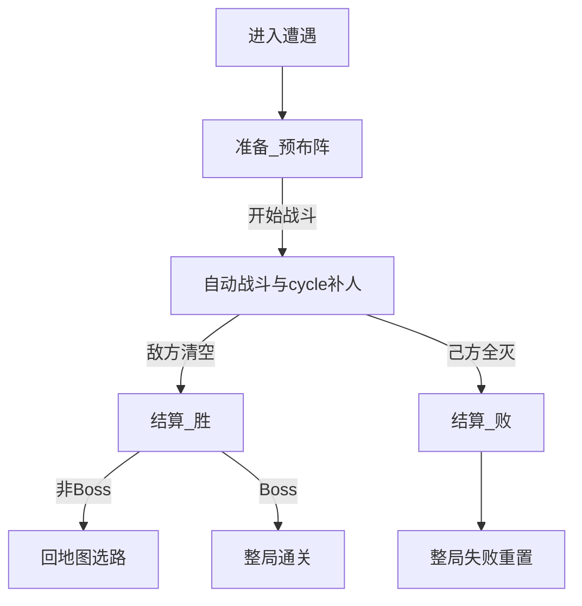

# 战斗

> 功能规格 · 只谈一场遭遇内的流程与职责，不写具体数值 · 2026-10-12（顶栏 2026-10-14 修订）  
> 相关文档：[游戏基础循环](./GAME_LOOP.md) · [地图与节点](./MAP.md) · [战斗关卡](./COMBATLEVEL.md) · [游戏愿景](../GAME_VISION.md) · [玩家](./PLAYER.md) · [角色单位](./UNITS.md) · [角色技能](./UNIT_ABILITIES.md) · [增益](../BUFF_SYSTEM.md) · [架构](../ARCHITECTURE.md)  
> **本版不写**：攻防点数、刷怪数量、节奏秒数、掉金点数；技能积木全表；商店购买细则；地图选路。  
> **【玩家牌流】** 无准备预布阵、无人口硬顶、无部署时间；抽打弃 + **号令**（主闸门）+ 入手冷却弱化，见 [玩家](./PLAYER.md)。下文若仍写「准备 / 人口 / 没有出牌费用」视为旧句漂移，以玩家篇与实时主路径为准。  
> **【战斗推进】** Run 主路径为实时固定步长推进（`scripts/combat/realtime/`），没有回合与行动顺序。旧线性开发关 `main.tscn` 仍按战斗回合在格子上行动。  
> **【战场】** 18 列 × 32 行、半场落点与竖屏朝向见 [战斗关卡](./COMBATLEVEL.md)；本篇只定遭遇流程与刷怪**时机**。

## 1. 这是什么

**战斗**规定：玩家进入战斗类地图节点（战斗 / 精英 / Boss）之后，一场自走棋遭遇怎么从预布阵打到结清。

玩家可见的一轮基础循环是三步：

1. **准备（预布阵）** — 抽本波手牌、预布阵、点开战  
2. **自动战斗 + cycle 补人** — 单位自动推进；玩家可在人口上限内从 cycle 手牌补人（已上场不可移动）  
3. **结算** — 判胜负、发奖励、清场并离开本场  

对应实现阶段：准备 / 战斗 / 结算（`PREPARE` / `COMBAT` / `RESOLVE`）。

| 本篇负责 | 别处负责 |
|----------|----------|
| 进遭遇后的三步怎么玩 | **循环**：何时进遭遇、胜回地图、败整局重置 |
| 实时推进、刷怪**时机**（功能） | **地图**：点哪个节点进来 |
| 战斗内何时能触发技能/临时层何时清 | **单位 / 技能 / 增益**：属性与效果内容 |
| — | **战斗关卡**：竖屏半场、友方/敌方**落点分区**、开战可否越线 |

---

## 2. 写什么、不写什么

### 2.1 本文要说清的

- 三步循环与玩家 / 系统职责  
- 「布局」相关的两种含义：站位、刷怪时机  
- 准备门槛、自动战斗推进边界、结算与清场  
- 与地图「一节点一战」的衔接  
- 现状：功能已存在 / 部分存在 / 仅愿景  

### 2.2 本版不写

| 内容 | 交给谁 |
|------|--------|
| 一整局生命周期、跨节点持久总表 | 游戏基础循环 |
| 节点种类与选路 | 地图与节点 |
| 生命 / 攻击 / 移动属性骨架 | 角色单位 |
| 技能槽、触发大类与强度维度 | 角色技能 |
| 增益附加流程 | 增益文档 |
| 具体数值与平衡 | 数值策划 |
| 竖屏朝向、半场落点、开战可否越线 | 战斗关卡 |

第一版边界（一句）：不做单位微操走位、羁绊、基地血条胜负、PvP；主模式商店不并进战斗三步。

---

## 3. 术语

| 说法 | 意思 |
|------|------|
| **遭遇** | 进入一个战斗类节点后的一整场战斗（主模式通常一节点一战） |
| **准备** | 预布阵、尚未开战的阶段 |
| **自动战斗** | 系统推进单位行动的阶段；玩家可 cycle 补人，不点技能/不拖已上场单位 |
| **本波 cycle 手牌** | 准备从牌库抽得的子集；战斗中滚动出牌（见愿景 / 商店 §4） |
| **人口** | 同时上场友方人数上限（默认 5） |
| **结算** | 战斗结束后的胜负与清场处理 |
| **站位布局** | 友方投放在我半场哪些格子上（只决定落点；开战后单位自行移动） |
| **固定步长** | 实时战斗的逻辑推进节拍，按固定时间间隔推进，结果不依赖帧率；没有回合，也没有行动顺序 |
| **刷怪时机** | 敌方角色**何时**出现（落在**哪半场**见战斗关卡） |
| **部署时间** | 战中落地的单位开始行动前的等待（见角色单位） |
| **空闲格** | 当前未被占用、且落在规则允许半场内的可落格 |
---

## 4. 玩家可见三步（基础循环）

**保留三步，不拆成玩家必须多记的第四、第五步。**  
「进入遭遇」只是地图 → 棋盘的交接，不算玩家操作步。

| 步骤 | 玩家做什么 | 系统做什么 |
|------|------------|------------|
| **1. 准备（预布阵）** | 从本波手牌向**我半场**预布阵、调整站位、点「开始战斗」 | 抽牌；校验占用、人口与半场；禁止战斗；预览敌半场落点 |
| **2. 自动战斗 + 补人** | 手牌向**我半场**格子补人（受人口约束，无费用）；**不可**拖动已上场单位、不可点技能 | 敌半场刷怪、实时推进、伤害与技能事件、死亡腾人口、判结束 |
| **3. 结算** | 看结果 | 发波次金、清场、清临时状态；胜回地图 / 败整局失败 |

主模式**不要**把商店塞进这三步（商店在地图商店节点）。线性开发关「战后商店」见附录。



---

## 5. 「布局」两义澄清

| 概念 | 谁决定 | 本版约定 |
|------|--------|----------|
| **站位布局** | 玩家 | 预布阵和战中补人吸附到我半场的格子；之后玩家不能再挪动 |
| **刷怪时机** | 系统 | 开战时一次刷完，落在敌半场 |

实时战斗**没有行动顺序**：所有单位在同一个固定步长里同时推进。

---

## 6. 准备阶段

### 6.1 玩家

- 从本波手牌（默认抽 5 张）预布阵到我半场格子；准备阶段可点已布阵单位收回。  
- 不必把所有手牌都下场；可留人口给战斗中补人。  
- 确认后点「开始战斗」。

### 6.2 系统

- **抽牌**：每场准备无放回抽子集，形成本波 cycle 牌组（见愿景 / 架构摘要）。  
- 校验格占用、**人口上限**与**我半场**；准备阶段禁止战斗。  
- 开战前可预览本场敌人在**敌半场**的落点；开战时锁定该批落点。  

### 6.3 开战门槛（定稿）

1. 场上至少 **1** 名友方角色  
2. 未超过场上人数上限  
3. 本场遭遇数据有效  

### 6.4 禁止

准备阶段不跑战斗 AI、不发战斗事件、不造成战斗伤害。（事件总线进入遭遇时就建好，但开战前不发事件。）

---

## 7. 自动战斗

### 7.1 时间推进

- 按**固定步长**实时推进；逻辑结果不依赖帧率。  
- 每一步：更新部署倒计时 → 选目标 → 移动与推挤 → 攻击计时与出手 → 投射物飞行与命中 → 死亡与胜负判定。

### 7.2 单位行为

选目标、移动、攻击方式、碰撞与部署见 [角色单位](./UNITS.md)。伤害走伤害管线；攻击、受伤、死亡经战斗事件总线发出；击杀敌人即时掉金。

### 7.3 刷怪

开战时一次刷完本场敌人，只落敌半场（见战斗关卡）。不做延时分批刷怪。

### 7.4 资源约束

**【As-Is / 待对齐】** 旧句曾写「没有出牌费用 / 人口上限」。**【To-Be】** 出牌节奏以 [玩家](./PLAYER.md) 为准：有**号令**、无人口硬顶、抽打弃轮转。

### 7.5 技能与增益边界

| 可以 | 不可以 |
|------|--------|
| 战斗内事件经战斗事件总线分发 | 伤害管线 / 单位大脑直接改其他单位属性 |
| 主技能、被动监听战斗事件 | 商店买卖升级走战斗总线 |
| 增益里「战斗触发」类挂战斗钩子 | 第一版羁绊凑数团队增益 |

战斗临时属性：本场有效；**结算时清除临时层**。本版角色无技能，不生成代理角色。牌库养成与跨节点生命不在此清（见循环文档）。

### 7.6 战斗中胜负判定

| 结果 | 条件 |
|------|------|
| **胜** | 场上没有存活的敌方单位 |
| **败** | 己方场上没有存活单位（**部署中也算存活**），无论手里还有没有牌 |

对齐愿景清波制；不以基地血条为主轴。

### 7.7 玩家在战斗中的交互

- **补人**：人口未满时，从手牌往我半场格子落子；落地后经过部署时间才行动。死亡腾出人口，那张牌可以再打出，打出时满生命。  
- **已上场单位不可拖动**；不可点选技能或指定攻击目标；单位自行越半场交战（见战斗关卡）。

---

## 8. 结算

| 项 | 约定 |
|----|------|
| 胜 | 清光本场全部敌方角色 |
| 败 | 己方角色全部阵亡 |
| 经济 | 战斗内击杀即时金 + 结算波次固定收益（具体数留给数值） |
| 清场 | 清掉双方全部场上单位；友方生命不带出本场（下次打出即满生命） |
| 临时状态 | 清空本场临时属性修饰；销毁战斗事件总线；格子战斗效果不带出 |
| 胜且非 Boss | 回地图选路（**不**强制商店） |
| 胜且 Boss | 整局通关 |
| 败 | 整局失败重置（生命周期见循环文档） |

结算以看结果为主；主模式不在此强制买卡。

---

## 9. 与地图「一节点一战」的衔接

```text
地图选路 → 进入战斗 / 精英 / Boss
  → 加载战斗关卡战场规格（半场）
  →【本篇】准备预布阵 → 自动战斗与 cycle 补人 → 结算
  → 胜：完成节点回地图（Boss 则通关）
  → 败：整局失败
```

- 遭遇数据携带本场敌人计划、棋盘覆盖等；本篇消费「一场」配置。  
- 精英 / Boss 与常规战**同一套三步**；威胁与通关语义见地图文档；半场见 [战斗关卡](./COMBATLEVEL.md)。  
- 商店 / 事件 / 附魔节点内容不在本篇展开。

---

## 10. 玩家操作与验收（L0）

1. 进入战斗节点后进入准备，能预布阵。  
2. 无人上场时不能开战；至少 1 人且未超人口上限时可开战。  
3. 开战后单位实时平滑移动并自动攻击；已上场单位不能被拖动。  
4. 人口未满时可以补人；补人单位落地后先部署再行动；死亡后同一张牌可以再打出。  
5. 敌方清空 → 胜结算 → 非 Boss 回地图；Boss 胜 → 通关。  
6. 己方全灭 → 败结算 → 整局失败。  
7. 胜后不强制进商店。  

**本版不做**：延时分批刷怪、补人冷却队列、暂停与倍速。

---

## 11. 现状对照

| 能力 | 标注 | 证据（路径） |
|------|------|----------------|
| 阶段：准备 / 战斗 / 结算 | 功能已存在 | `scripts/ui/realtime/realtime_battle_controller.gd`（`Phase`） |
| 主模式进遭遇 → 准备 | 功能已存在 | `run_game_controller.gd` → `RealtimeBattleController.start_encounter` |
| 布阵 + 开战门槛 | 功能已存在 | `RealtimeBattleController.try_deploy` / `try_start_combat` |
| 抽牌形成 cycle 牌组 + 战中补人 | 功能已存在 | 同上；冷却队列 / 可见窗 4 不在本版 |
| 敌人落点预览与锁定 | 功能已存在 | 准备阶段预览，开战时按预览落点刷出 |
| 实时模拟、事件总线、伤害管线、单位大脑 | 功能已存在 | `scripts/combat/realtime/`（旧网格工具环保留回合调度） |
| 刷怪仅开战一批 | 功能已存在 | 开战时敌方一次出齐 |
| 我半场 / 敌半场投放与刷怪分区 | 功能已存在 | [战斗关卡](./COMBATLEVEL.md) |
| 清波胜负 | 功能已存在 | 战斗结束判定；愿景定稿 |
| 击杀掉金 + 波次结算金 | 功能已存在 | 经济与击杀钩子 |
| 胜回地图 / 败整局失败 | 功能已存在 | 遭遇完成回传 |
| 清临时修饰、停战斗总线 | 功能已存在 | 停战后清理 |

---

## 12. 已拍板默认

| 项 | 定稿 |
|----|------|
| 玩家可见循环 | 准备预布阵 → 自动战斗与 cycle 补人 → 结算 |
| 战斗推进 | 实时固定步长；没有回合，也没有行动顺序 |
| 刷怪时机 | 第一版开战首回合一次刷完 |
| 刷怪落点 | 敌半场（见战斗关卡） |
| 开战 | 至少 1 名友方；手牌不必全下 |
| 战斗中交互 | cycle 补我半场 + 观看；已上场不可移动；无点技能微操 |
| 人口 | 同时上场上限默认 5；死亡腾人口 |

---

## 13. 开放问题（实现前可再拍）

| 问题 | 建议默认 |
|------|----------|
| 延时分批刷怪是否进第一版？ | **否**；保留数据扩展 |
| 准备阶段是否显示完整敌方名单（不止落点）？ | 可显示预览；信息量交给 UI 切片 |

---

## 附录：线性开发关差异

线性多波关卡是工具环：结算后可进商店再准备下一波，**不是**主模式战斗三步的一部分。主循环见 [游戏基础循环](./GAME_LOOP.md) 附录；本篇三步在每一波内部仍然成立。
