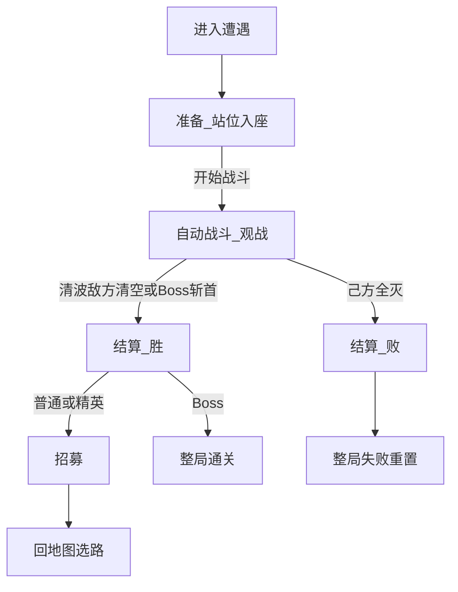

# 战斗

> 功能规格 · 只谈一场遭遇内的流程与职责，不写具体数值 · 2026-10-16  
> 相关文档：[游戏基础循环](./GAME_LOOP.md) · [地图与节点](./MAP.md) · [战斗关卡](./COMBATLEVEL.md) · [队伍强度抽阵](./ENEMY_SPAWN_BUDGET.md) · [Boss](./BOSS.md) · [游戏愿景](../GAME_VISION.md) · [玩家](./PLAYER.md) · [角色单位](./UNITS.md) · [角色技能](./UNIT_ABILITIES.md) · [增益](../BUFF_SYSTEM.md) · [架构](../ARCHITECTURE.md)  
> **本版不写**：攻防点数、敌方占座具体名单、单动秒数定死；技能积木全表；商店购买细则；地图选路；出手条 / 速度条 UI。  
> **【玩家准备 To-Be】** 准备：按**持久占位**载入队伍 → 可换座（写回持久占位）→ 点开战；开战**完全不能改阵**。无号令；无遭遇内抽牌 / 手牌刷新。席位上限本版固定 5。见 [玩家](./PLAYER.md)。  
> **【胜后】** 普通 / 精英胜 → **招募**再回地图；Boss 胜直接通关。见 [招募](./RECRUIT.md) / [循环](./GAME_LOOP.md)。本篇不写招募操作细则。  
> **【As-Is】** 主路径仍可能无准备、战中号令出牌；**战斗推进已改为回合制依次行动**（`RealtimeCombatSim` 行动队列）；无招募；准备/招募等循环仍可能未对齐。  
> **【战斗推进】** 回合制自动战：敌我**混排**固定行动队列，每回合同序**依次**行动；每一动尽量「靠近并出手」；一动内八向落格顿步（见战斗关卡）。单动演出可压短，观战可加速。  
> **【战场】** 双方角色座位、半场与八向格网见 [战斗关卡](./COMBATLEVEL.md)；本篇定遭遇流程、敌方出兵**时机**、开战锁阵生成序（§6.5）与行动队列（§7）。  
> **【观战反馈】** 当前行动者高亮 + 一动内结算演出（结果数字 + 稀有短提示；本版无普攻飘字/战斗日志/出手条）见 [战斗观战反馈](./COMBAT_FEEDBACK.md)。

## 1. 这是什么

**战斗**规定：玩家进入战斗类地图节点（战斗 / 精英 / Boss）之后，一场自走棋遭遇怎么从准备打到结清。

玩家可见的一轮基础循环是三步：

1. **准备** — 队伍成员入**角色座位**、调站位、点开战  
2. **自动战斗（观战）** — 单位自动推进；玩家**不能改阵**、不能改座  
3. **结算** — 判胜负、发奖励、清场并离开本场  

对应实现阶段：准备 / 战斗 / 结算（`PREPARE` / `COMBAT` / `RESOLVE`）。

| 本篇负责 | 别处负责 |
|----------|----------|
| 进遭遇后的三步怎么玩 | **循环**：何时进遭遇、胜回地图、败整局重置 |
| 回合推进、行动队列、一动语义、敌方出兵**时机**与开战锁阵生成序 | **地图**：点哪个节点进来 |
| 战斗内何时能触发技能/临时层何时清 | **单位 / 技能 / 增益**：属性与效果内容 |
| — | **战斗关卡**：竖屏半场、**双方角色座位**几何、开战可否越线 |
| — | **Boss**：Boss 遭遇斩首、足迹、一动策略三选一、推开与对砍例外 |
| — | **玩家**：队伍、席位上限、入座与全体上场 |
| — | **招募**：胜后短名单拿人 / 换人 |

---

## 2. 写什么、不写什么

### 2.1 本文要说清的

- 三步循环与玩家 / 系统职责  
- 准备门槛、**开战瞬间（锁阵）生成序与部署/开战技能分层**、开战锁操作、自动战斗推进边界、结算与清场  
- 与地图「一节点一战」的衔接  

### 2.2 本版不写

| 内容 | 交给谁 |
|------|--------|
| 一整局生命周期、跨节点持久总表 | 游戏基础循环 |
| 节点种类与选路 | 地图与节点 |
| 生命 / 攻击 / 移动属性骨架 | 角色单位 |
| 技能槽、触发大类与强度维度 | 角色技能 |
| 增益附加流程 | 增益文档 |
| 具体数值与平衡 | 数值策划 |
| 竖屏朝向、半场、双方角色座位几何 | 战斗关卡 |
| 队伍 / 席位上限 / 入座规则 | 玩家 |

第一版边界（一句）：不做单位微操走位、羁绊、基地血条胜负、PvP、战中改阵；主模式商店不并进战斗三步。

---

## 3. 术语

| 说法 | 意思 |
|------|------|
| **遭遇** | 进入一个战斗类节点后的一整场战斗（主模式通常一节点一战） |
| **准备** | 队伍入座、调站位、尚未开战的阶段 |
| **自动战斗** | 系统按回合与行动队列推进单位行动的阶段；玩家只观战（可加速），不能改阵 |
| **角色座位** | 双方可见站位座位（默认各 2×5）；友方入座见玩家篇；几何见战斗关卡 |
| **结算** | 战斗结束后的胜负与清场处理 |
| **站位布局** | 友方占用哪些角色座位（决定开战落点；开战后单位在自己的行动中自行移动） |
| **行动队列** | 开战锁阵后排出的敌我**混排**固定顺序；每回合按该序依次行动；阵亡者跳过 |
| **一动** | 队列轮到某存活单位时，默认尽量「靠近目标 + 若已能打则出手」；**Boss** 为一动三选一（召/动/打），见 [Boss](./BOSS.md) |
| **回合** | 行动队列从头走到尾（存活者都轮过或已跳过）算一回合结束，再开下一回合 |
| **出兵时机** | 敌方角色**何时**出现（落在**哪些敌方座位**见战斗关卡） |
| **落座时间序**（亦称入座时间序） | 各友方成员**最后一次成功落到某座**的先后（含招募落座与准备换座）；开战时友方按此序依次生成，并参与混排队列合成。见 [玩家](./PLAYER.md) |
| **部署时** | 开战锁阵中，单位在座位坐标**生成完成当下**；可结算「自己被生成时」等技能（见技能篇） |
| **游戏开始** | 双方生成与锁阵完成后广播的开战事件；结算「开战时 / 开场类」技能；之后排出行动队列并进入第 1 回合 |

---

## 4. 玩家可见三步（基础循环）

| 步骤 | 玩家做什么 | 系统做什么 |
|------|------------|------------|
| **1. 准备** | 载入持久占位、换座（写回）、点「开始战斗」 | 带入队伍与占位；校验全体入座；禁止战斗；可预览敌方已占座位；无手牌刷新 |
| **2. 自动战斗** | **观战**（可加速）；**不能**改阵、改座 | 敌方按已配置座位出齐、排出混排行动队列、按回合依次一动、伤害与技能事件、判结束 |
| **3. 结算** | 看结果 | 按当前层发金（取代波次金）、清场、清临时状态；普通/精英胜 → 招募；Boss 胜 → 通关；败 → 整局失败 |

主模式**不要**把地图商店塞进这三步（商店在地图节点）。胜后短名单见 [招募](./RECRUIT.md)。线性开发关「战后商店」见附录。



---

## 5. 「布局」两义澄清

| 概念 | 谁决定 | 本版约定 |
|------|--------|----------|
| **站位布局** | 玩家 | 整局**持久占位**决定开战落点；准备阶段可换座写回；开战后玩家不能再挪动 |
| **出兵时机** | 系统 | 开战锁阵中按配置书写顺序**依次生成、本场一次出齐**，落在关卡已配置的敌方座位（见 §6.5） |

敌方「抽谁、落哪座」的生成规则见 [队伍强度抽阵](./ENEMY_SPAWN_BUDGET.md)；本篇只定**何时**按占座表书写顺序生成。

进入自动战斗之后：单位按**行动队列依次**完成各自的一动（敌我混排；见 §7）。开战锁阵内的**生成序**（§6.5）只服务部署/开战技能与队列合成素材，不等于「大家同时扭打」。

---

## 6. 准备阶段

### 6.1 玩家

- 进入准备时按整局**持久占位**载入队伍成员到友方座位（不是从空板重新布阵）。  
- 可换座；换座**写回**持久占位，并刷新该成员**落座时间**（细则见玩家篇）。  
- 席位内成员**全体上场**；空座可保留作站位选择（座位网格 2×5=10，席位上限本版 5）。  
- 准备阶段可通过**准备商店**买角色/道具（即时改队伍或永久属性 / 席位上限，见 [准备商店](./PREPARE_SHOP.md)）；不能刷新手牌 / 抽选上场名单。  
- 全体成员入座后点「开始战斗」。

### 6.2 系统

- 按玩家篇带入当前队伍。  
- 校验座位占用、全体入座与开战门槛；准备阶段禁止战斗。  
- 开战前可预览本场敌人在**已配置敌方座位**上的单位；开战时锁定该批落点与配置书写顺序。  

### 6.3 开战门槛（定稿）

1. 至少 **1** 个友方角色座位已入成员，且队伍**全体成员**均已入座  
2. 本场遭遇数据有效  

### 6.4 禁止

准备阶段不跑战斗 AI、不发战斗事件、不造成战斗伤害。

### 6.5 开战瞬间（锁阵）【定稿】

点「开始战斗」且满足 §6.3 后，按下列顺序执行；**本段结束前**不进入行动队列上的索敌 / 移动 / 普攻。

1. **友方按落座时间序依次生成，并结算部署时技能**  
   - 取本场已占用友方座位，按**落座时间序**排序（最后一次成功落座较早者在前；准备换座或招募落座会刷新时间，见玩家篇）。  
   - 按该顺序一次生成一体：在对应座位坐标生成友方单位。  
   - 该体生成完成当下：若技能符合「自己部署时 / 自己被生成时」等条件，**立刻结算**。  
   - 例：友方 A「部署时给队友增益」——在 A 生成时结算；目标仅为**当时已在场**的友方。  
   - 再处理下一座，直到全部已占用友方座位生成完毕。  

2. **敌方按遭遇配置书写顺序依次生成，并结算部署时技能**  
   - 按关卡（遭遇）占座配置表的**书写顺序**，依次在对应敌半场座位生成敌方单位。  
   - 每体生成完成当下：符合条件的部署时 / 被生成时技能立刻结算。  
   - 本场敌人在本步**全部出齐**（不做延时分批刷怪；仅生成结算有先后）。几何见 [战斗关卡](./COMBATLEVEL.md)。  

3. **结束准备**  
   - 准备结束；本场无手牌 / 刷新可清（本版准备无手牌区）。  
   - **部署技能与准备 UI 无关**：结算不读取商店或队伍编辑状态。  

4. **锁操作**  
   - 之后：**不能改座、不能改队伍**；无号令。  

5. **触发「游戏开始」事件**  
   - 在步骤 1–4 全部完成后，广播本场**游戏开始 / 开战**事件。  
   - 「开战时 / 开场类」技能在此刻结算。  
   - **允许与部署时叠加**：同一单位可先完成自己的部署结算，再响应游戏开始；两段都符合条件则两段都结算，不互斥。细则见 [角色技能](./UNIT_ABILITIES.md)。  
   - **观战反馈**：锁阵阶段部署时 / 游戏开始若有技能结算，按生成/事件顺序播**动画或 UI 提示**（可视为第 0 段串行），**不**占用行动队列上的「当前行动者」高亮通道（见 [战斗观战反馈](./COMBAT_FEEDBACK.md)）。  

6. **排出本场行动队列**  
   - 将本场已生成的友方与敌方单位合成**一条敌我混排**固定序（规则见 §7.1）。  
   - 之后进入 §7 自动战斗（观战），从第 1 回合队首开始。

```text
点「开始战斗」
  → 友方：按落座时间序 生成 → 部署时技能 → …
  → 敌方：按遭遇配置书写顺序 生成 → 部署时技能 → …
  → 准备结束；锁改座 / 改队伍
  → 触发「游戏开始」（开战时技能；可与部署叠加）
  → 排出敌我混排行动队列
  → 自动战斗：按回合依次一动（观战）
```

---

## 7. 自动战斗

### 7.1 行动队列【定稿】

| 项 | 定稿 |
|----|------|
| 组成 | **敌我混排**进**同一条**队列 |
| 何时排 | 开战锁阵 §6.5 完成后排**一次** |
| 之后 | 每回合按**同一顺序**行动；阵亡或不在场者**跳过** |
| 不做 | 每回合因速度重排；常驻出手条 / 速度条 / CTB 仪表盘 |

**默认合成法（可验收）**：

1. 友方子序 = **落座时间序**（与 §6.5 友方生成序一致）。  
2. 敌方子序 = 遭遇配置**书写顺序**（与 §6.5 敌方生成序一致）。  
3. **交错混排**：友0、敌0、友1、敌1…；一侧用尽则续另一侧剩余。  

本场中途生成的代理角色：插入规则见角色技能 / 单位篇；**【建议默认】** 插在当前行动者之后、本回合尚未行动的位置，或下场回合队尾——实现前可在开放问题拍板，但不得破坏「一次只演一个行动者」。

### 7.2 回合与一动【定稿】

| 项 | 定稿 |
|----|------|
| **回合** | 从队首走到队尾（存活者都已行动或跳过）→ 回合结束 → 下一回合仍从队首按同序开始 |
| **一动** | **默认（普通单位）**：尽量在**同一动**内完成「选目标 → 八向靠近（一动内落格顿步）→ 若已进入攻距则出手」；不是「这一动只能走或只能打」二选一。**Boss**：一动在召唤 / 移动 / 出手中**三选一**，见 [Boss](./BOSS.md) |
| **一动内步数** | 最多可迈的格数由单位移动属性决定（见角色单位；具体格数交数值） |
| **够不着** | 用尽本动移动预算仍不在攻距：本动以移动结束，不强制空手砍空气 |
| **已在攻距** | 可不迈或少迈，直接出手（仍算完整一动） |
| **对砍（同时结算）** | 出手命中主目标时：若行动者**也在该目标的攻击距离内**，则目标**立刻反打**行动者；双方伤害**同一结算批次**扣血，**无先后手**；可同归于尽。反打不占用目标自己的行动队列一动；反打为单体（不跟溅射）。远程在落点/命中瞬间同样按格距判定是否反打。**例外**：主目标为 **Boss（首领）** 时**跳过反打**；Boss 出手打友方时，友方仍可按通例反打。见 [Boss](./BOSS.md) |
| **胜负检查** | 每一动结算后（含该动内技能尾巴）检查胜负；满足则结束战斗，不必凑完本回合。**普通/精英**：清敌 / 全灭；**同帧双方清空**按清敌胜。**Boss 遭遇**：首领死亡 → 斩首胜并溃散其余敌方（溃散≠死亡）；同帧首领已死且己方全灭仍判胜。见 [Boss](./BOSS.md) |

选目标、八向移动、攻击方式、一格一体见 [角色单位](./UNITS.md) / [战斗关卡](./COMBATLEVEL.md)。伤害走伤害管线；攻击、受伤、死亡经战斗事件总线发出；**击杀敌人不掉金**（经济见愿景；结算按当前层发金，取代波次金）。

### 7.3 时长与加速【定稿】

- **单动演出可压短**：走位与出手动画以「能看懂当前行动者在干什么」为下限，不为炫技留长镜头。  
- **观战加速**为正式能力：缩短单动 / 技能尾巴的表现寿命，不改变已结算数值与行动顺序。  
- **本版不做**「跳过当前这一动动画、直接跳结果」（若日后仍嫌慢再开）。  
- 控遭遇落在愿景约 1–3 分钟：靠短演出、加速档、席位与敌方占座配置，而非改回实时并行。

### 7.4 敌方出兵

出兵落在关卡已配置的**敌方角色座位**（见战斗关卡）。**何时、按何序生成、部署时技能**见 §6.5：占座表书写顺序依次生成、本场一次出齐。不做延时分批刷怪。

占座表**如何抽人与落座**见 [队伍强度抽阵](./ENEMY_SPAWN_BUDGET.md)（普通/精英按进点队伍强度定目标；Boss 不吃真队；无战力 HUD）。关预算开关时可回退波次「出兵只数」随机，见该文。

### 7.5 资源与操作约束

开战锁阵完成后（§6.5）：**不能改阵、不能改座**。无号令。上场人数已在准备阶段由队伍全体入座锁定。

### 7.6 技能与增益边界

| 可以 | 不可以 |
|------|--------|
| 战斗内事件经战斗事件总线分发 | 伤害管线 / 单位大脑直接改其他单位属性 |
| 主技能、被动监听战斗事件 | 商店买卖升级走战斗总线 |
| 增益里「战斗触发」类挂战斗钩子 | 第一版羁绊凑数团队增益 |

战斗临时属性：本场有效；**结算时清除临时层**。队伍养成与跨节点生命不在此清（见循环文档）。技能时机大类见 [角色技能](./UNIT_ABILITIES.md)。

### 7.7 战斗中胜负判定

| 遭遇类型 | 胜 | 败 |
|----------|----|----|
| **普通 / 精英** | 场上没有存活的敌方单位（清波） | 己方场上没有存活单位（含生成的代理角色） |
| **Boss** | **首领死亡**（斩首）；其余敌方溃散清除 | 同上（己方全灭）；若同批首领已死则仍判胜 |

对齐愿景：默认清波；Boss 斩首例外见 [Boss](./BOSS.md)。不以基地血条为主轴。

### 7.8 玩家在战斗中的交互

- **只能观战**（可加速）。  
- **已上场单位不可拖动**；不可点选技能或指定攻击目标；单位在自己的一动内自行越半场交战（见战斗关卡）。  
- 观战主通道：**当前行动单位高亮** + 一动一结算（含该动内技能结果演出）；普攻不飘伤害数字。见 [战斗观战反馈](./COMBAT_FEEDBACK.md)。  
- **不做**出手条 / 速度条作为主交付。

---

## 8. 结算

| 项 | 约定 |
|----|------|
| 胜 | 普通/精英：清光本场全部敌方；Boss：斩首（见 Boss 篇） |
| 败 | 己方角色全部阵亡（Boss 同批斩首已成立时仍判胜） |
| 经济 | 战斗内击杀即时金 + 结算波次固定收益（具体数留给数值） |
| 清场 | 清掉双方全部场上单位；友方生命不带出本场（下次上场满生命） |
| 临时状态 | 清空本场临时属性修饰；销毁战斗事件总线 |
| 胜且非 Boss | 回地图选路（**不**强制商店） |
| 胜且 Boss | 整局通关 |
| 败 | 整局失败重置（生命周期见循环文档） |

---

## 9. 与地图「一节点一战」的衔接

```text
地图选路 → 进入战斗 / 精英 / Boss
  → 加载战斗关卡战场规格（半场、双方角色座位、敌方占座配置）
  →【本篇】准备入座 → 自动战斗观战 → 结算
  → 胜：完成节点回地图（Boss 则通关）
  → 败：整局失败
```

- 精英 / Boss 与常规战**同一套三步**。  
- 商店 / 事件 / 附魔节点内容不在本篇展开。

---

## 10. 玩家操作与验收（L0）

1. 进入战斗节点后进入准备，队伍按持久占位落座，能换座写回（全体上场；无手牌刷新）。  
2. 无人入座或尚有队员未入座时不能开战；全体入座后可开战；不要求占满全部座位。  
3. 点开战后：友方按落座时间序、敌方按配置书写顺序依次生成；可先结算部署时技能，再触发「游戏开始」；排出敌我混排行动队列；进入依次行动后，同一时刻只有一名当前行动者在演（高亮可读）；已上场单位不能被拖动；**不能再改阵**。  
4. 每一动尽量表现为「靠近并出手」；队列走完进入下一回合；阵亡者被跳过。  
5. 可加速观战；单动演出偏短仍能指认当前行动者在干什么。  
6. 普通/精英敌方清空，或 Boss 斩首 → 胜结算 → 普通 / 精英进招募再回地图；Boss 胜 → 通关。  
7. 己方全灭 → 败结算 → 整局失败（Boss 同批已斩首除外）。  
8. 胜后进的是招募（非地图商店节点）；招募细则见招募篇。  

**本版不做**：战中改阵、号令、遭遇内抽牌、延时分批刷怪、前后排技能标签、出手条/速度条主交付、跳过单动动画。

---

## 11. 现状对照

| 能力 | 标注 | 说明 |
|------|------|------|
| 阶段枚举含准备 / 战斗 / 结算 | 部分存在 | 控制器有 `Phase`，但进遭遇常直接开战 |
| 准备载入持久占位 + 换座写回（全体上场） | **未实现**（To-Be） | 见玩家篇；As-Is 仍可能有手牌刷新 / 每场重建入座 |
| 开战纯观战 | **未对齐** | As-Is 仍战中号令出牌 |
| 事件总线、伤害管线 | 功能已存在 | `scripts/combat/realtime/` |
| 回合制行动队列 / 一动靠近并出手 | **已落地**（轻量） | `RealtimeCombatSim` §7；表现/加速手感待用户验 |
| 开战一批出兵、半场分区 | 功能部分存在 | As-Is 敌半场候选刷出；To-Be 敌方按座位、按配置书写顺序依次出齐（§6.5） |
| 开战锁阵：落座时间序生成 + 部署/开战分层 | **未实现**（To-Be） | 见 §6.5 |
| 清波胜负、波次金 | 功能已存在 | — |
| 击杀掉金 | **已否决**（击杀不掉金） | 见愿景经济 |
| 胜回地图 / 败整局失败 | 功能已存在 | — |

---

## 12. 已拍板默认

| 项 | 定稿 |
|----|------|
| 玩家可见循环 | 准备（载入占位 / 换座）→ 自动战斗观战 → 结算 |
| 战斗推进 | **回合制依次行动**；敌我混排固定队列；默认一动 = 靠近并出手；Boss 一动三选一；互在攻距则**对砍同时结算**（主目标为 Boss 时不反打）；一动内八向落格顿步（见战斗关卡） |
| Boss 遭遇胜负 | **斩首** + 溃散；细则 [Boss](./BOSS.md) |
| 行动序 | 开战排一次；每回合同序；阵亡跳过；默认友/敌子序交错混排 |
| 时长 | 单动演出可压短；观战可加速；本版不跳过单动动画 |
| 出兵时机 | 开战锁阵中按配置书写顺序依次生成、本场一次出齐 |
| 出兵落点 | 关卡已配置的敌方角色座位（见战斗关卡） |
| 友方生成序 | 落座时间序（最后一次成功落座时间；含招募与准备换座） |
| 部署时 vs 开战时 | 先部署结算、后「游戏开始」；**允许叠加**；再排行动队列 |
| 部署技能与准备 UI | **无关** |
| 开战 | 队伍全体入座；至少 1 人；不要求占满全部座位 |
| 战斗中交互 | 仅观战；已上场不可移动；无点技能微操；无出手条主交付 |
| 上场人数 | 等于队伍成员数（本版 ≤ 5）；座位网格 2×5 固定可更大 |

---

## 13. 开放问题（实现前可再拍）

| 问题 | 建议默认 |
|------|----------|
| 延时分批刷怪是否进第一版？ | **否**；保留数据扩展 |
| 准备阶段是否显示完整敌方名单（不止落点）？ | 可显示预览；信息量交给 UI 切片 |
| 本场中途生成的代理角色插入队列何处？ | 插在当前行动者之后（本回合稍后行动）；或下回合队尾 |
| 是否显示极简「第 N 回合」角标？ | **先不做**；playtest 需要段落感再加 |

---

## 14. 修订记录

| 日期 | 变更 |
|------|------|
| 2026-10-14 | 开战瞬间（锁阵）定稿：友方入座时间序 / 敌方配置书写顺序依次生成；部署时与游戏开始分层且可叠加；部署技能与手牌无关。 |
| 2026-10-14 | 交叉引用观战反馈：实时战斗技能时停播报队列；锁阵阶段不走时停队列。 |
| 2026-10-14 | 自动战斗步进交叉引用八向格心取样（见战斗关卡）；不再以圆推挤为主轴表述。 |
| 2026-10-15 | 自动战斗步进交叉引用改为八向落格顿步（见战斗关卡）。 |
| 2026-10-15 | 对齐玩家篇：准备改为队伍全体入座 / 只调站位；删除遭遇抽选与刷新表述。 |
| 2026-10-15 | **时间模型改订**：实时并行 → 回合制敌我混排依次行动；一动=靠近并出手；开战排一次序；短演出+加速；观战主通道改为当前行动者高亮。 |
| 2026-10-15 | **对砍同时结算**：出手时若互在对方攻距内则反打同批扣血，可同归于尽；同帧双方清空算清敌胜。 |
| 2026-10-16 | 对齐玩家篇：友方持久占位；准备换座写回；落座时间序；席位上限本版 5；无准备手牌刷新。 |
| 2026-10-16 | Boss 遭遇：斩首胜负、对砍首领例外、一动策略交叉引用 [Boss](./BOSS.md)。 |

---

## 附录：线性开发关差异

线性多波关卡是工具环：结算后可进商店再准备下一波，**不是**主模式战斗三步的一部分。主循环见 [游戏基础循环](./GAME_LOOP.md) 附录；本篇三步在每一波内部仍然成立。
