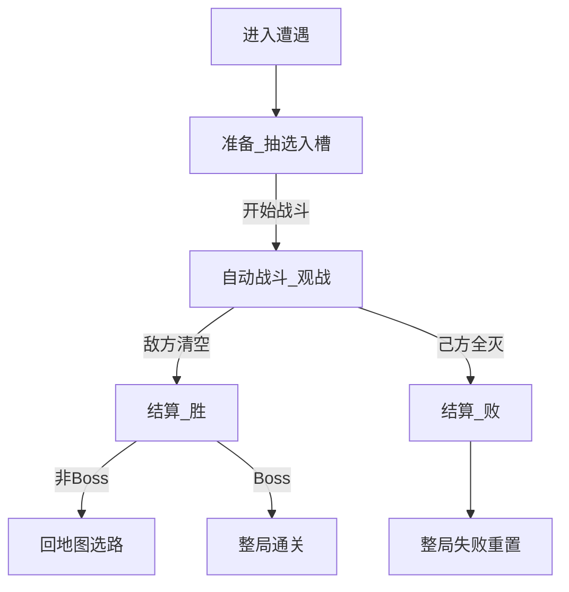

# 战斗

> 功能规格 · 只谈一场遭遇内的流程与职责，不写具体数值 · 2026-10-14  
> 相关文档：[游戏基础循环](./GAME_LOOP.md) · [地图与节点](./MAP.md) · [战斗关卡](./COMBATLEVEL.md) · [游戏愿景](../GAME_VISION.md) · [玩家](./PLAYER.md) · [角色单位](./UNITS.md) · [角色技能](./UNIT_ABILITIES.md) · [增益](../BUFF_SYSTEM.md) · [架构](../ARCHITECTURE.md)  
> **本版不写**：攻防点数、敌方占座具体名单、节奏秒数、掉金点数；技能积木全表；商店购买细则；地图选路。  
> **【玩家牌流 To-Be】** 准备：抽选 → 入角色座位 →（可刷新）→ 点开战；开战**完全不能出牌**。无人口、无号令。见 [玩家](./PLAYER.md)。  
> **【As-Is】** 实时主路径仍为无准备、战中号令出牌；**文档 To-Be ≠ 已实现**。  
> **【战斗推进】** Run 主路径为实时固定时间步推进（`scripts/combat/realtime/`）；单位移动为八向格心取样（见战斗关卡）。旧线性开发关 `main.tscn` 仍按战斗回合行动轮。  
> **【战场】** 双方角色座位、半场与八向格网见 [战斗关卡](./COMBATLEVEL.md)；本篇定遭遇流程、敌方出兵**时机**与开战锁阵生成序（§6.5）。  
> **【观战反馈】** 技能触发可读（结果数字 + 稀有短提示；本版无普攻飘字/战斗日志）见 [战斗观战反馈](./COMBAT_FEEDBACK.md)。

## 1. 这是什么

**战斗**规定：玩家进入战斗类地图节点（战斗 / 精英 / Boss）之后，一场自走棋遭遇怎么从准备打到结清。

玩家可见的一轮基础循环是三步：

1. **准备** — 抽候选手牌、选人入**角色座位**、可选刷新、点开战  
2. **自动战斗（观战）** — 单位自动推进；玩家**不能出牌**、不能改座  
3. **结算** — 判胜负、发奖励、清场并离开本场  

对应实现阶段：准备 / 战斗 / 结算（`PREPARE` / `COMBAT` / `RESOLVE`）。

| 本篇负责 | 别处负责 |
|----------|----------|
| 进遭遇后的三步怎么玩 | **循环**：何时进遭遇、胜回地图、败整局重置 |
| 实时推进、敌方出兵**时机**与开战锁阵生成序 | **地图**：点哪个节点进来 |
| 战斗内何时能触发技能/临时层何时清 | **单位 / 技能 / 增益**：属性与效果内容 |
| — | **战斗关卡**：竖屏半场、**双方角色座位**几何、开战可否越线 |
| — | **玩家**：抽牌堆 / 手牌 / 弃牌堆、刷新、入座与上场人数上限 |

---

## 2. 写什么、不写什么

### 2.1 本文要说清的

- 三步循环与玩家 / 系统职责  
- 准备门槛、**开战瞬间（锁阵）生成序与部署/开战技能分层**、开战锁操作、自动战斗推进边界、结算与清场  
- 与地图「一节点一战」的衔接  

### 2.2 本版不写

| 内容 | 交给谁 |
|------|--------|
| 一整局生命周期、跨节点持久总表 | 游戏基础循环 |
| 节点种类与选路 | 地图与节点 |
| 生命 / 攻击 / 移动属性骨架 | 角色单位 |
| 技能槽、触发大类与强度维度 | 角色技能 |
| 增益附加流程 | 增益文档 |
| 具体数值与平衡 | 数值策划 |
| 竖屏朝向、半场、双方角色座位几何 | 战斗关卡 |
| 抽选 / 刷新 / 上场人数上限 | 玩家 |

第一版边界（一句）：不做单位微操走位、羁绊、基地血条胜负、PvP、战中出牌；主模式商店不并进战斗三步。

---

## 3. 术语

| 说法 | 意思 |
|------|------|
| **遭遇** | 进入一个战斗类节点后的一整场战斗（主模式通常一节点一战） |
| **准备** | 抽选、入槽、刷新、尚未开战的阶段 |
| **自动战斗** | 系统推进单位行动的阶段；玩家只观战（可加速），不能出牌 |
| **角色座位** | 双方可见站位座位（默认各 2×5）；友方入座人数见玩家篇上限；几何见战斗关卡 |
| **结算** | 战斗结束后的胜负与清场处理 |
| **站位布局** | 友方占用哪些角色座位（决定开战落点；开战后单位自行移动） |
| **固定步长** | 实时战斗的逻辑推进节拍，结果不依赖帧率 |
| **出兵时机** | 敌方角色**何时**出现（落在**哪些敌方座位**见战斗关卡） |
| **入座时间序** | 准备阶段各友方座位**最后一次成功入座**的先后；开战时友方按此序依次生成 |
| **部署时** | 开战锁阵中，单位在座位坐标**生成完成当下**；可结算「自己被生成时」等技能（见技能篇） |
| **游戏开始** | 双方生成与牌区锁定完成后广播的开战事件；结算「开战时 / 开场类」技能 |

---

## 4. 玩家可见三步（基础循环）

| 步骤 | 玩家做什么 | 系统做什么 |
|------|------------|------------|
| **1. 准备** | 从手牌选人入**角色座位**、收回、可选刷新（≤3）、点「开始战斗」 | 抽牌；校验座位与上场人数上限；禁止战斗；可预览敌方已占座位 |
| **2. 自动战斗** | **观战**（可加速）；**不能**出牌、改座、刷新 | 敌方按已配置座位出齐、实时推进、伤害与技能事件、判结束 |
| **3. 结算** | 看结果 | 发波次金、清场、清临时状态；胜回地图 / 败整局失败 |

主模式**不要**把商店塞进这三步（商店在地图商店节点）。线性开发关「战后商店」见附录。



---

## 5. 「布局」两义澄清

| 概念 | 谁决定 | 本版约定 |
|------|--------|----------|
| **站位布局** | 玩家 | 准备阶段把牌放入我半场**角色座位**（受上场人数上限约束）；开战后玩家不能再挪动 |
| **出兵时机** | 系统 | 开战锁阵中按配置书写顺序**依次生成、本场一次出齐**，落在关卡已配置的敌方座位（见 §6.5） |

实时战斗（进入自动战斗之后）**没有行动顺序**：所有单位在同一个固定步长里同时推进。开战锁阵内的**生成序**见 §6.5，不属行动轮。

---

## 6. 准备阶段

### 6.1 玩家

- 从本场手牌将角色卡放入空角色座位；可收回到手牌。  
- 入座人数不超过本场上场人数上限；空座可保留作站位选择。  
- 系统记录各座**入座时间**（收回再入座则更新为最后一次成功入座时间；细则见玩家篇）。  
- 可免费刷新未入座手牌（上限 3；细则见玩家篇）。  
- 确认后点「开始战斗」。

### 6.2 系统

- 按玩家篇建抽牌堆、起手抽牌、处理刷新。  
- 校验座位占用、上场人数上限与开战门槛；准备阶段禁止战斗。  
- 开战前可预览本场敌人在**已配置敌方座位**上的单位；开战时锁定该批落点与配置书写顺序。  

### 6.3 开战门槛（定稿）

1. 至少 **1** 个友方角色座位已入牌  
2. 本场遭遇数据有效  

### 6.4 禁止

准备阶段不跑战斗 AI、不发战斗事件、不造成战斗伤害。

### 6.5 开战瞬间（锁阵）【定稿】

点「开始战斗」且满足 §6.3 后，按下列顺序执行；**本段结束前**不进入索敌 / 移动 / 普攻的实时推进。

1. **友方按入座时间序依次生成，并结算部署时技能**  
   - 取本场已占用友方座位，按**入座时间序**排序（先成功入座者在前；收回再入座按**最后一次成功入座**时间）。  
   - 按该顺序一次生成一体：在对应座位坐标生成友方单位。  
   - 该体生成完成当下：若技能符合「自己部署时 / 自己被生成时」等条件，**立刻结算**。  
   - 例：友方 A「部署时给队友增益」——在 A 生成时结算；目标仅为**当时已在场**的友方。  
   - 再处理下一座，直到全部已占用友方座位生成完毕。  

2. **敌方按遭遇配置书写顺序依次生成，并结算部署时技能**  
   - 按关卡（遭遇）占座配置表的**书写顺序**，依次在对应敌半场座位生成敌方单位。  
   - 每体生成完成当下：符合条件的部署时 / 被生成时技能立刻结算。  
   - 本场敌人在本步**全部出齐**（不做延时分批刷怪；仅生成结算有先后）。几何见 [战斗关卡](./COMBATLEVEL.md)。  

3. **清理未入座牌，结束准备**  
   - 未入座手牌全部回到抽牌堆（可再洗匀）；手牌清空；准备结束。  
   - **部署技能与手牌无关**：结算不读取手牌张数或内容；清牌放在双方生成之后。  

4. **锁操作**  
   - 之后：**不能出牌、不能改座、不能刷新**；无人口、无号令。  

5. **触发「游戏开始」事件**  
   - 在步骤 1–4 全部完成后，广播本场**游戏开始 / 开战**事件。  
   - 「开战时 / 开场类」技能在此刻结算。  
   - **允许与部署时叠加**：同一单位可先完成自己的部署结算，再响应游戏开始；两段都符合条件则两段都结算，不互斥。细则见 [角色技能](./UNIT_ABILITIES.md)。  
   - **观战反馈**：锁阵阶段部署时 / 游戏开始若有技能结算，只播**动画或 UI 提示**，**不**走实时战斗的时停播报队列（见 [战斗观战反馈](./COMBAT_FEEDBACK.md)）。  

之后进入 §7 自动战斗（观战）。

```text
点「开始战斗」
  → 友方：按入座时间序 生成 → 部署时技能 → …
  → 敌方：按遭遇配置书写顺序 生成 → 部署时技能 → …
  → 未入座手牌回抽牌堆；手牌清空；准备结束
  → 锁出牌 / 改座 / 刷新
  → 触发「游戏开始」（开战时技能；可与部署叠加）
  → 自动战斗（观战）
```

---

## 7. 自动战斗

### 7.1 时间推进

- 按**固定步长**实时推进；逻辑结果不依赖帧率。  
- 每一步：选目标 → 八向格步（占格冲突改道/短等）→ 攻击计时与出手 → 投射物飞行与命中 → 死亡与胜负判定。

### 7.2 单位行为

选目标、八向移动、攻击方式、一格一体见 [角色单位](./UNITS.md) / [战斗关卡](./COMBATLEVEL.md)。伤害走伤害管线；攻击、受伤、死亡经战斗事件总线发出；击杀敌人即时掉金。

### 7.3 敌方出兵

出兵落在关卡已配置的**敌方角色座位**（见战斗关卡）。**何时、按何序生成、部署时技能**见 §6.5：配置书写顺序依次生成、本场一次出齐。不做延时分批刷怪；主路径不再以敌半场自由落点为主。

### 7.4 资源与操作约束

开战锁阵完成后（§6.5）：**不能出牌、不能改座、不能刷新**。无人口、无号令。上场人数已在准备阶段由入座结果与上场人数上限锁定。

### 7.5 技能与增益边界

| 可以 | 不可以 |
|------|--------|
| 战斗内事件经战斗事件总线分发 | 伤害管线 / 单位大脑直接改其他单位属性 |
| 主技能、被动监听战斗事件 | 商店买卖升级走战斗总线 |
| 增益里「战斗触发」类挂战斗钩子 | 第一版羁绊凑数团队增益 |

战斗临时属性：本场有效；**结算时清除临时层**。牌库养成与跨节点生命不在此清（见循环文档）。

### 7.6 战斗中胜负判定

| 结果 | 条件 |
|------|------|
| **胜** | 场上没有存活的敌方单位 |
| **败** | 己方场上没有存活单位（含生成的代理角色），无论牌区是否还有牌 |

对齐愿景清波制；不以基地血条为主轴。

### 7.7 玩家在战斗中的交互

- **只能观战**（可加速，若实现提供）。  
- **已上场单位不可拖动**；不可点选技能或指定攻击目标；单位自行越半场交战（见战斗关卡）。  
- 技能因果触发时走**时停播报队列**（含高频；初始时停 0.4s；本版不可跳过；同刻/连锁入队 FIFO）；普攻不入队、不飘伤害数字。见 [战斗观战反馈](./COMBAT_FEEDBACK.md)。

---

## 8. 结算

| 项 | 约定 |
|----|------|
| 胜 | 清光本场全部敌方角色 |
| 败 | 己方角色全部阵亡 |
| 经济 | 战斗内击杀即时金 + 结算波次固定收益（具体数留给数值） |
| 清场 | 清掉双方全部场上单位；友方生命不带出本场（下次上场满生命） |
| 临时状态 | 清空本场临时属性修饰；销毁战斗事件总线 |
| 胜且非 Boss | 回地图选路（**不**强制商店） |
| 胜且 Boss | 整局通关 |
| 败 | 整局失败重置（生命周期见循环文档） |

---

## 9. 与地图「一节点一战」的衔接

```text
地图选路 → 进入战斗 / 精英 / Boss
  → 加载战斗关卡战场规格（半场、双方角色座位、敌方占座配置）
  →【本篇】准备入座 → 自动战斗观战 → 结算
  → 胜：完成节点回地图（Boss 则通关）
  → 败：整局失败
```

- 精英 / Boss 与常规战**同一套三步**。  
- 商店 / 事件 / 附魔节点内容不在本篇展开。

---

## 10. 玩家操作与验收（L0）

1. 进入战斗节点后进入准备，能抽选手牌并入座（受上场人数上限约束）。  
2. 无人入座时不能开战；至少 1 座有人时可开战；不要求填满上限。  
3. 点开战后：友方按入座时间序、敌方按配置书写顺序依次生成；可先结算部署时技能，再在锁牌后触发「游戏开始」（锁阵反馈只播动画/UI）；进入实时战斗后技能走时停播报队列；已上场单位不能被拖动；**不能再出牌**。  

4. 敌方清空 → 胜结算 → 非 Boss 回地图；Boss 胜 → 通关。  
5. 己方全灭 → 败结算 → 整局失败。  
6. 胜后不强制进商店。  

**本版不做**：战中出牌、人口、号令、延时分批刷怪、前后排技能标签。

---

## 11. 现状对照

| 能力 | 标注 | 说明 |
|------|------|------|
| 阶段枚举含准备 / 战斗 / 结算 | 部分存在 | 控制器有 `Phase`，但进遭遇常直接开战 |
| 准备抽选入座 + 刷新 | **未实现**（To-Be） | 见玩家篇 |
| 开战纯观战 | **未对齐** | As-Is 仍战中号令出牌 |
| 实时模拟、事件总线、伤害管线 | 功能已存在 | `scripts/combat/realtime/` |
| 开战一批出兵、半场分区 | 功能部分存在 | As-Is 敌半场候选刷出；To-Be 敌方按座位、按配置书写顺序依次出齐（§6.5） |
| 开战锁阵：入座时间序生成 + 部署/开战分层 | **未实现**（To-Be） | 见 §6.5 |
| 清波胜负、击杀掉金、波次金 | 功能已存在 | — |
| 胜回地图 / 败整局失败 | 功能已存在 | — |

---

## 12. 已拍板默认

| 项 | 定稿 |
|----|------|
| 玩家可见循环 | 准备入座 → 自动战斗观战 → 结算 |
| 战斗推进 | 实时固定时间步；没有行动轮；移动为八向格心取样（见战斗关卡） |
| 出兵时机 | 开战锁阵中按配置书写顺序依次生成、本场一次出齐 |
| 出兵落点 | 关卡已配置的敌方角色座位（见战斗关卡） |
| 友方生成序 | 入座时间序（收回再入 = 最后一次成功入座时间） |
| 部署时 vs 开战时 | 先部署结算、后「游戏开始」；**允许叠加** |
| 部署技能与手牌 | **无关**；清未入座手牌在双方生成之后 |
| 开战 | 至少 1 座有人；不要求填满上场人数上限 |
| 战斗中交互 | 仅观战；已上场不可移动；无点技能微操 |
| 上场人数 | 由本场上场人数上限约束入座（无人口系统；座位网格可更大） |

---

## 13. 开放问题（实现前可再拍）

| 问题 | 建议默认 |
|------|----------|
| 延时分批刷怪是否进第一版？ | **否**；保留数据扩展 |
| 准备阶段是否显示完整敌方名单（不止落点）？ | 可显示预览；信息量交给 UI 切片 |

---

## 14. 修订记录

| 日期 | 变更 |
|------|------|
| 2026-10-14 | 开战瞬间（锁阵）定稿：友方入座时间序 / 敌方配置书写顺序依次生成；部署时与游戏开始分层且可叠加；部署技能与手牌无关。 |
| 2026-10-14 | 交叉引用观战反馈：实时战斗技能时停播报队列；锁阵阶段不走时停队列。 |
| 2026-10-14 | 自动战斗步进交叉引用八向格心取样（见战斗关卡）；不再以圆推挤为主轴表述。 |

---

## 附录：线性开发关差异

线性多波关卡是工具环：结算后可进商店再准备下一波，**不是**主模式战斗三步的一部分。主循环见 [游戏基础循环](./GAME_LOOP.md) 附录；本篇三步在每一波内部仍然成立。
