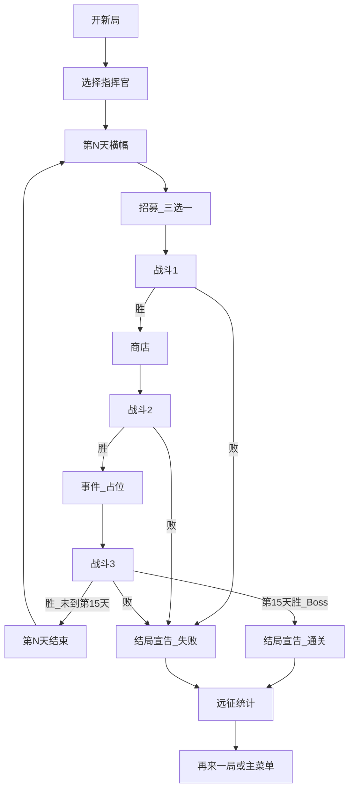

# 游戏基础循环

> 功能规格 · 只谈流程与生命周期，不写具体数值 · 2026-11-03  
> 相关文档：[游戏愿景](../GAME_VISION.md) · [招募](./RECRUIT.md) · [商店](./MAP_SHOP.md) · [装备](./EQUIPMENT.md) · [战斗](./COMBAT.md) · [战斗关卡](./COMBATLEVEL.md) · [玩家](./PLAYER.md) · [无尽](./ENDLESS.md) · [架构](../ARCHITECTURE.md)  
> **本版不写**：商店货品设计与定价、事件内容、角色攻防数字、技能积木清单、战斗 tick / 伤害公式、换皮与改名。  
>
> **【用户新共识 · 十五天日程 · 2026-11-03】** 主爬塔**废止地图选路**。一整局 = 选指挥官 + 固定 **15 天**；每天依次 **招募 → 战斗 → 商店 → 战斗 → 事件 → 战斗 → 结束一天**。第 15 天第三场为 **Boss**，胜即通关。**胜后无免费强化、无胜后招募。**

## 1. 这是什么

**游戏基础循环**规定：玩家从主菜单进入、打完一整局、再回到主菜单的完整生命周期——以及一整局里「一天六步」和战斗内「准备 → 自动战斗 → 结算」怎么嵌套。

**必须分清两种模式**：

| 模式 | 入口 | 在循环里的地位 |
|------|------|----------------|
| **爬塔（主模式）** | 主菜单 → 开始游戏 | **主循环**：十五天日程（本篇） |
| **无尽** | 主菜单 → 无尽 | **并列模式**：仍走地图线性爬层、无通关；细则见 [无尽](./ENDLESS.md)、[地图与节点](./MAP.md) |
| **线性波次（开发 / 平衡用）** | 直开线性关工具 | **工具环**；不得写成主循环 |

胜负以愿景**清波制 / 斩首例外 / 指挥官阵亡即败**定稿为准。

---

## 2. 术语

| 说法 | 意思 |
|------|------|
| **局外** | 主菜单、设置；不在某一整局里 |
| **一整局** | 从开新局到通关或失败的一次爬塔（实现里的「Run」） |
| **天** | 日程单位；一整局共 15 天 |
| **步** | 一天内的六个阶段之一：招募 / 战斗 / 商店 / 战斗 / 事件 / 战斗 |
| **遭遇** | 一场自走棋战斗：准备 → 观战 → 结算 |
| **三选一弹层** | 招募、商店、指挥官选择共用的卡片选择界面（短按选择、长按看详情） |
| **装备暂存** | 队伍共享的未挂装备列表；商店买入的装备先进这里（见 [装备](./EQUIPMENT.md)） |

---

## 3. 局外生命周期

| 阶段 | 玩家在做什么 | 约定 |
|------|--------------|------|
| 主菜单 | 开始游戏、无尽、角色库、沙盒、设置、退出 | 主入口为十五天爬塔 |
| 开局 | 点「开始」→ **选择指挥官** | 本版只有一位指挥官（2 攻 / 30 血 / 1 装备槽），仍走一次选择 |
| 中途回主菜单 | 放弃本局 | 本局作废 |
| 通关 / 失败后 | 结算「继续」→ **结局宣告**（胜：撑过十五天并击败 Boss；败：倒在第 N 天）→ **远征统计** → 再来一局或回主菜单 | 不做局外奖励 |
| 存档 / 局外成长 | — | **不做** |

---

## 4. 局内生命周期（一整局）

### 4.1 总流程



### 4.2 一天六步

| 步 | 玩家在做什么 | 离开条件 |
|----|--------------|----------|
| **招募** | 三选一免费拿人；第 1 天连续 **6 次**、不可跳过；第 2 天起 **1 次**、可点「今天不招」 | 拿满次数或跳过 |
| **战斗 1** | 准备站位（含挂装）→ 开战观战 → 结算 | 胜 → 商店；败 → 整局失败 |
| **商店** | 先选 **军械 / 远程 / 魔法 / 消耗品** 之一（或「不逛了」）→ 随机货架购买 →「完成购买」 | 完成或不逛 |
| **战斗 2** | 同战斗 1 | 胜 → 事件 |
| **事件** | 占位说明 → 点「继续」 | 点继续 |
| **战斗 3** | 同战斗 1；**第 15 天为 Boss（斩首）** | 胜 → 结束一天 / 第 15 天通关 |

跨天时播放「第 N 天结束」与「第 N+1 天」横幅；最后一天横幅提示末场迎战 Boss。顶部日程条显示「第 N/15 天」与六步进度（已过 / 当前 / 未到）。

### 4.3 通关与整局失败

| 结果 | 条件 |
|------|------|
| **遭遇胜** | 普通战清光敌方；Boss 战首领死亡（斩首，见 [Boss](./BOSS.md)） |
| **遭遇败** | **指挥官阵亡**（其余友方仍在场亦败） |
| **整局通关** | 第 15 天第三场击败 Boss |
| **整局失败** | 任一战败 → 整局重置（队伍、金币、装备暂存、日程、指挥官生命） |

---

## 5. 跨战斗持久状态

| 状态 | 跨战斗 / 跨天 | 整局失败时 |
|------|----------------|------------|
| 队伍（成员、星级、装备）与持久占位、备战区 | 保留并可变 | 重置 |
| 金币 | 保留 | 重置 |
| 装备暂存 | 保留 | 清空 |
| 日程（天、步） | 推进 | 回到第 1 天 |
| 友方队伍成员当前生命 | **不保留**：每场满生命 | — |
| **指挥官当前生命** | **保留**（开局满血） | 重置 |

> 事件为占位，本版无治疗来源。

---

## 6. 战斗内循环

```text
进入战斗步
  → 准备（载入持久占位、换座、备战上座、短点角色从装备暂存挂装、点开始战斗）
  → 回合制自动战斗观战（不能改阵）
  → 结算（胜发日金；Boss 胜不提供最终试炼）
  → 胜：回日程下一步；败：整局失败
```

顶栏遭遇名显示「第 N 天 · 第 K 战 · 遭遇名」，Boss 场为「第 15 天 · Boss 战 · 遭遇名」。普通战从地图配置的普通遭遇池随机抽；敌方强度按当天天数（1–15）推进。

---

## 7. 经济

| 时机 | 来源 |
|------|------|
| 战斗内 | 无击杀掉金 |
| 战斗胜利 | 日金：按当天天数发金（与原「层金」同一公式，层号换为天数）；遭遇额外奖励金照发 |
| 招募 | **免费** |
| 商店 | 装备 / 消耗品按标价扣金 |

---

## 8. 玩家操作与验收（L0）

1. 主菜单「开始」→ 指挥官选择弹层 → 第 1 天横幅  
2. 连续 6 次三选一招募（不可跳过）后进入第 1 战准备，可调座位后开战  
3. 第 1 战胜 → 商店类型选择 → 货架；买装备显示「已入暂存」，下一场准备可短点角色挂装  
4. 第 2 战胜 → 事件占位 → 继续 → 第 3 战  
5. 第 3 战胜 → 「第 1 天结束」→「第 2 天」→ 招募 1 次（可「今天不招」）  
6. 第 15 天第 3 战为 Boss；胜 → 结局宣告「你撑过了十五天并击败了 Boss」→ 远征统计  
7. 任一战败 → 结局宣告「倒在第 N 天」→ 远征统计 → 再来一局或回主菜单

---

## 9. 现状对照

| 能力 | 标注 | 证据（路径） |
|------|------|----------------|
| 十五天日程步序 | 功能已存在 | `scripts/core/run/day_run_schedule.gd` |
| 日程编排（指挥官选择 / 招募 / 战斗 / 商店 / 事件 / 跨天） | 功能已存在 | `scripts/core/run/run_game_controller.gd`（`_day_*`） |
| 三选一弹层与卡片（Tween 动效） | 功能已存在 | `scripts/ui/day_loop/day_pick_overlay.gd`、`day_pick_card.gd` |
| 四类商店分类 | 功能已存在（按装备来源角色粗分，货品后续设计） | `scripts/core/run/day_shop_catalog.gd` |
| 事件 | 占位 | `scripts/ui/placeholder/placeholder_node_screen.gd` |
| 无尽地图 | 功能已存在（不受本篇影响） | `scenes/main/endless_game.tscn` |
| 测试 | 功能已存在 | `scripts/core/run/day_loop_test_runner.gd`、`scripts/ui/day_loop/day_loop_flow_test_runner.gd` |
