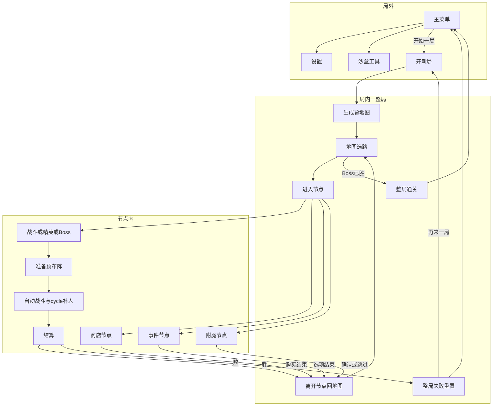

# 游戏基础循环

> 功能规格 · 只谈流程与生命周期，不写具体数值 · 2026-10-12  
> 相关文档：[游戏愿景](../GAME_VISION.md) · [地图与节点](./MAP.md) · [战斗](./COMBAT.md) · [战斗关卡](./COMBATLEVEL.md) · [增益](../BUFF_SYSTEM.md) · [角色单位](./UNITS.md) · [架构](../ARCHITECTURE.md)  
> **本版不写**：商店定价与品阶表、角色攻防数字、技能积木清单、战斗 tick / 伤害公式、换皮与改名。  
> **宏观参照**：杀戮尖塔式「局外 → 开一局 → 地图选路 → 节点 → 回地图 → Boss / 失败」；节点内战斗映射为本作自走棋，**不照搬**对方的卡牌战斗细则。

## 1. 这是什么

**游戏基础循环**规定：玩家从主菜单进入、打完一整局、再回到主菜单的完整生命周期——以及一整局里「地图选路 → 进节点 → 出节点」和战斗节点里「准备 → 自动战斗 → 结算」怎么嵌套。

| 杀戮尖塔宏观 | 本作对应 |
|--------------|----------|
| 主菜单 / 开一局 | 主菜单「开始」→ 新开一整局（第一版不设选初始角色） |
| 幕地图选路 | 幕地图上点选节点前进 |
| 房间战斗 | **自走棋一场**：准备预布阵 → 自动战斗与 cycle 补人 → 结算 |
| 战后选牌 / 营地商店 | **主模式不在战斗胜利后强制进商店**；商店、事件、附魔等在地图节点上 |
| 击败幕 Boss 通关；战斗失败整局结束 | 清光敌方胜 / 己方全灭败；失败则整局重置 |

**必须分清两种模式**：

| 模式 | 入口 | 在循环里的地位 |
|------|------|----------------|
| **爬塔（主模式）** | 主菜单 → 爬塔场景 | **主循环**：一节点一战；商店在地图商店节点 |
| **线性波次（开发 / 平衡用）** | 直开线性关或沙盒工具 | **工具环**：一关多波，波次之间可进商店；不得写成主循环 |

第一版乐趣：商店构筑牌库 → 准备预布阵 → 战斗中 cycle 补人看联动兑现（见愿景）。胜负以愿景**清波制**定稿为准。抽牌与战中 cycle 补人已在实时战斗关卡实现。

---

## 2. 写什么、不写什么

### 2.1 本文要说清的

- 局外与局内怎么分界
- 一整局里：幕、地图选路、节点进出、通关与整局失败
- 跨节点保留什么、失败时重置什么
- 战斗类节点内：准备预布阵 → 自动战斗与 cycle 补人 → 结算 → 回地图
- 商店在主模式与线性工具环中的位置差异
- 玩家可观察操作与验收口径
- 现状：功能已存在 / 部分存在 / 仅愿景 / 文档漂移

### 2.2 本版不写

商店定价与品阶表、角色攻防数字、技能积木全表、增益流程、战斗 tick 实现见对应文档。中世纪换皮与改名本版不写。第一版不做羁绊、PvP、基地血条胜负、多幕局外成长。

### 2.3 和别的文档怎么分

| 本篇负责 | 别的文档负责 |
|----------|--------------|
| 何时进商店、何时布阵、何时开战、何时回地图 | **商店**：买什么、怎么刷新、满库怎么换 |
| 胜负与整局重置的边界 | **愿景**：清波制定稿；本篇只引用 |
| 牌库跨节点保留 | **商店 / 牌库**：条目结构与抽牌规则 |
| 节点内「摆谁」（单位含义） | **角色单位**：生命 / 攻击 / 移动含义 |
| 节点内「摆哪一侧」、竖屏半场 | **战斗关卡**：我半场 / 敌半场、硬半场投放、开战越线 |
| 遭遇内三步怎么走、刷怪时机 | **战斗**：准备 → 自动战斗与 cycle → 结算 |
| 开战后战斗模拟细节 | **架构**：事件总线、效果结算 |

---

## 3. 术语

| 说法 | 意思 |
|------|------|
| **局外** | 主菜单、设置、沙盒入口；不在某一整局的地图进度里 |
| **一整局** | 从开新局到通关或失败重置的一次爬塔（对应实现里的「Run」） |
| **幕** | 一张爬塔地图 + 本幕 Boss；第一版只有一幕 |
| **节点** | 地图上的一格选择：战斗、商店、事件、附魔等 |
| **遭遇** | 进入战斗类节点后的一场自走棋战斗（主模式通常一节点一战） |
| **波次** | 线性开发关里的一波；也用于描述遭遇内部的刷怪节奏。主模式不要把「每波必商店」当成主循环 |
| **线性开发关** | 直开多波关卡的工具模式，用于开发与平衡，不是玩家主入口 |

---

## 4. 局外生命周期

对照杀戮尖塔「营地 / 主菜单 → 开一局 → 结束回退」：

| 阶段 | 玩家在做什么 | 第一版约定 | 现状 |
|------|--------------|------------|------|
| 主菜单 | 开始游戏、进沙盒、设置、退出 | 主入口只讲爬塔主模式；沙盒 / 线性关标为工具 | **功能已存在**（主菜单可进爬塔与沙盒） |
| 开局 | 点「开始」进入新开一整局 | **不设**选初始角色、难度、种子界面；开局 = 默认起始牌库 + 新地图 | **无选初始**；点开始即新开局 |
| 中途回主菜单 | 放弃本局 | 中途退出 = 本局作废（等同失败重置意图） | 结束界面可回菜单；中途放弃未成主流程文案 |
| 通关 / 失败后 | 再来一局或回主菜单 | 不写局外奖励；失败整局重置后可重开 | **部分存在**（通关 / 失败叠层 → 重开或回菜单） |
| 存档 / 继续 | — | **第一版不做**中途存档；进程结束即本局丢失 | **不存在** |
| 局外成长 | — | **第一版不做**永久解锁、多幕进度 | **不存在**（仅第一幕配置） |

杀戮尖塔「选角色再进一局」→ 本作第一版「主菜单开始 → 直接进入幕地图」。

---

## 5. 局内生命周期（一整局）

### 5.1 总流程

1. 生成（或加载）本幕地图  
2. 在地图上选可到达节点  
3. 进入节点 → 处理节点内容 → 离开节点回地图  
4. 击败本幕 Boss → 整局通关；任一战斗遭遇失败 → 整局失败并重置  



### 5.2 幕与地图选路

| 概念 | 含义 | 第一版约定 |
|------|------|------------|
| 幕 | 一张地图 + Boss | **只有一幕**；通关 = 击败该幕 Boss |
| 地图选路 | 从起点沿连通边前进，每层可选若干节点 | 只能点「当前可达」节点；种类可见 |
| 节点种类 | 见下表 | 细则见 [地图与节点](./MAP.md) |

### 5.3 节点类型（第一版定稿）

| 节点 | 玩家在做什么 | 离开条件 |
|------|--------------|----------|
| **起点** | 进入即完成 | 自动完成，无战斗 |
| **战斗** | 准备预布阵 → 自动战斗与 cycle 补人 → 结算 | 胜 → 回地图；败 → 整局失败 |
| **精英** | 同战斗，威胁更高 | 同战斗 |
| **Boss** | 本幕终点战斗 | 胜 → 整局通关；败 → 整局失败 |
| **商店** | 购买角色卡 / 增益卡、刷新 | 结束购买后回地图 |
| **事件** | 选项事件 | 选完后回地图 |
| **附魔** | 为牌库角色新增或更换主技能 | 确认或跳过后回地图 |

> **第一版不做**：休息、宝箱、献祭、神秘。代码若仍有占位，以 [地图与节点](./MAP.md) 为准收敛。

### 5.4 节点进入与离开

- **进入**：仅可选当前可达节点；未进入前显示真实种类。  
- **战斗类**：进入遭遇 → 准备 → 自动战斗 → 结算 →（胜）完成节点回地图 /（败）整局失败。  
- **非战斗类**（商店 / 事件 / 附魔）：完成交互后回地图。  
- **主模式战斗胜利后直接回地图**，不会被强制塞进商店。

### 5.5 通关与整局失败

| 结果 | 条件 |
|------|------|
| **遭遇胜** | 清光本场全部敌方角色 |
| **遭遇败** | 己方角色全部阵亡（不以基地血条为主轴） |
| **整局通关** | 击败本幕 Boss |
| **整局失败** | 任一战斗遭遇失败 → **整局重置**（牌库、金币、地图进度） |

胜负细节以 [游戏愿景](../GAME_VISION.md) 清波制定稿为准。

---

## 6. 跨节点持久状态与重置

| 状态 | 跨战斗 / 跨节点 | 整局失败时 |
|------|-----------------|------------|
| 牌库（角色条目、等级、已挂增益） | 保留并可变 | 重置为开局默认 |
| 金币 | 保留 | 重置 |
| 地图进度、已完成节点 | 保留 | 重新生成 / 清空进度 |
| 商店访问次数等推进用计数 | 保留（可影响品阶等） | 重置 |
| 本场战斗临时增益 / 场上实体 | **不**跨战斗保留 | — |
| 友方角色当前生命 | **不跨战斗保留**：每次从手牌打出都是满生命 | — |
| 局外永久解锁 | 第一版无 | — |

> **生命**：本版每次打出都是满生命上场，旧约定「生命跨节点保留」作废；事件节点本版是占位，不提供治疗。

---

## 7. 节点内战斗循环

### 7.1 主模式（爬塔）— 战斗类节点

```text
进入战斗节点
  → 准备（本波手牌、预布阵、点开始战斗）
  → 实时自动战斗与补人（人口上限；已上场不可拖动）
  → 结算（发波次金、清场、判胜负）
  → 胜：回地图选路
  → 败：整局失败 → 重开或回主菜单
```

细则见 [战斗](./COMBAT.md) 与 [游戏愿景](../GAME_VISION.md) 主循环。进场战场形状与半场落点见 [战斗关卡](./COMBATLEVEL.md)；本篇只嵌套三步生命周期。

- **商店不在战斗胜利后自动出现**；要买卡须走地图上的商店节点（事件 / 附魔提供其它构筑机会）。  
- 杀戮尖塔「房间战斗」→ 本作「自走棋一场」；对方「战后选牌」→ 本作拆到「地图商店 / 事件 / 附魔」等。

### 7.2 准备阶段要点

| 玩家 | 系统 |
|------|------|
| 从本波手牌预布阵 | 抽牌形成本场手牌；校验格占用、人口与**我半场**；禁止战斗 |
| 调整站位后点「开始战斗」 | 进入战斗阶段 |

默认每场抽 5 张、人口 5、起始牌库 8 名新角色（数值可配置）。

### 7.3 战斗与结算

| 阶段 | 玩家 | 系统 |
|------|------|------|
| 战斗 | 手牌出牌（受**号令**约束，无人口硬顶；见 [玩家](./PLAYER.md)）；不能拖动已上场单位 | 开战时在敌半场一次刷怪；实时自动战斗；击杀掉金 |
| 结算 | 查看结果 | 发放波次固定收益；清场；敌方全灭 → 胜；己方全灭 → 败 |

战斗内临时增益在波次 / 遭遇结束时清空；牌库养成与跨节点生命见第 6 节。

---

## 8. 商店在循环中的位置

| 模式 | 商店出现时机 |
|------|--------------|
| **主模式（爬塔）** | **仅地图商店节点**（事件可给非完整商店类奖励；附魔改主技能） |
| **线性开发关** | 波次结算之后、下一波准备之前（工具环专用） |

商店「买什么、怎么刷新、满库怎么换」见愿景 / 架构摘要与实现（旧商店规格已删除）。本篇只规定**何时**能进商店。

---

## 9. 玩家操作与验收（L0）

可观察路径（主模式）：

1. 主菜单能进入爬塔  
2. 地图上能看到可选节点并点选  
3. 战斗节点：能预布阵、开战、看实时自动战斗、战中补人；胜回地图，败出结束界面  
4. 商店 / 事件 / 附魔节点（本版占位）：显示说明，点「继续」回地图；战斗胜利后不会被强制进商店  
5. Boss 胜 → 胜利结束；失败 → 牌库 / 金 / 地图进度清掉并可重开  

第一版不做：单位微操走位、羁绊、基地血条胜负、PvP、多幕局外成长、中途存档；勿把线性「每波必商店」写成主循环。

---

## 10. 现状对照

| 阶段 / 能力 | 标注 | 证据（路径） |
|-------------|------|----------------|
| 主菜单 → 开爬塔 / 沙盒 | 功能已存在 | `scenes/main/main_menu.tscn`，`scripts/ui/main_menu.gd` |
| 爬塔场景编排 | 功能已存在 | `scenes/main/run_game.tscn`，`scripts/core/run/run_game_controller.gd` |
| 宏观阶段：地图 / 遭遇 / 通关 / 失败 | 功能已存在 | `scripts/core/run/run_controller.gd` |
| 地图生成与选路 | 功能已存在 | `scripts/core/run/map_generator.gd`，`map_state.gd`，`resources/runs/act1_map.tres` |
| 节点类型（第一版七类） | 功能已存在 | 生成器只产出七类；商店/事件/附魔本版为占位界面 |
| 战斗节点：准备→战斗→结算→回地图 | 功能已存在 | `scenes/combat/realtime/realtime_battle.tscn`（实时战斗） |
| 商店 / 事件 / 附魔节点 | 本版占位 | `scenes/ui/placeholder/`；旧商店与事件界面不接入 Run 主路径 |
| 清波胜负 + 失败整局重置 | 功能已存在（对齐愿景） | 愿景定稿；失败时重初始化牌库与经济 |
| 单幕通关 = Boss 胜 | 功能已存在 | Boss 遭遇完成后进入通关 |
| 多幕 / 局外永久解锁 | 仅愿景 | 愿景「远期」 |
| 存档续打 / 选初始角色 | 仅愿景或未写 | 无存档；主菜单无选人 |
| 线性波次 + 波后商店 | 功能已存在（开发模式） | `scenes/main/main.tscn`，线性开发开关 |
| 抽牌 + 战斗中补人 | 功能已存在 | 实时战斗关卡；冷却队列不在本版 |
| 「商店只在线性步骤 5」被读成主循环 | 文档漂移 | 主模式以本篇与愿景爬塔节为准 |

---

## 11. 开放问题（已拍板默认）

| 问题 | 默认（写入本篇） |
|------|------------------|
| 第一版是否只有一幕？ | **是**；通关 = 击败第一幕 Boss |
| 局外是否要有选初始 / 种子 / 难度？ | **都不要**；开始 = 新开一局 + 默认起始牌库 |
| 中途存档？ | **不做** |
| 友方生命是否跨战斗节点保留？ | **不保留**；每次打出满生命 |
| 地图节点清单？ | **起点、战斗、精英、Boss、商店、事件、附魔**（见 [地图与节点](./MAP.md)） |


---

## 附录 A：线性波次工具环

开发 / 平衡用，**不是**主循环：

```text
线性关加载 →（商店）→ 准备 → 战斗 → 结算 → 商店 → 下一波 …
         ↘ 败 → 商店 / 重置构筑 → 再挑战
```

差异要点：线性模式是「一关多波、波波可商店」；主模式是「一节点一战、商店在地图上」。六步职责细节见 [游戏愿景](../GAME_VISION.md)「线性波次」节；实现入口见 `scenes/main/main.tscn`。
