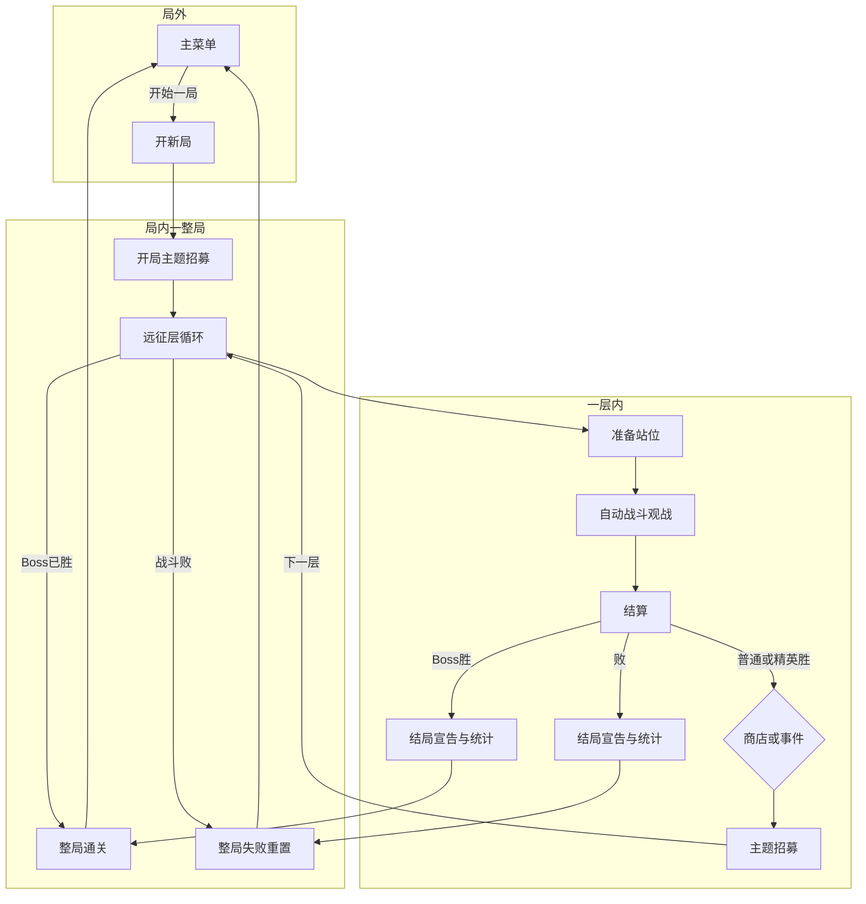

# 游戏基础循环

> 功能规格 · 只谈流程与生命周期，不写具体数值 · 2026-11-05  
> 相关文档：[游戏愿景](../GAME_VISION.md) · [远征层进度](./MAP.md) · [战斗](./COMBAT.md) · [战斗关卡](./COMBATLEVEL.md) · [增益](../BUFF_SYSTEM.md) · [角色单位](./UNITS.md) · [架构](../ARCHITECTURE.md)  
> **本版不写**：商店定价与品阶表、角色攻防数字、技能积木清单、战斗 tick / 伤害公式、换皮与改名。  
> **【用户新共识 · 2026-11-05】** 主模式**取消地图选路**；改为线性远征层：开局主题招募 →（战斗 → 商店或事件二选一 → 主题招募）×N → Boss。本版主循环**不接入附魔**。

## 1. 这是什么

**游戏基础循环**规定：玩家从主菜单进入、打完一整局、再回到主菜单的完整生命周期——以及一整局里「远征层推进」和每层「准备 → 自动战斗 → 结算 → 商店或事件 → 招募」怎么嵌套。

| 宏观步骤 | 本作对应 |
|----------|----------|
| 主菜单 / 开一局 | 主菜单「开始」→ 新开一整局（第一版不设选初始角色） |
| 层进度 | **远征层**线性前进（无分叉选路） |
| 房间战斗 | **自走棋一场**：准备站位 → 自动战斗观战 → 结算 |
| 战后养成 | **商店或事件二选一**，再 **主题承诺招募** |
| 击败 Boss 通关；战斗失败整局结束 | 清光敌方胜 / 己方全灭败；失败则整局重置 |

**必须分清两种模式**：

| 模式 | 入口 | 在循环里的地位 |
|------|------|----------------|
| **爬塔（主模式）** | 主菜单 → 爬塔场景 | **主循环**：线性远征层；每层战斗后商店或事件二选一 |
| **无尽** | 主菜单 → 无尽 | **并列模式**：线性普通爬层、无通关；细则见 [无尽](./ENDLESS.md) |
| **线性波次（开发 / 平衡用）** | 直开线性关工具 | **工具环**：一关多波；不得写成主循环 |

第一版乐趣：主题承诺养队 → 准备站位 → 开战观战 → 战后在商店与事件间取舍 → 再主题招募 → 打到 Boss。胜负以愿景**清波制**定稿为准。**【As-Is】** 主路径可能仍为地图选路；主题锁池招募可能未落地。

---

## 2. 写什么、不写什么

### 2.1 本文要说清的

- 局外与局内怎么分界
- 一整局里：幕、远征层推进、通关与整局失败
- 跨层保留什么、失败时重置什么
- 一层内：准备 → 自动战斗观战 → 结算 →（普通/精英胜）商店或事件 → 主题招募
- 商店与招募在主模式中的位置差异
- 玩家可观察操作与验收口径
- 现状：功能已存在 / 部分存在 / 仅愿景 / 文档漂移

### 2.2 本版不写

商店定价与品阶表、招募单价与刷新费、角色攻防数字、技能积木全表、增益流程、战斗 tick 实现见对应文档。中世纪换皮与改名本版不写。第一版不做 PvP、基地血条胜负、多幕局外成长；主题羁绊见 [主题羁绊](./UNIT_THEME_BONDS.md)。**附魔不接入本版主循环**。

### 2.3 和别的文档怎么分

| 本篇负责 | 别的文档负责 |
|----------|--------------|
| 何时进商店/事件、何时布阵、何时开战、何时招募、何时进下一层 | **商店**：买什么、怎么刷新 |
| 胜负与整局重置的边界 | **愿景**：清波制定稿；本篇只引用 |
| 队伍跨层保留 | **玩家 / 商店 / 招募**：队伍成员与席位上限 |
| — | **招募**：主题三选一、锁池、短名单操作细则 |
| — | **玩家**：持久占位、席位上限 5、自动三合一 |
| — | **远征层进度**：层表、精英插入、Boss 层 |
| 遭遇内三步怎么走 | **战斗**：准备入座 → 自动战斗观战 → 结算 |
| 开战后战斗模拟细节 | **架构**：事件总线、效果结算 |

---

## 3. 术语

| 说法 | 意思 |
|------|------|
| **局外** | 主菜单、设置；不在某一整局的进度里 |
| **一整局** | 从开新局到通关或失败重置的一次爬塔 |
| **幕** | 一整局的一层进度带 + 本幕 Boss；第一版只有一幕 |
| **远征层** | 线性进度单位：一场普通或精英战斗 +（胜后）商店或事件 + 主题招募；Boss 层例外 |
| **遭遇** | 进入本层战斗后的一场自走棋战斗 |
| **主题承诺招募** | 先主题三选一，再短名单招人；候选人仅主或辅匹配所选主题 |
| **线性开发关** | 直开多波关卡的工具模式，不是玩家主入口 |

---

## 4. 局外生命周期

| 阶段 | 玩家在做什么 | 第一版约定 | 现状 |
|------|--------------|------------|------|
| 主菜单 | 开始游戏、角色库、**沙盒**、附魔试验场、设置、退出 | 主入口以爬塔为主；沙盒为局外试验（见 [沙盒](./SANDBOX.md)）；线性关标为工具 | **功能已存在** |
| 开局 | 点「开始」进入新开一整局 | **不设**选初始角色、难度、种子界面；开局 = 默认起始队伍 + 开局主题招募 | **无选初始**；**【As-Is】** 可能仍直接进地图 |
| 中途回主菜单 | 放弃本局 | 中途退出 = 本局作废 | 结束界面可回菜单 |
| 通关 / 失败后 | 战斗结算「继续」→ **结局宣告** → **远征统计** → 再来一局或回主菜单 | 不写局外奖励；失败整局重置后可重开 | **部分存在** |
| 存档 / 继续 | — | **第一版不做**中途存档 | **不存在** |
| 局外成长 | — | **第一版不做**永久解锁、多幕进度 | **不存在** |

---

## 5. 局内生命周期（一整局）

### 5.1 总流程（To-Be）

1. 开局：主题三选一 → 主题锁池短名单招募  
2. 按远征层推进：本层遭遇（普通或精英，由层表决定）→ 准备 → 战斗 → 结算  
3. 普通 / 精英胜：商店或事件二选一 → 主题承诺招募 → 进入下一层  
4. Boss 层胜 → 整局通关；任一战斗遭遇失败 → 整局失败并重置  



### 5.2 远征层与遭遇类型

| 概念 | 含义 | 第一版约定 |
|------|------|------------|
| 幕 | 线性层表 + Boss | **只有一幕**；通关 = 击败该幕 Boss |
| 远征层 | 一层一场战斗（普通或精英） | 无分叉；不可回退 |
| 精英 | 更高威胁遭遇 | **层表固定插入**（哪几层为精英由配置填空） |
| Boss | 本幕终点 | 胜 → **直接通关**（不进商店/事件/招募） |

细则见 [远征层进度](./MAP.md)。

### 5.3 一层内步骤（普通 / 精英）

| 步骤 | 玩家在做什么 | 离开条件 |
|------|--------------|----------|
| **准备** | 站位入座、备战上座、点开战 | 点开始战斗 |
| **战斗** | 观战（可加速） | 敌全灭或己全灭 |
| **结算** | 查看结果与层金 | 胜继续 / 败整局失败 |
| **商店或事件** | **二选一**：进商店，或进事件 | 完成所选交互（可整局只选商店，接受零圣物） |
| **主题招募** | 主题三选一 → 短名单招人等 | 跳过或完成 → 下一层 |

### 5.4 Boss 层

进入 Boss 遭遇 → 准备 → 自动战斗 → 结算 →「继续」→ **结局宣告** → **远征统计** → 再来一局或回主菜单（**不**进商店、事件、招募）。Boss 胜负为**斩首**（见 [Boss](./BOSS.md)）。

### 5.5 通关与整局失败

| 结果 | 条件 |
|------|------|
| **遭遇胜** | 清光本场全部敌方角色（Boss 为斩首） |
| **遭遇败** | 己方角色全部阵亡 |
| **整局通关** | 击败本幕 Boss |
| **整局失败** | 任一战斗遭遇失败 → **整局重置**（队伍、金币、层进度） |

---

## 6. 跨层持久状态与重置

| 状态 | 跨战斗 / 跨层 | 整局失败时 |
|------|----------------|------------|
| 队伍（成员、等级、已挂增益）与队伍席位上限 | 保留并可变 | 重置为开局默认 |
| 远征行囊圣物 | 保留 | 重置 |
| 金币 | 保留 | 重置 |
| 远征层进度 | 保留 | 清空进度 |
| 本场战斗临时增益 / 场上实体 | **不**跨战斗保留 | — |
| 友方角色当前生命 | **不跨战斗保留**：每次入座开战都是满生命 | — |
| 局外永久解锁 | 第一版无 | — |

> **生命**：本版每次入座开战都是满生命上场；需要回复类效果时优先走**事件选项**（若玩家选择进事件）。

---

## 7. 一层内战斗循环

```text
进入本层（普通或精英）
  → 准备（队伍全体入角色座位、调站位、点开始战斗）
  → 自动战斗观战（不能改阵）
  → 结算（发层金、清场、判胜负）
  → 胜：商店或事件二选一 → 主题承诺招募 → 下一层
  → 败：整局失败 → 重开或回主菜单

进入 Boss 层
  → 准备 → 观战 → 结算 →「继续」
  → 胜：结局宣告 → 远征统计 → 再来一局或回主菜单
  → 败：结局宣告 → 远征统计 → 重开或回主菜单
```

细则见 [战斗](./COMBAT.md)、[招募](./RECRUIT.md)、[玩家](./PLAYER.md)、[地图商店](./MAP_SHOP.md) 与 [游戏愿景](../GAME_VISION.md)。

### 7.1 准备阶段要点

| 玩家 | 系统 |
|------|------|
| 将队伍成员入角色座位、换座 | 带入当前队伍；校验全体入座；禁止战斗 |
| 全体成员入座后点「开始战斗」 | 进入战斗阶段（见玩家篇） |

座位网格默认 4×5；队伍席位上限可成长且最大 ≤ 10；细则见 [玩家](./PLAYER.md) 与 [战斗关卡](./COMBATLEVEL.md)。无号令；无遭遇内抽牌。

### 7.2 战斗与结算

| 阶段 | 玩家 | 系统 |
|------|------|------|
| 战斗 | **仅观战**（可加速）；不能改阵、不能改座 | 开战时敌方座位一次出齐；自动战斗；击杀不掉金 |
| 结算 | 查看结果 | 按远征层发金；清场；敌方全灭 → 胜；己方全灭 → 败 |

---

## 8. 商店、事件与招募在循环中的位置

| 环节 | 出现时机 |
|------|----------|
| **开局招募** | 新开局后、第一场战斗前 |
| **商店或事件** | 普通 / 精英**胜利结算后**、进入本层招募前；玩家**二选一**（无强制事件保底） |
| **主题招募** | 开局；以及普通 / 精英胜且完成商店或事件之后（Boss 胜不进） |
| **商店内容** | 消耗品 / 装备 / 半场换座等，见 [地图商店](./MAP_SHOP.md) |
| **事件内容** | 选项博弈；**远征圣物**仅事件三选一获取，见 [远征行囊](./EXPEDITION_RELICS.md) |

招募 ≠ 商店：招募做主题锁池短名单拿人；商店做装备/消耗品养成。

---

## 9. 玩家操作与验收（L0）

可观察路径（主模式 · To-Be）：

1. 主菜单能进入爬塔  
2. 开局能完成一次主题三选一与短名单招募（候选人仅匹配主题）  
3. 每层：能准备站位、开战、看自动战斗；胜则出现商店/事件二选一，完成后再主题招募；败则结局宣告 → 统计 → 再来一局或回主菜单  
4. 层表在指定层出现精英；Boss 层胜通关且不进商店/事件/招募  
5. 整局可只选商店、零圣物（玩家选择，非缺陷）  

第一版不做：单位微操走位、基地血条胜负、PvP、多幕局外成长、中途存档、主循环附魔、地图选路。

---

## 10. 现状对照

| 阶段 / 能力 | 标注 | 证据（路径） |
|-------------|------|----------------|
| 主菜单 → 开爬塔 | 功能已存在 | `scenes/main/main_menu.tscn` |
| 爬塔场景编排 | 功能已存在 | `scenes/main/run_game.tscn`，`run_game_controller.gd` |
| 地图选路生成 | **As-Is 仍存在**；**【To-Be】主模式取消选路** | `map_generator.gd`，`map_state.gd` |
| 线性远征层 + 店/事二选一 + 主题招募 | **仅愿景 / To-Be** | 本文与愿景 2026-11-05 |
| 清波胜负 + 失败整局重置 | 功能已存在 | — |
| 单幕通关 = Boss 胜 | 功能已存在 | — |
| 准备站位 + 开战观战 | 文档 To-Be；实现对照战斗篇 | — |
| 主题锁池招募 | 文档 To-Be | 见招募篇 |

---

## 11. 开放问题（已拍板默认）

| 问题 | 默认（写入本篇） |
|------|------------------|
| 第一版是否只有一幕？ | **是**；通关 = 击败第一幕 Boss |
| 是否地图选路？ | **否**；线性远征层 |
| 战后商店与事件？ | **二选一**；无强制事件保底 |
| 精英如何出现？ | **层表固定插入** |
| 附魔是否进主循环？ | **本版不接入** |
| 局外是否要有选初始 / 种子 / 难度？ | **都不要** |
| 中途存档？ | **不做** |
| 友方生命是否跨战斗保留？ | **不保留**；每次打出满生命 |

---

## 附录 A：线性波次工具环

开发 / 平衡用，**不是**主循环：

```text
线性关加载 →（商店）→ 准备 → 战斗 → 结算 → 商店 → 下一波 …
         ↘ 败 → 商店 / 重置构筑 → 再挑战
```

差异要点：线性工具环是「一关多波、波波可商店」；主模式是「一层一战、战后店或事二选一再主题招募」。实现入口见 `scenes/main/main.tscn`。
