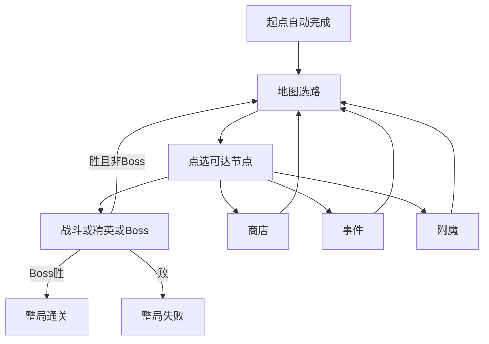

# 地图与节点

> 功能规格 · 只谈地图结构与节点作用，不写具体数值 · 2026-10-12  
> 相关文档：[游戏基础循环](./GAME_LOOP.md) · [战斗](./COMBAT.md) · [游戏愿景](../GAME_VISION.md) · [商店](../SHOP_SYSTEM.md) · [角色单位](./UNITS.md) · [技能目录](../ABILITIES.md) · [架构](../ARCHITECTURE.md)  
> **本版不写**：层数/概率/金币/治疗量等具体数字；遭遇内战斗细则；商店定价与品阶表；事件文案花名册；换皮叙事。  
> **宏观参照**：杀戮尖塔式幕地图选路；节点内战斗仍是本作自走棋，不照搬对方卡牌战斗。

## 1. 这是什么

**地图**是爬塔主模式里「选下一条路」的那一层：一张幕地图由多层节点连通而成；玩家只走当前可达节点，进入后处理该节点内容，再回到地图（Boss 胜利则整局通关）。

| 本篇负责 | [游戏基础循环](./GAME_LOOP.md) 负责 |
|----------|-------------------------------------|
| 地图长什么样、点哪能走 | 何时开局 / 通关 / 失败重置 |
| 每种节点里玩家做什么 | 何时进节点、何时回地图 |
| 节点种类清单（第一版定稿） | 节点内战斗三步（准备→战斗→结算）的生命周期 |

第一版地图节点**只保留**下列种类，并**新增附魔**：

起点 · 战斗 · 精英 · Boss · 商店 · 事件 · **附魔**

**不进入第一版地图规格**（即便代码里仍可能有占位）：休息、宝箱、献祭、神秘（?）。

---

## 2. 写什么、不写什么

### 2.1 本文要说清的

- 幕地图的结构：层、连通、可达、类型可见性
- 第一版节点种类总表与逐类作用
- 附魔节点：给牌库角色**新增**或**更换**主技能的规则
- 与杀戮尖塔房间的宏观映射
- 现状：功能已存在 / 部分存在 / 仅愿景 / 待从规格中收敛的旧类型

### 2.2 本版不写或以后再说

| 内容 | 状态 |
|------|------|
| 休息 / 宝箱 / 献祭 / 神秘 | **第一版不做**（见第 10 节） |
| 多幕、局外成长、存档 | 第一版不做 |
| 商店买什么、刷新、满库 | 见商店文档 |
| 遭遇内布阵与自动战斗 | 见循环 / 战斗实现 |
| 事件正文与选项内容库 | 内容切片；本篇只定「事件节点是什么」 |
| 附魔技能池的具体名单与权重 | 数值 / 内容；本篇只定规则骨架 |
| 羁绊、PvP | 第一版不做 |

### 2.3 和别的文档怎么分

| 本篇（地图） | 相邻文档 |
|--------------|----------|
| 何时出现商店节点、节点里结束回地图 | **商店**：购买、刷新、品阶 |
| 战斗 / 精英 / Boss 进入后是一场遭遇 | **循环**：准备→战斗→结算、胜负 |
| 附魔改的是牌库角色的主技能槽 | **角色单位 / 技能**：技能槽含义、技能积木 |
| 事件可改金、血、牌库等 | **循环**持久状态；具体选项内容另库 |

---

## 3. 术语

| 说法 | 意思 |
|------|------|
| **幕** | 一张爬塔地图 + 本幕 Boss；第一版只有一幕 |
| **层** | 地图上的纵向进度带：起点层 → 中间层 → Boss 层 |
| **节点** | 地图上的一格选择及其类型 |
| **可达** | 当前已完成节点的出边上、尚未完成的节点，玩家可以点选 |
| **遭遇** | 进入战斗类节点后的一场自走棋战斗 |
| **附魔** | 地图节点：为牌库中的友方角色新增或更换主技能 |

---

## 4. 地图结构

```text
一整局 → 一幕（第一版）→ 一张地图
  → 层：起点层 → 中间若干层 → Boss 层
  → 每层若干节点（列位可不同）
  → 边：由下层连向上层
  → 玩家只走「当前已完成节点」的出边（不可回退、不可跳层）
```

| 概念 | 功能含义 | 第一版约定 |
|------|----------|------------|
| 幕 | 一张地图 + Boss | 只有一幕；通关 = 击败 Boss |
| 连通 | 出边决定下一步候选 | 只能点当前可达节点 |
| 类型可见性 | 未进入前能否看见种类 | **显示真实种类**（便于规划路线） |
| 生成意图 | 中间层混入战斗/精英/商店/事件/附魔；终点为 Boss | 具体概率与上限交给数值；规格要求生成结果**只使用本篇节点表** |

### 进出总规则

1. 开局生成地图；起点自动完成；进入地图选路。  
2. 点选可达节点 → 进入 → 处理节点内容。  
3. 非战斗节点：交互结束 → 标记完成 → 回地图。  
4. 战斗类：胜 → 完成回地图；败 → 整局失败（重置见循环文档）。  
5. Boss 胜 → 整局通关（不再回选路）。  
6. 战斗胜利后**不**强制进商店。



---

## 5. 节点种类总表（第一版定稿）

| 节点 | 目的 | 玩家操作 | 离开 | 奖励 / 风险（功能） |
|------|------|----------|------|---------------------|
| **起点** | 路线起点 | 无实质交互 | 开局自动完成 | 无 |
| **战斗** | 常规遭遇 | 准备→开战→看戏→结算 | 胜回地图 / 败整局失败 | 进度与经济；损血等风险 |
| **精英** | 更高威胁遭遇 | 同战斗 | 同战斗 | 相对常规更高收益预期（数值另定） |
| **Boss** | 本幕终点 | 同战斗 | 胜通关 / 败整局失败 | 通关 |
| **商店** | 地图上构筑 | 买角色卡/增益卡、刷新、离开 | 结束购买回地图 | 花金币强化牌库 |
| **事件** | 短选项博弈 | 读文案→选一项 | 选完回地图 | 收益或代价（金/治疗/牌库等） |
| **附魔** | 改主技能 | 选角色→选技能→确认；或跳过 | 确认或跳过回地图 | 新增或更换主技能 |

---

## 6. 逐节点说明

### 6.1 起点

- **作用**：固定开局位置；出边给出第一批可选节点。  
- **验收**：开局后地图可见；起点已完成；首批可选为其出边。  
- **现状**：功能已存在。

### 6.2 战斗 / 精英 / Boss

- **作用**：一场自走棋遭遇。威胁梯队（体验语言）：战斗 < 精英 < Boss。  
- **玩家**：布阵 → 开始战斗 → 观看 → 看结算（三步细则见 [战斗](./COMBAT.md)）。  
- **进出**：胜则完成节点；败则整局失败；Boss 胜则整局通关。  
- **验收**：三类都能进入棋盘；胜回地图（Boss 除外为通关）；败出结束；胜后不进商店。  
- **现状**：功能已存在（遭遇池 / 精英池 / Boss 遭遇）。  
- **非目标**：实时微操；把 Boss 做成解谜机制关。

### 6.3 商店

- **作用**：主模式正经买卡窗口。  
- **玩家**：购买、刷新、结束离开。  
- **验收**：能买能走；战斗胜利后不被强制塞进商店。  
- **现状**：功能已存在。买什么见 [商店](../SHOP_SYSTEM.md)。

### 6.4 事件

- **作用**：用少量选项制造收益、代价或离开。  
- **玩家**：读标题/正文 → 点一个选项。  
- **效果大类（功能，不定数值）**：得金 / 失金 / 治疗 / 改牌库 / 挂增益 / 无事离开等——以事件数据为准。  
- **验收**：有可读选项；选后状态变化可观察；回地图。  
- **现状**：部分存在（解析与少量事件资源；内容池薄）。  
- **非目标**：实时小游戏、长剧情演出阻塞选路。

> 第一版**没有休息节点**。需要回复生命时，优先通过**事件选项**（或其它非地图系统）提供，不另开休息房。

### 6.5 附魔（新增 · 设计定稿）

- **作用**：让牌库里的一名友方角色获得主技能，或换掉现有主技能。  
- **和增益卡的区别**：增益是挂在条目上的强化层；附魔改的是**主技能槽**本身。  
- **和旧「献祭」的区别**：不要求祭献另一名角色、不拆掉牌库里另一条；从技能池选技能赋予目标。

#### 玩家流程

1. 进入附魔节点。  
2. **选择目标**：牌库中的一名友方角色。  
3. **选择技能**：从本节点给出的若干候选技能中选一个（候选如何 roll 由数值/内容定；本篇只要求「有明确可选列表」）。  
4. **确认**后生效并回地图；允许**跳过**（不改牌库，直接回地图）。

#### 生效规则

| 目标当前主技能 | 附魔结果 |
|----------------|----------|
| **没有主技能** | **新增**：把所选技能写入该角色条目的主技能槽 |
| **已有主技能** | **更换**：用所选技能替换原主技能；原主技能不再保留在该槽 |

补充约定：

- 只动**主技能槽**；不在本节点自动堆叠多条「主技能」。被动槽是否被附魔改写：**第一版不改被动**，只动主技能。  
- 候选技能来自「附魔技能池」（数据资源，另建）；池内容与权重本篇不定。  
- 牌库为空或没有任何可选目标时：只能跳过离开。  
- 与 [角色单位](./UNITS.md) 的关系：商店买到的友方角色默认应带主技能；附魔仍支持「当前没有主技能」的条目（例如特殊事件清空、或后续允许无技能模板），此时走「新增」分支。

#### 验收（功能）

- 进入附魔节点有选角色、选技能、确认、跳过。  
- 无主技能角色确认后拥有该主技能。  
- 有主技能角色确认后主技能变为新技能（旧的不再作为主技能生效）。  
- 跳过后牌库技能不变并回地图。  

#### 现状

**仅愿景 / 待实现**。代码里尚无「附魔」节点类型；现有「献祭」是另一套技能转移，**不**当作附魔的实装。

---

## 7. 与杀戮尖塔房间的映射

| 杀戮尖塔（宏观） | 本作第一版 |
|------------------|------------|
| 普通敌人 | 战斗 → 自走棋一场 |
| 精英 | 精英 → 同流程、更高威胁池 |
| Boss | Boss → 胜则通关 |
| 商店 | 地图商店节点 |
| 事件 | 事件节点 |
| 营地休息 | **不做**（治疗等改由事件等提供） |
| 未知 / ? | **不做** |
| 宝箱 | **不做**（奖励改由商店/事件/附魔等承担） |
| （无直接对应） | **附魔**（新增/更换主技能） |
| 战后选牌 | 不挂在战斗胜利强制链上；构筑在商店/事件/附魔 |

---

## 8. 玩家主路径验收（L0）

1. 开局见到地图；起点已完成；能点可达节点。  
2. 未到达节点能看出种类（战斗/精英/商店/事件/附魔/Boss）。  
3. 战斗/精英：能打完并回地图；败则整局失败。  
4. Boss：胜则通关。  
5. 商店：能购买并离开回地图。  
6. 事件：能选选项并回地图。  
7. 附魔：能新增或更换主技能，或跳过；回地图。  
8. 地图生成与 UI **不应再把**休息/宝箱/献祭/神秘当作第一版必经内容（旧占位需收敛或隐藏）。

---

## 9. 非目标

- 休息、宝箱、献祭、神秘节点（第一版）  
- 多幕地图、局外永久解锁、中途存档  
- 羁绊、PvP、实时微操  
- 把线性开发关「波后商店」写进地图主规格  
- 附魔改攻击方式、或一次附魔写入多条主技能  

---

## 10. 从规格中移除的旧节点（对照现状）

下列类型**不在第一版地图定稿内**。实现里若仍存在，视为待收敛占位，不要写进玩家主循环验收。

| 旧类型 | 原意图（摘要） | 第一版去向 |
|--------|----------------|------------|
| 休息 | 治疗 / 整理牌库 | 不做；治疗等改事件 |
| 宝箱 | 增益三选一 | 不做；构筑走商店/事件/附魔 |
| 献祭 | 两角色间转移技能 | 不做；技能改挂**附魔** |
| 神秘（?） | 进入揭晓 | 不做；种类一律可见 |

---

## 11. 现状对照

| 能力 | 标注 | 说明 |
|------|------|------|
| 地图生成、选路、可达 | 功能已存在 | `map_generator.gd` / `map_state.gd` 等 |
| 战斗 / 精英 / Boss / 商店 / 事件 | 功能已存在或事件内容偏薄 | 事件池需加厚（内容） |
| 附魔节点 | **仅愿景** | 需新节点类型 + UI + 写主技能槽 |
| 休息 / 宝箱 / 献祭 / 神秘 | 代码仍有 | **规格已移除**；待实现收敛 |
| 生成只产出本篇七类节点 | 仅愿景 | 现生成器仍会 roll 旧类型 |

---

## 12. 已拍板默认

| 项 | 定稿 |
|----|------|
| 第一版节点清单 | 起点、战斗、精英、Boss、商店、事件、附魔 |
| 附魔 | 无主技能 → 新增；有主技能 → 更换；可跳过；只动主技能 |
| 神秘 / 休息 / 宝箱 / 献祭 | 第一版不做 |
| 前方节点种类 | 显示真实种类 |
| 治疗 | 不靠休息节点；可由事件等提供 |

---

## 13. 开放问题（实现前可再拍）

| 问题 | 建议默认（未另通知则按此） |
|------|----------------------------|
| 附魔每次给几个候选技能？ | 少量固定数量的可辨认选项（具体个数交给数值） |
| 附魔技能池是否与角色品阶/幕进度挂钩？ | 第一版可先跟商店访问进度或幕进度弱相关；不定死公式 |
| 事件是否必须总有「离开」？ | 建议至少部分事件带无事离开；不强制每个事件都能白嫖 |

---

## 附录：线性开发关

线性多波 + 波后商店是工具环，**不是**本篇地图。见 [游戏基础循环](./GAME_LOOP.md) 附录。
