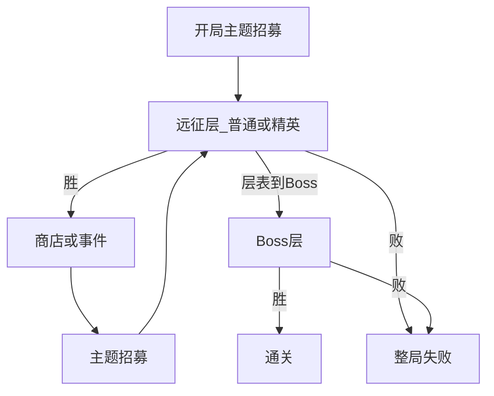

# 远征层进度

> 功能规格 · 主模式线性层进度与遭遇编排，不写具体层数/概率点数 · 2026-11-05  
> 相关文档：[游戏基础循环](./GAME_LOOP.md) · [战斗](./COMBAT.md) · [战斗关卡](./COMBATLEVEL.md) · [游戏愿景](../GAME_VISION.md) · [架构](../ARCHITECTURE.md)  
> **本版不写**：总层数与精英层表具体数字；遭遇内战斗细则；商店定价；事件文案花名册。  
> **【用户新共识 · 2026-11-05】** 主模式**取消地图选路**（无分叉节点图）。进度改为**远征层**线性前进；每层战斗类型由**层表**决定（普通 / 精英）；终点 Boss。战后商店与事件的二选一见循环篇，**不是**地图上的可选节点。

## 1. 这是什么

**远征层进度**规定一整局里「打到第几层、本层是普通还是精英、何时打 Boss」，以及层号如何驱动经济与品阶解锁。

| 本篇负责 | [游戏基础循环](./GAME_LOOP.md) 负责 |
|----------|-------------------------------------|
| 层怎么数、精英/Boss 怎么插入 | 一层内准备/战斗/店或事/招募的嵌套 |
| 层号对经济/品阶的语义 | 胜负与整局重置 |

**【As-Is】** 代码仍可能生成尖塔式幕地图并选路；以实现为准，**不等于**本文 To-Be。

---

## 2. 写什么、不写什么

### 2.1 本文要说清的

- 远征层、层表、Boss 层的含义  
- 普通 / 精英 / Boss 在进度上的位置  
- 与旧「地图选路」的边界（本版主模式不做）  
- 现状对照  

### 2.2 本版不写

| 内容 | 状态 |
|------|------|
| 分叉选路、未知(?)节点、休息/宝箱 | **主模式不做** |
| 附魔进主循环 | **本版不接入**（见循环篇） |
| 商店/事件操作细则 | 见 [地图商店](./MAP_SHOP.md)、循环篇、[远征行囊](./EXPEDITION_RELICS.md) |
| 遭遇内布阵与自动战斗 | 见战斗 / 战斗关卡 |
| 具体层数与精英插入表 | 配置 / 数值填空 |

---

## 3. 术语

| 说法 | 意思 |
|------|------|
| **幕** | 一张线性层表 + 本幕 Boss；第一版只有一幕 |
| **远征层** | 进度带上的一层；对应一场普通或精英战斗（Boss 层单独） |
| **层表** | 配置：每一层是普通还是精英，以及哪一层是 Boss |
| **层号** | 1-based 进度；用于发层金、品阶解锁、敌方人数等 |

---

## 4. 进度结构（To-Be）

```text
一整局 → 一幕（第一版）
  → 开局主题招募（不计为一场战斗层，或计为层前步骤，实现可配置）
  → 远征层 1 … N-1：普通或精英（层表）→ 胜则店|事 → 主题招募
  → Boss 层：Boss 战 → 胜通关 / 败整局失败
```

| 概念 | 功能含义 | 第一版约定 |
|------|----------|------------|
| 连通 / 选路 | — | **无**；只能前进到下一层 |
| 精英 | 更高威胁遭遇 | **层表固定插入**（具体层号配置填空） |
| Boss | 本幕终点 | 唯一终点层；胜通关 |
| 类型可见性 | 进入本层前能否看见普通/精英 | **显示真实类型** |

### 进出总规则

1. 开局完成主题招募后进入第 1 层遭遇。  
2. 普通 / 精英胜 → 商店或事件二选一 → 主题招募 → 层号 +1。  
3. Boss 胜 → 整局通关（先经结局宣告与远征统计）。  
4. 任一战斗败 → 整局失败重置。  
5. **不可**回退到已完成层。



---

## 5. 遭遇类型在进度上的含义

| 类型 | 目的 | 进度角色 |
|------|------|----------|
| **普通** | 常规遭遇 | 层表默认 |
| **精英** | 更高威胁 | 层表指定层 |
| **Boss** | 本幕终点 | 层表终点；胜通关、不进店/事/招 |

战斗内流程见 [战斗](./COMBAT.md)；战场见 [战斗关卡](./COMBATLEVEL.md)。

---

## 6. 层号对外契约

下列系统消费「远征层号」（口径同原文档中的「地图层」）：

| 消费者 | 用法（功能） |
|--------|----------------|
| 经济 | 结算按层号发金（层号 +1 金等，点数见愿景） |
| 招募品阶 | 层段解锁更高品阶（见招募篇） |
| 敌方配兵 | 普通关人数与层绑定等（见 [队伍强度抽阵](./ENEMY_SPAWN_BUDGET.md)） |

---

## 7. 与旧地图选路的关系

| 旧规格（已替换） | 本版 To-Be |
|------------------|------------|
| 尖塔式分叉选路 | **取消** |
| 地图上商店 / 事件 / 附魔 / 未知节点 | 商店与事件改为**战后二选一**；附魔不进主循环；未知删除 |
| `MapGenerator` 权重桶 | **As-Is** 可仍存在；主模式目标不再依赖选路生成 |

历史生成规则与节点颜色等实现细节以代码为准，**不再作为主模式设计定稿**。

---

## 8. 玩家操作与验收（L0）

1. 开局后不出现选路地图也能进入第一场战斗（To-Be）。  
2. 能看见当前层号与本层类型（普通 / 精英 / Boss）。  
3. 精英只在层表指定层出现；Boss 为终点。  
4. 胜后不「回地图点下一节点」，而是进商店或事件二选一（见循环篇）。  

---

## 9. 现状对照

| 能力 | 标注 |
|------|------|
| 地图生成与选路 UI | **As-Is 功能已存在**；与 To-Be 冲突，待实现切片拆除或旁路 |
| 线性远征层表 | **仅愿景 / To-Be** |
| 层号驱动经济 / 品阶 / 配兵 | 功能部分存在（原地图层号语义可平移） |

---

## 10. 开放问题（已拍板默认）

| 问题 | 默认 |
|------|------|
| 是否保留分叉地图？ | **否** |
| 精英如何出现？ | **层表固定插入** |
| 附魔是否进层表？ | **本版不接入** |
