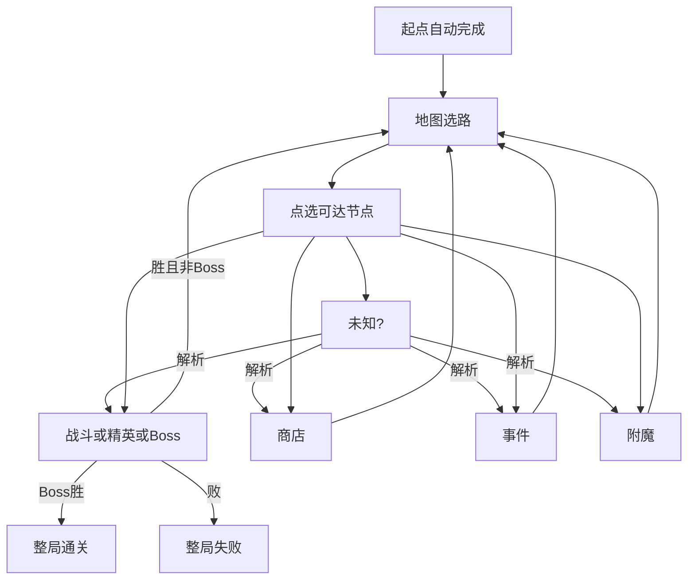

# 地图与节点

> 功能规格 · 只谈地图结构与节点作用，不写具体数值 · 2026-10-19  
> 相关文档：[游戏基础循环](./GAME_LOOP.md) · [战斗](./COMBAT.md) · [战斗关卡](./COMBATLEVEL.md) · [游戏愿景](../GAME_VISION.md) · [角色单位](./UNITS.md) · [角色技能](./UNIT_ABILITIES.md) · [架构](../ARCHITECTURE.md)  
> **本版不写**：层数/概率/金币/治疗量等具体数字；遭遇内战斗细则；商店定价与品阶表；事件文案花名册；换皮叙事。  
> **宏观参照**：杀戮尖塔式幕地图选路；节点内战斗仍是本作自走棋，不照搬对方卡牌战斗。

## 1. 这是什么

**地图**是爬塔主模式里「选下一条路」的那一层：一张幕地图由多层节点连通而成；玩家只走当前可达节点，进入后处理该节点内容，再回到地图（Boss 胜利则整局通关）。

| 本篇负责 | [游戏基础循环](./GAME_LOOP.md) 负责 |
|----------|-------------------------------------|
| 地图长什么样、点哪能走 | 何时开局 / 通关 / 失败重置 |
| 每种节点里玩家做什么 | 何时进节点、何时回地图 |
| 节点种类清单（第一版定稿） | 节点内战斗三步（准备→战斗→结算）的生命周期 |

第一版地图节点保留下列种类，并含附魔与未知：

起点 · 战斗 · 精英 · Boss · 商店 · 事件 · **附魔** · **未知（?）**

**不进入第一版地图规格**（即便代码里仍可能有占位）：休息、宝箱、献祭。

> **【愿景已有】** 战斗 / 精英 / Boss 完整遭遇；商店、事件、附魔进入后可先占位说明 +「继续」。  
> **【用户新共识】** 地图生成对齐尖塔：先画不交叉上行路径，再按权重桶填类型 + 邻接/兄弟约束；产出含未知（?）；不做休息/宝箱节点。

---

## 2. 写什么、不写什么

### 2.1 本文要说清的

- 幕地图的结构：层、连通、可达、类型可见性
- 第一版节点种类总表与逐类作用
- 附魔节点：双献祭熔合 **熔印者**（细则见 [附魔](./ENCHANT.md)）
- 未知（?）节点：进房时解析为已有类型
- 与杀戮尖塔房间的宏观映射与生成意图
- 现状：功能已存在 / 部分存在 / 仅愿景 / 待从规格中收敛的旧类型

### 2.2 本版不写或以后再说

| 内容 | 状态 |
|------|------|
| 休息 / 宝箱 / 献祭 | **第一版不做**（见第 10 节） |
| 多幕、局外成长、存档 | 第一版不做 |
| 商店买什么、刷新、满库 | 见愿景 / 架构摘要与实现（旧商店规格已删除） |
| 遭遇内布阵与自动战斗 | 见战斗 / 战斗关卡 |
| 事件正文与选项内容库 | 内容切片；本篇只定「事件节点是什么」 |
| 熔合攻血系数、敌预算对熔印者加权 | 数值；流程见 [附魔](./ENCHANT.md) |
| 羁绊、PvP | 第一版不做 |

### 2.3 和别的文档怎么分

| 本篇（地图） | 相邻文档 |
|--------------|----------|
| 何时出现商店节点、节点里结束回地图 | **商店**：购买、刷新、品阶 |
| 战斗 / 精英 / Boss 进入后是一场遭遇 | **战斗**：三步流程；**战斗关卡**：进场后战场半场规格 |
| 附魔节点产出熔印者 | **[附魔](./ENCHANT.md)**；**角色技能**：缝合与单 spec |
| 事件可改金、血、队伍等 | **循环**持久状态；具体选项内容另库 |

---

## 3. 术语

| 说法 | 意思 |
|------|------|
| **幕** | 一张爬塔地图 + 本幕 Boss；第一版只有一幕 |
| **层** | 地图上的纵向进度带：起点层 → 中间层 → Boss 层 |
| **节点** | 地图上的一格选择及其类型 |
| **可达** | 当前已完成节点的出边上、尚未完成的节点，玩家可以点选 |
| **遭遇** | 进入战斗类节点后的一场自走棋战斗 |
| **附魔** | 地图节点：双献祭熔合 **熔印者**（见 [附魔](./ENCHANT.md)） |
| **未知（?）** | 地图上显示为 ?；进入时解析为战斗 / 事件 / 商店 / 附魔之一 |

---

## 4. 地图结构

```text
一整局 → 一幕（第一版）→ 一张地图
  → 层：起点层 → 中间若干层 → Boss 层
  → 每层若干节点（列位可不同；≤ 列数）
  → 边：由下层连向上层（不交叉）
  → 玩家只走「当前已完成节点」的出边（不可回退、不可跳层）
```

| 概念 | 功能含义 | 第一版约定 |
|------|----------|------------|
| 幕 | 一张地图 + Boss | 只有一幕；通关 = 击败 Boss |
| 连通 | 出边决定下一步候选 | 只能点当前可达节点 |
| 类型可见性 | 未进入前能否看见种类 | **显示真实种类**（未知显示为 ?，进房再解析） |
| 生成意图 | **【用户新共识】** 尖塔式：先画 **4～5** 条不交叉上行路径（共享格合并），起点连 floor1、顶层连唯一 Boss；路网建完后做**拓扑剪枝**（见规则 1b）；再按权重桶填类型并施加邻接/兄弟约束 | 权重与下限见实现配置；规格要求生成结果**只使用本篇节点表**（无休息/宝箱/献祭） |

### 生成规则摘要（【用户新共识】）

1. **路网**：在 `column_count × floor_count` 逻辑格上画多条上行路径（配置 `path_count`；**未配置时随机 4～5 条**，旧默认约 6 条已收敛）；每步列距 ≤1；边不交叉；共享格合并。  
1b. **拓扑剪枝（【用户新共识 · 2026-10-28】）**：填类型**之前**；同父节点的两个子节点若在 **2 层**前向可达节点集合相同，视为无信息分叉，删掉较偏列的一支并移除不可达格；**不做**分叉异型 / 下游类型签名约束（占位期仍可能「类型不同、体验相近」）。  
2. **固定**：floor1（起点上一层）全部战斗；无宝藏层、无营地层。  
3. **权重桶**（未定型连通节点）：未知 / 精英 / 商店 / 事件 / 附魔按权重领取（实现默认约 **10% / 8% / 5% / 4% / 8%**），**其余为战斗**；洗牌后按格领取。  
4. **约束**：精英不低于 `elite_min_floor`；商店尊重 `shop_min_floor`；**附魔不低于 `enchant_min_floor`（路径中后期，默认可自动推算）**；与已连接父节点、同父兄弟之间，精英/商店/附魔不可相同；领不到则跳过，剩余填战斗。未知（?）在过早层解析时**不出**附魔。  
5. **不做**「每条路必有精英/店/事件」的路径保底（尖塔亦不如此）。

### 进出总规则

1. 开局生成地图；起点自动完成；进入地图选路。  
2. 点选可达节点 → 进入 → 处理节点内容。  
3. 未知：进入时解析为战斗 / 事件 / 商店 / 附魔，再按解析结果处理。  
4. 非战斗节点：交互结束 → 标记完成 → 回地图。  
5. 战斗 / 精英：胜 → 招募 → 完成回地图；Boss 胜 / 任一败 → 战斗结算「继续」→ 结局宣告 → 远征统计 →「继续」→ 再来一局或回主菜单（败时重置见循环文档）。  
6. Boss 胜 → 整局通关（不再回选路；先经结局宣告与远征统计）。  
7. 战斗胜利后**不**强制进商店。



---

## 5. 节点种类总表（第一版定稿）

| 节点 | 目的 | 玩家操作 | 离开 | 奖励 / 风险（功能） |
|------|------|----------|------|---------------------|
| **起点** | 路线起点 | 无实质交互 | 开局自动完成 | 无 |
| **战斗** | 常规遭遇 | 准备站位→观战→结算→（胜）招募 | 胜→招募后回地图 / 败整局失败 | 进度与经济；损血等风险 |
| **精英** | 更高威胁遭遇 | 同战斗 | 同战斗 | 相对常规更高收益预期（数值另定） |
| **Boss** | 本幕终点 | 准备站位→观战→结算 | 胜→**直接通关**（不进招募）/ 败整局失败 | 通关 |
| **商店** | 地图上完整养队 | 本版：看占位说明 → 点「继续」 | 结束购买回地图 | 升级 / 增益 / 扩席等 |
| **事件** | 短选项博弈 | 本版：看占位说明 → 点「继续」 | 选完回地图 | 收益或代价（金/治疗/队伍等） |
| **附魔** | 双献祭熔合 | 本版：看占位说明 → 点「继续」 | 融合或跳过回地图 | 产出 **熔印者**（见 [附魔](./ENCHANT.md)） |
| **未知（?）** | 路线不确定感 | 进房解析后再进入对应内容 | 同解析结果 | 同解析类型 |

---

## 6. 逐节点说明

### 6.1 起点

- **作用**：固定开局位置；出边给出第一批可选节点。  
- **验收**：开局后地图可见；起点已完成；首批可选为其出边。  
- **现状**：功能已存在。

### 6.2 战斗 / 精英 / Boss

- **作用**：一场自走棋遭遇。威胁梯队（体验语言）：战斗 < 精英 < Boss。  
- **战场**：进场后的竖屏半场、双方角色座位见 [战斗关卡](./COMBATLEVEL.md)（To-Be 参考 9×16，我下敌上硬半场；As-Is 仍为 18×32 自由投放）。  
- **玩家**：准备站位 → 开始战斗 → 观战 → 看结算（流程见 [战斗](./COMBAT.md)）；普通 / 精英胜后再进**招募**（见 [招募](./RECRUIT.md)）。  
- **进出**：普通 / 精英胜 → 招募 → 完成节点回地图；Boss 胜 → **直接通关**（不进招募）；败 → 整局失败。  
- **Boss 胜负**：斩首制（首领死亡即胜、其余敌方溃散）；机制见 [Boss](./BOSS.md)。普通 / 精英仍清波。  
- **验收**：三类都能进入棋盘；普通 / 精英胜后出现招募再回地图；Boss 胜通关；败出结束。  
- **现状**：战斗链路功能已存在；**招募未实现**（文档 To-Be）；Boss 机制规格已定、**实现未对齐**。  
- **非目标**：玩家拖动或指挥已上场单位；把 Boss 做成解谜机制关。（单位自己实时移动，不算微操。）

### 6.3 商店

- **作用**：主模式养队窗口；与胜后招募短名单分工见 [招募](./RECRUIT.md)。  
- **玩家**：购买、刷新、结束离开；细则见 [地图商店](./MAP_SHOP.md)。  
- **验收**：能买能走；普通 / 精英胜后进的是招募而非本商店节点。  
- **本版**：按 [地图商店](./MAP_SHOP.md) 可玩（消耗品＋装备＋半场换座；本切片不含买人）。买角色 / 升级 / 增益等完整货架另案。

### 6.4 事件

- **作用**：用少量选项制造收益、代价或离开。  
- **玩家**：读标题/正文 → 点一个选项。  
- **效果大类（功能，不定数值）**：得金 / 失金 / 治疗 / 改队伍 / 挂增益 / 无事离开等——以事件数据为准。  
- **验收**：有可读选项；选后状态变化可观察；回地图。  
- **本版**：占位节点（说明 + 继续）。完整功能以本节规则为目标，不在本切片验收。  
- **非目标**：实时小游戏、长剧情演出阻塞选路。

> 第一版**没有休息节点**。需要回复生命时，优先通过**事件选项**（或其它非地图系统）提供，不另开休息房。

### 6.5 附魔（【用户新共识】· 设计定稿）

- **作用**：在附魔节点用 **两名** 有主技能的队员熔合，产出一名 **熔印者**（runtime 数值与缝合主技能）；每节点 **至多成功融合 1 次**；可 **跳过**。  
- **和增益卡的区别**：增益挂在队员强化层；附魔 **销毁两名原料** 并生成 **新队员**（净 −1 席）。  
- **和旧「献祭」/ 旧附魔池的区别**：不做技能池三选一、不做单目标换技能；旧献祭 **不** 接入主循环。

完整流程、布局、缝合规则、熔印者星级与三合一边界见 **[附魔（熔炉）](./ENCHANT.md)**。

#### 现状

**本版**：占位节点（说明 + 继续）。节点类型与地图颜色已有；熔炉 UI 与融合服务 **未实装**。

### 6.6 未知 / ?（【用户新共识】· 做）

- **作用**：地图上显示为 `?`，制造路线不确定感。  
- **解析**：进入房间时解析为 **战斗 / 事件 / 商店 / 附魔** 之一（不含宝箱、休息、精英、Boss）。  
- **进出**：按解析后的类型走对应节点流程，再回地图。  
- **验收**：地图上能出现 `?`；点进后变为上述已有类型之一并完成对应占位或遭遇。  
- **现状**：生成器产出 `MYSTERY`；`RunController` 进房调用 `finalize_mystery_node`；地图视图已有颜色。

---

## 7. 与杀戮尖塔房间的映射

| 杀戮尖塔（宏观） | 本作第一版 |
|------------------|------------|
| 普通敌人 | 战斗 → 自走棋一场 |
| 精英 | 精英 → 同流程、更高威胁池 |
| Boss | Boss → 胜则通关 |
| 商店 | 地图商店节点 |
| 事件 | 事件节点 |
| 营地休息 | **不做**（治疗等改由事件等提供） |
| 未知 / ? | **做**（进房解析为战斗/事件/商店/附魔） |
| 宝箱 | **不做**（奖励改由商店/事件/附魔等承担） |
| （无直接对应） | **附魔**（双献祭熔印者） |
| 战后选牌 | 不挂在战斗胜利强制链上；构筑在商店/事件/附魔 |

---

## 8. 玩家主路径验收（L0）

1. 开局见到地图；起点已完成；能点可达节点。  
2. 未到达节点能看出种类（战斗/精英/商店/事件/附魔/未知?/Boss）。  
3. 战斗/精英：能打完，胜后进招募再回地图；败则整局失败。Boss 胜直接通关。  
4. Boss：胜则通关。  
5. 商店、事件、附魔：进入后看到占位说明，点「继续」回地图，该节点标记完成。  
6. 未知（?）：进入后解析为战斗/事件/商店/附魔之一，再按该类型处理。  
7. 地图上只出现本篇节点表中的种类：起点、战斗、精英、Boss、商店、事件、附魔、未知（?）；不出现休息/宝箱/献祭。

---

## 9. 边界与旧节点

第一版地图节点：起点、战斗、精英、Boss、商店、事件、附魔、未知（?）。休息 / 宝箱 / 献祭**不做**（代码若仍有枚举，视为待收敛占位，不进主循环验收）。附魔为双献祭熔合 **熔印者**（可跳过）。治疗由事件等提供，不靠休息节点。

---

## 10. 现状对照

| 能力 | 标注 | 说明 |
|------|------|------|
| 地图生成、选路、可达 | 功能已存在 | `map_generator.gd` / `map_state.gd` 等；**【用户新共识】** 尖塔式路径 + 权重 + 约束 |
| 战斗 / 精英 / Boss | 功能已存在 | 进入 2D 实时战斗关卡（`scenes/combat/realtime/`） |
| 商店 / 事件 / 附魔 | **本版占位** | `scenes/ui/placeholder/`；旧商店与事件界面不接入 Run 主路径 |
| 未知（?） | 生成 + 进房解析已接 | `MYSTERY` → `finalize_mystery_node`；解析池无宝箱 |
| 附魔规则 | **规格已定 · 未实装** | 见 [附魔](./ENCHANT.md)；占位进房 |
| 休息 / 宝箱 / 献祭 | 生成器不产出 | 枚举与旧界面文件仍在，不进主循环 |
| 生成只产出本篇节点表 | 功能已存在 | `map_generator_test` 覆盖 |

---

## 11. 已拍板默认

| 项 | 定稿 |
|----|------|
| 第一版节点清单 | 起点、战斗、精英、Boss、商店、事件、附魔、未知（?） |
| 附魔 | 双献祭 → 熔印者；每节点 1 次；可跳过（见 [附魔](./ENCHANT.md)） |
| 未知解析池 | 战斗、事件、商店、附魔 |
| 前方节点种类 | 显示真实种类（未知显示为 ?） |
| 休息 / 宝箱 | **不做** |

---

## 12. 开放问题（实现前可再拍）

| 问题 | 建议默认（未另通知则按此） |
|------|----------------------------|
| 事件是否必须总有「离开」？ | 建议至少部分事件带无事离开；不强制每个事件都能白嫖 |

---

## 附录：线性开发关

线性多波 + 波后商店是工具环，**不是**本篇地图。见 [游戏基础循环](./GAME_LOOP.md) 附录。
