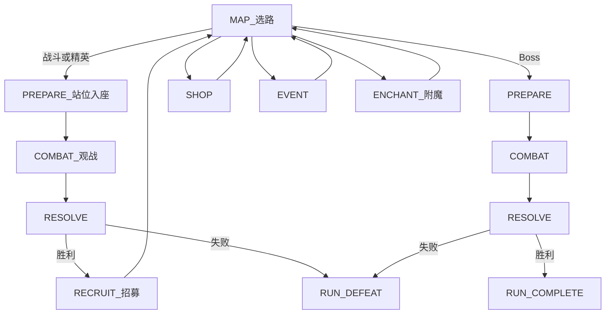

# 游戏愿景 — 中世纪幻想 2D 自走棋（PvE）

> 设计愿景与规则定稿入口。**胜负 / 乐趣支柱 / 主循环 / 敌情节奏 / 主题** 以本文为准。  
> **玩家拥有物与准备布阵**（队伍 / 队伍席位上限 / 角色座位 / 全体上场）以 [Features/PLAYER.md](./Features/PLAYER.md) 为准；**胜后招募**以 [Features/RECRUIT.md](./Features/RECRUIT.md) 为准。  
>
> **【设定定稿 / 表现待迁移】** 主题为中世纪幻想；`resources/units` 与 roster 中的动物名/占位图为 As-Is，换皮另开切片。  
>
> **【循环 To-Be】** 有准备阶段：商店 / 招募养成的**队伍**与**友方持久占位**在席位上限内**全体上场**；准备载入占位并可换座写回（座位网格固定 2×5，**席位上限本版固定 5**）；点开战后天**完全观战**，不能改阵。普通 / 精英**胜利**后进入**招募**（短名单拿人 / 换人 / **出售腾位**，上区即战斗占位），再回地图；**Boss 胜直接通关**（不进招募）。队伍内**同角色同星满三自动三合一**。无号令；无遭遇内抽牌 / 手牌 / 准备刷新手牌。席位扩展途径另案。细则见 [Features/PLAYER.md](./Features/PLAYER.md)、[Features/RECRUIT.md](./Features/RECRUIT.md)。  
> **【循环 As-Is】** 主路径仍为无准备、战中抽打弃 + 号令，且仍以牌库/手牌为中介；无招募阶段；**文档 To-Be ≠ 已实现**。  
>
> **【战场 To-Be】** 双方各有可见**角色座位**（默认 2 行 × 5 列）；友方入座人数 = 当前队伍成员数（≤ 队伍席位上限）；敌方占座与人数由关卡配置。开战后为**回合制自动战**：敌我**混排**进一条固定行动队列，每回合按同序**依次**行动；每一动尽量在同一段内完成「八向靠近 + 能打则出手」（一动内**落格顿步**、**一格一体**），可越半场。竖屏、我下敌上见 [Features/COMBATLEVEL.md](./Features/COMBATLEVEL.md)；推进细则见 [Features/COMBAT.md](./Features/COMBAT.md)。  
> **【战场 As-Is】** Run 主路径**战斗时钟已落地为回合制依次行动**（敌我混排队列；一动内八向格步）；座位几何部分已落地。准备/招募等循环仍可能未对齐文档 To-Be。  
>
> **【本版范围】** 地图只实装战斗 / 精英 / Boss；商店、事件、附魔为占位节点，主路径暂无构筑入口。角色为 Content 十人基础兵种；流派联动以资源挂载为准。

## 一句话

玩家在竖屏战场上构筑中世纪阵容：商店与胜后**招募**养成**队伍**，进遭遇后在**准备阶段**把队员放入**角色座位**（全体上场），开战后天**回合制自动战斗**（单位依次行动、玩家只观战）。清光本遭遇全部敌人则胜，己方全灭则败。

## 电梯稿

本作是 **关卡制 / 爬塔 PvE**：地图节点上 **商店完整养队**，战斗节点内 **准备站位 → 开战观战**，普通 / 精英胜后 **招募短名单换人** 再回地图；单位靠内建技能自动联动。主流派（坚韧、冲锋）应一眼可认；跨技能涌现是加分，不作主门槛。美术与叙事为中世纪幻想（骑士、佣兵、据点与魔物），剪影可读优先。

**构筑深度** = 单位内建联动 + 槽位站位 + 增益卡。v1 **不做**种族/职业羁绊。

### 胜负规则【设计定稿】

| 结果 | 条件 |
|------|------|
| **胜（遭遇）** | 清光本遭遇 **全部敌方单位** |
| **败（遭遇）** | **己方单位全部阵亡**（含生成的代理角色；细则见战斗 / 玩家篇） |
| **Run 通关** | 击败 Act Boss（及关卡完成条件） |
| **Run 失败** | 任一战斗遭遇失败 → **整局重置** |

---

## 核心体验支柱

1. **养队（含占位）→ 准备微调站位 → 观战 →（胜后）招募**【设计定稿方向 · 细则见玩家篇 / 招募篇】  
   地图商店做完整养成；普通 / 精英胜后招募做短名单拿人 / 换人 / 出售（上区即战斗占位）；进遭遇后载入持久占位并可换座；开战后天只观战。主乐趣是队伍取舍、养成与站位，不是抽牌或战中微操。

2. **空间与敌压**【设计定稿】  
   战场竖屏窄深、我下敌上、中线硬半场：双方在各自半场的**角色座位**上开战落点；开战后天按**固定混排行动队列**依次行动，每一动内八向靠近目标并可出手（一动内落格顿步、一格一体，可越线；非钉座对撞）。友方准备只入我半场空座位（席位内全体上场）；敌方按关卡占敌半场座位一次出齐。压力来自阵型、行动先后与越线。Boss：超高单体威胁。细则见 [Features/COMBATLEVEL.md](./Features/COMBATLEVEL.md)、[Features/COMBAT.md](./Features/COMBAT.md)。

3. **中世纪幻想主题**【设定定稿】  
   兵种/魔物剪影可读；特效服务技能因果（观战以**当前行动者**串行演出为主，见 [Features/COMBAT_FEEDBACK.md](./Features/COMBAT_FEEDBACK.md)）。表现迁移待实现。

**深度公式**：联动技能 + 槽位站位 + 增益卡。  
队伍与准备见 [Features/PLAYER.md](./Features/PLAYER.md)；胜后招募见 [Features/RECRUIT.md](./Features/RECRUIT.md)；增益见 [BUFF_SYSTEM.md](./BUFF_SYSTEM.md)；实现摘要见 [ARCHITECTURE.md](./ARCHITECTURE.md)。

---

## 主循环骨架【设计定稿方向】

玩家侧拥有物与准备节奏以 [Features/PLAYER.md](./Features/PLAYER.md) 为准。摘要：

| 层 | 含义 |
|----|------|
| **队伍** | 一整局拥有的友方角色；成员数 ≤ 当前队伍席位上限；商店买/替/升级/挂增益；同角色同星满 3 自动三合一 |
| **队伍席位上限** | 当前最多拥有且全部上场的人数；**本版固定 5**；扩展途径另案 |
| **角色座位** | 半场上可见的站位座位（默认 2×5，**固定**）；几何见战斗关卡 |
| **友方持久占位** | 成员占用哪个友方座位的整局状态；招募上区与战斗准备共用；准备换座写回 |

- **有**准备阶段；开战后天**不能**改阵。  
- **无**号令（战令）及号令费用；**无**遭遇内抽牌 / 手牌 / 弃牌 / 准备刷新手牌；**无**备战席勾选。  
- **座位网格固定 2×5**；席位上限本版 5；空座位是站位选择，不要求填满全部座位。  
- 席位内队伍成员**全体上场**；准备载入持久占位并可换座写回。  
- **有**队伍侧自动三合一（同角色同星满 3 → 星 +1、攻血加总；最高 3 星）；细则见玩家篇。  
- 上场单位 **自动战斗**；玩家 **不可** 移动已上场单位，不可点技能。

### 单局战斗时长【设计定稿】

**常规遭遇约 1–3 分钟**；精英/Boss 可略长，仍靠威胁收束而非拖血。  
控时长旋钮：队伍席位上限、敌方占座配置、Boss 血线；以及**单动演出预算可压短**与**观战加速**（依次行动下加速为正式能力，见战斗 / 观战反馈）。具体秒数可配置，不在愿景定死。

---

## 流派与联动技能

玩家通过选角、入座站位，让「事件 → 效果」链在战斗中兑现。样板流派：**坚韧**、**冲锋**。

| 层级 | 数据 | 典型效果 |
|------|------|----------|
| **单位联动技能** | `AbilityData`（`EffectSpec`） | 受伤时自身 +X 攻击 |
| **增益卡** | `BuffCardData`（挂队伍成员） | 永久 +1 攻/血、死亡掉金等 |

主技能槽 `ability` 本版允许为空（基础单兵为纯属性单位）；可选 `passives`。目标可选 `self` / `adjacent_allies` / `all_allies` / `allies_with_tag`（技能筛选，非羁绊计数）。

波末清空战斗临时增益；Run 持久增益随队伍成员保留。

**公式**：联动技能组合 + 槽位站位（承伤/相邻）+ 增益卡。

---

## 核心对局循环

### 爬塔 Run（主模式）

主菜单 [`run_game.tscn`](../scenes/main/run_game.tscn)：Act 地图选路。第一版节点：起点 / 战斗 / 精英 / 商店 / 事件 / **附魔** / Boss。节点内 **准备站位 → 开战观战 → 结算**；普通 / 精英胜 → **招募** → 回地图；**Boss 胜 → 通关**；败整局重置。地图商店做完整养成；招募做胜后短名单。生命周期见 [Features/GAME_LOOP.md](./Features/GAME_LOOP.md)；节点细则见 [Features/MAP.md](./Features/MAP.md)；招募见 [Features/RECRUIT.md](./Features/RECRUIT.md)；队伍与准备见 [Features/PLAYER.md](./Features/PLAYER.md)。



数据：`RunMapConfig` + `MapGenerator` → `MapState`；单次战斗 `EncounterData.wave`。见 [ARCHITECTURE.md](./ARCHITECTURE.md) §3.1。

### 线性波次（开发用）

[`main.tscn`](../scenes/main/main.tscn) + [`dev_6x6.tres`](../resources/levels/dev_6x6.tres) 15 波；遭遇池在 [`resources/encounters/`](../resources/encounters/)。


### 阶段职责（To-Be）

| 步骤 | 阶段 | 玩家行为 | 系统行为 |
|------|------|----------|----------|
| 1 | 进入波次 / 遭遇 | 查看棋盘、金币、队伍 | 加载遭遇；带入当前队伍 |
| 2 | 准备 | 载入持久占位；换座写回；点开战 | 校验座位；无手牌刷新；不推进战斗 |
| 3 | 战斗 | 观战（可加速）；不能改阵 | 敌方按已配置座位出齐；回合制依次自动战斗；击杀掉金 |
| 4 | 结算 | 查看结果 | 波次金；敌全灭胜 / 己全灭败。线性关可重开；Run 失败整局重置 |
| 5 | 招募（仅普通 / 精英胜） | 花金招人/替换；出售腾位；刷新；重置；跳过或完成 | 改队伍与金币；可触发三合一；见招募篇 / 玩家篇。Boss 胜跳过本步直接通关 |
| 6 | 商店（线性关波间 / Run 地图节点） | 买角色/增益；换人等 | 扣费、改队伍；席位扩展另案；细则见商店 |
| 7 | 下一波 / 回地图 | — | `wave_index++`、回地图或关卡完成 |

**【As-Is】** 实时主路径仍可能跳过准备、战中出牌；无招募阶段。

### 经济（v1）

| 时机 | 来源 |
|------|------|
| 战斗内 | 击杀掉金 |
| 波次结算 | `WaveData.wave_gold_reward`（或默认波次金） |
| 商店出售 | 按队伍成员星级 / 等级退金（细则见商店） |
| 招募出售 | 正常退金腾位（细则见招募篇；点数见数值） |

```
LEVEL_LOAD → PREPARE → COMBAT → RESOLVE → … → LEVEL_COMPLETE
                              ↘ DEFEAT → 重开或 RUN_DEFEAT
```

---

## 关卡与棋盘

- Run 主路径战场：竖屏、我下敌上、中线对半；没有河、桥、塔。见 [Features/COMBATLEVEL.md](./Features/COMBATLEVEL.md)。  
- **【To-Be】** 双方各有可见**角色座位**（默认 2×5，固定）；友方席位内全体入座；敌方占座由关卡配置、开战一次出齐。开战后在 **9×16** 逻辑格网上走**回合制依次行动**（敌我混排固定序）；每一动内八向寻路、落格顿步、一格一体，可越线交战。  
- 旧线性开发关 [`dev_6x6.tres`](../resources/levels/dev_6x6.tres)（8×8）与沙盒仍是旧网格工具环（象棋式走法身份等；**非**本篇主路径规格）。

### 敌情节奏【设计定稿】

| 类型 | 体验 | 压力 |
|------|------|------|
| 小怪 | 清杂 + 验证队伍/站位 | 敌方占座阵型与越线压迫 |
| Boss / 精英 | 攻坚 | 超高单体威胁 |

胜负只看敌方是否清空 / 己方是否全灭。

---

## 术语表

玩家侧完整术语见 [Features/PLAYER.md](./Features/PLAYER.md)。此处仅列愿景摘要：

| 术语 | 含义 |
|------|------|
| 波次 / 遭遇 | 准备 + 战斗 + 结算的一完整周期 |
| **队伍** | 一整局拥有的友方角色集合（成员数 ≤ 席位上限） |
| **队伍席位上限** | 当前最多拥有且全部上场的人数；本版固定 5 |
| **角色座位**（角色槽） | 半场可见站位座位；默认双方各 2×5，固定；空座可选 |
| **友方持久占位** | 成员 ↔ 友方座位的整局映射；招募与准备共用 |
| **队伍成员** | 队伍中的一名角色（含星级 / 增益 / 占位）；同角色同星满 3 自动三合一（见玩家篇） |
| 空座位 | 尚未放入角色的角色座位 |
| 前排 / 后排座位 | 相对中线更近 / 更靠己方底的座位行；**仅开战落点差**，技能与索敌不认前后排标签 |
| 我半场 / 敌半场 | 画面下方 / 上方半区；投放与出兵分区见 [战斗关卡](./Features/COMBATLEVEL.md) |
| 硬半场（投放） | 准备入座只许在己方半场座位；开战后天可越半场交战 |
| Tier | 商店强度档 1–6 |
| 联动技能 | Trigger + 目标 + Effect |
| 流派 | 以触发链与站位为核心的构筑方向 |
| 清波制 | 敌全灭胜 / 己全灭败 |
| 行动队列 | 开战排一次的敌我混排固定序；每回合同序依次行动（见战斗篇） |
| 一动 | 轮到某单位时尽量「靠近并出手」演完的一段自动行动 |

---

## 游戏模式

- **Roguelike Run**：[`run_game.tscn`](../scenes/main/run_game.tscn)
- **沙盒**：[`sandbox.tscn`](../scenes/main/sandbox.tscn)
- **线性波次（开发）**：[`main.tscn`](../scenes/main/main.tscn)

---

## 里程碑

| 阶段 | 目标 | 状态 |
|------|------|------|
| M1 | 可变棋盘 + 布阵 + 占格 | 已实现 |
| M2a–c | 刷怪、战斗框架、多波循环 | 已实现 |
| M3b | 牌库 + 角色/增益商店 + Tier | 已实现（**文档 To-Be 已改为队伍**；实现待回摆） |
| M4a | 本波抽牌 + 旧战中补人 / 号令出牌 | 已实现（**待回摆**至准备站位观战） |
| M3.5 | EffectResolver + 样本技能 | 已实现 |
| M4 | 增益商店完善、更多技能、关卡 UI；半场 | 部分先行 |
| M5 | 多遭遇节奏、tooltip、平衡、美术音效 | — |
| — | 玩家篇：持久占位 / 席位上限 5 / 准备换座写回 / 开战观战 | 文档 To-Be（实现未对齐） |
| — | 招募：短名单 + 出售 + 上区即战斗占位 | 文档 To-Be（占位持久未对齐） |
| — | 队伍自动三合一（同角色同星满 3） | 文档 To-Be（代码有初版；占位规则待对齐） |

技术拆解见 [ARCHITECTURE.md](./ARCHITECTURE.md)。

---

## 未决问题

仅列与当前循环直接相关、实现前需拍板的项：

- 商店：满员换人交互、出售与增益挂载细则（见商店文档；玩家篇不写）
- 席位扩展途径（本版固定 5；另案）
- 开局队伍人数与默认占位（数值填空）
- 招募：单价、刷新费、出售退金点数、品阶×进度权重表（数值填空；见招募篇）
- 三合一：攻血加总后的手感调参（功能规则见玩家篇）

---

相关文档：[ARCHITECTURE.md](./ARCHITECTURE.md) · [BUFF_SYSTEM.md](./BUFF_SYSTEM.md) · [Features/PLAYER.md](./Features/PLAYER.md) · [Features/RECRUIT.md](./Features/RECRUIT.md) · [Features/COMBATLEVEL.md](./Features/COMBATLEVEL.md) · [Features/GAME_LOOP.md](./Features/GAME_LOOP.md) · [Features/COMBAT.md](./Features/COMBAT.md) · [INDEX.md](./INDEX.md)
