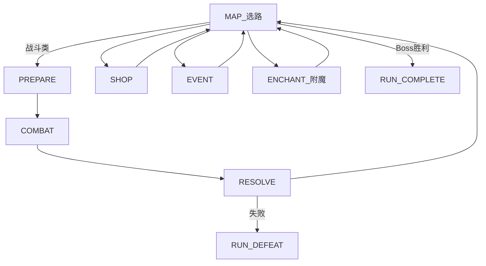
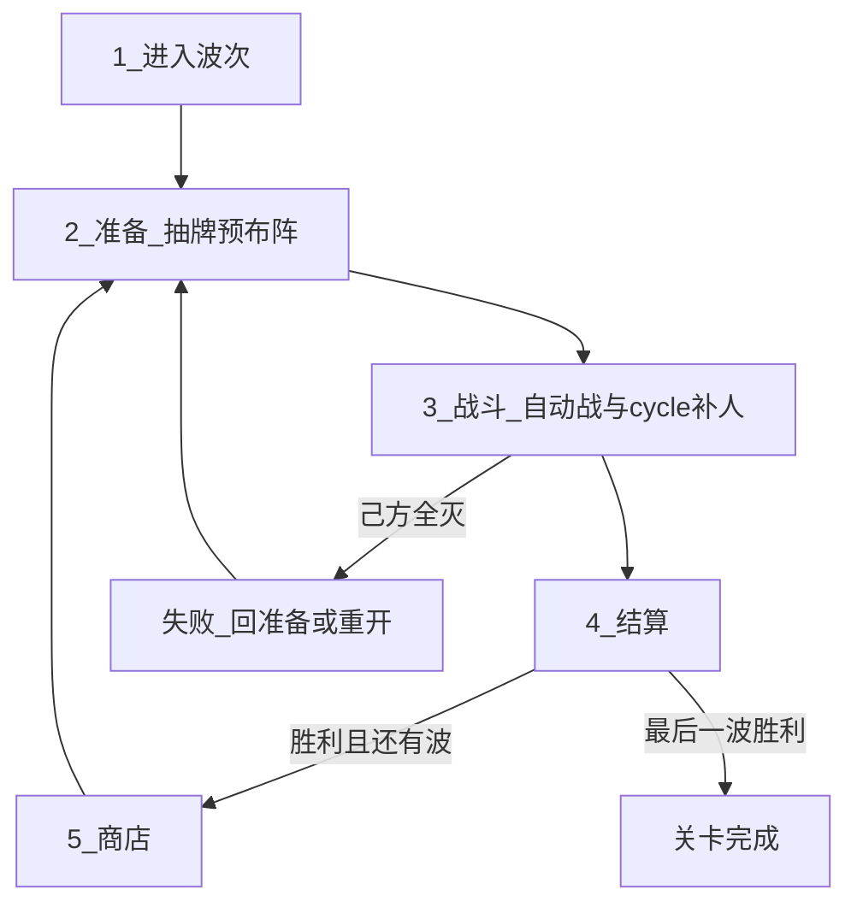

# 游戏愿景 — 中世纪幻想 2D 自走棋（PvE）

> 设计愿景与规则定稿入口。**胜负 / 乐趣支柱 / 主循环 / 敌情节奏 / 主题** 以本文为准。
>
> **【设定定稿 / 表现待迁移】** 主题为中世纪幻想；`resources/units` 与 roster 中的动物名/占位图为 As-Is，换皮另开切片。
>
> **【循环 As-Is】** 本波抽牌 + 战斗 cycle 补人（无冷却队列）已实装；冷却队列 / 可见窗 4 仍为 To-Be。
>
> **【战场 As-Is】** Run 主路径为 2D 俯视竖屏 18×32、我下敌上、硬半场投放；开战后单位在连续坐标上实时移动与攻击（皇室战争式，无河/桥/塔），见 [Features/COMBATLEVEL.md](./Features/COMBATLEVEL.md)。
>
> **【本版范围】** 地图只实装战斗 / 精英 / Boss；商店、事件、附魔为占位节点，主路径暂无构筑入口。角色为皇室战争式基础单兵占位（无主技能），流派联动暂不可见。

## 一句话

玩家在 **竖屏 18×32 战场** 上构筑中世纪阵容：商店养成牌库，准备阶段预布阵，战斗中用 **cycle 手牌** 在人口上限内补人；上场单位自动实时作战，玩家不可拖动。清光本遭遇全部敌人则胜，己方全灭则败。

## 电梯稿

本作是 **关卡制 / 爬塔 PvE**：波次间 **商店构筑**，进战前 **预布阵**，战斗中 **有限即时补人**；单位靠内建技能自动联动。主流派（坚韧、冲锋）应一眼可认；跨技能涌现是加分，不作主门槛。美术与叙事为中世纪幻想（骑士、佣兵、据点与魔物），剪影可读优先。

**构筑深度** = 单位内建联动 + 站位 + 增益卡。v1 **不做**种族/职业羁绊。

### 胜负规则【设计定稿】

| 结果 | 条件 |
|------|------|
| **胜（遭遇）** | 清光本遭遇 **全部敌方单位** |
| **败（遭遇）** | **己方单位全部阵亡** |
| **Run 通关** | 击败 Act Boss（及关卡完成条件） |
| **Run 失败** | 任一战斗遭遇失败 → **整局重置** |

---

## 核心体验支柱

1. **构筑 → 预布阵 → 战斗补人**【设计定稿】  
   商店养成牌库；准备抽本波子集并预布阵；战斗中 cycle 补人。主乐趣仍是构筑质量与技能涌现；战中操作是节奏杠杆，不是微操主菜。

2. **空间与敌压**【设计定稿】  
   战场竖屏窄深、我下敌上、中线硬半场：敌从**敌半场**一次涌入，开战后天可越线交战；友方预布阵与 cycle 只落**我半场**。压力来自半场涌入与越线，而非全盘抢空闲格。Boss：超高单体威胁。细则见 [Features/COMBATLEVEL.md](./Features/COMBATLEVEL.md)。

3. **中世纪幻想主题**【设定定稿】  
   兵种/魔物剪影可读；特效服务技能因果。表现迁移待实现。

**深度公式**：联动技能 + 站位 + 增益卡。  
商店与牌库见 [SHOP_SYSTEM.md](./SHOP_SYSTEM.md)、[BUFF_SYSTEM.md](./BUFF_SYSTEM.md)。

---

## 主循环骨架【设计定稿】

### 两层牌

| 层 | 含义 |
|----|------|
| **构筑牌库** | Run 内拥有的角色条目；商店买/替/升级/挂增益 |
| **本波 cycle 手牌** | 准备阶段从牌库无放回抽得的子集；战斗中在该子集内滚动出牌 |

战斗中**不再**从构筑牌库新抽；波结束 cycle 解散，下一波重抽。

### 准备

- 抽本波子集（默认 **5**，可配置）。
- 可 **预布阵** 到**我半场**空格（占人口、占格；见战斗关卡）。
- 点「开始战斗」进入 COMBAT。

### 战斗

- 上场单位 **自动战斗**；玩家 **不可** 移动/换位已上场单位，不可点技能。
- 从 **cycle 手牌** 向**我半场**空格补人；受 **人口上限** 约束（默认 **5**，与 `max_board_units` 语义对齐）。
- 冷却队列 / 可见窗不在本版：死后同一张牌即可再打出，满生命上场。
- **死亡腾人口**，可即时再补（须有空格且人口未满）。
- 同一 `DeckEntry` 同时仅可一体在场；死后才可再从手牌打出。

### 借鉴（皇室战争）

借：**cycle 出牌** + **场上人口上限**。  
不另设圣水第二经济；胜负仍是清波，不是推塔。

### 单局战斗时长【设计定稿】

体感对齐皇室战争量级，**常规遭遇约 1–3 分钟**；精英/Boss 可略长，仍靠威胁收束而非拖血。  
控时长旋钮：人口、刷怪节奏、Boss 血线、cycle 节奏（具体数值可配置，实现期调）。

---

## 流派与联动技能

玩家通过选角、预布阵与补人时机，让「事件 → 效果」链在战斗中兑现。样板流派：**坚韧**、**冲锋**。

| 层级 | 数据 | 典型效果 |
|------|------|----------|
| **单位联动技能** | `AbilityData`（`EffectSpec`） | 受伤时自身 +X 攻击 |
| **增益卡** | `BuffCardData`（挂 `DeckEntry`） | 永久 +1 攻/血、死亡掉金等 |

主技能槽 `ability` 本版允许为空（基础单兵为纯属性单位）；可选 `passives`。目标可选 `self` / `adjacent_allies` / `all_allies` / `allies_with_tag`（技能筛选，非羁绊计数）。

波末清空战斗临时增益；Run 持久增益随 `DeckEntry` 保留。

**公式**：联动技能组合 + 站位（承伤/相邻）+ 增益卡。

---

## 核心对局循环

### 爬塔 Run（主模式）

主菜单 [`run_game.tscn`](../scenes/main/run_game.tscn)：Act 地图选路。第一版节点：起点 / 战斗 / 精英 / 商店 / 事件 / **附魔** / Boss。节点内 **准备 → 战斗 → 结算**；胜回地图；败整局重置。商店仅在地图商店节点。生命周期见 [Features/GAME_LOOP.md](./Features/GAME_LOOP.md)；节点细则见 [Features/MAP.md](./Features/MAP.md)。



数据：`RunMapConfig` + `MapGenerator` → `MapState`；单次战斗 `EncounterData.wave`。见 [ARCHITECTURE.md](./ARCHITECTURE.md) §3.1。

### 线性波次（开发用）

[`main.tscn`](../scenes/main/main.tscn) + [`dev_6x6.tres`](../resources/levels/dev_6x6.tres) 15 波；遭遇池在 [`resources/encounters/`](../resources/encounters/)。



### 六步职责

| 步骤 | 阶段 | 玩家行为 | 系统行为 |
|------|------|----------|----------|
| 1 | 进入波次 | 查看波次、棋盘、金币 | 加载本波 `WaveData` |
| 2 | 准备 | 抽本波子集；预布阵；开战 | `DrawService`；校验格与人口；禁止战斗 |
| 3 | 战斗 | cycle 补人；可加速观看 | 刷怪；自动战斗；击杀掉金；人口/手牌规则见上文 |
| 4 | 结算 | 查看结果 | 波次金；敌全灭胜 / 己全灭败。线性关可重开；Run 失败整局重置 |
| 5 | 商店 | 买角色/增益；刷新 | 扣费、Tier roll；满库替换 |
| 6 | 下一波 | — | `wave_index++` 或关卡完成 |

线性关节拍：`COMBAT → 商店 → PREPARE → COMBAT`（棋盘收起/浮入表现见实现）。Run 模式商店在地图节点，不经每波强制商店。

### 经济（v1）

| 时机 | 来源 |
|------|------|
| 战斗内 | 击杀掉金 |
| 波次结算 | `WaveData.wave_gold_reward`（或默认波次金） |
| 商店出售 | 按 `DeckEntry.level` 退金（见 SHOP_SYSTEM） |

```
LEVEL_LOAD → PREPARE → COMBAT → RESOLVE → … → LEVEL_COMPLETE
                              ↘ DEFEAT → 重开或 RUN_DEFEAT
```

---

## 关卡与棋盘

- Run 主路径战场：**18 列 × 32 行**逻辑格（只借皇室战争的比例），竖屏、我下敌上、中线对半；没有河、桥、塔。见 [Features/COMBATLEVEL.md](./Features/COMBATLEVEL.md)。  
- 格子只用于**投放吸附**：预布阵与 cycle 补人落我半场格子中心；敌人开战一次刷出在敌半场。开战后单位在连续坐标上实时移动、可越线交战。  
- 旧线性开发关 [`dev_6x6.tres`](../resources/levels/dev_6x6.tres)（8×8）与沙盒仍是回合制格子工具环。

### 敌情节奏【设计定稿】

| 类型 | 体验 | 压力 |
|------|------|------|
| 小怪 | 清杂 + 验证构筑/补人节奏 | 敌半场涌入数量与越线压迫 |
| Boss / 精英 | 攻坚 | 超高单体威胁 |

胜负只看敌方是否清空 / 己方是否全灭。

---

## 术语表

| 术语 | 含义 |
|------|------|
| 波次 | 准备 + 战斗 + 结算的一完整周期 |
| 构筑牌库 | Run 内角色条目集合 |
| 本波 cycle 手牌 | 本波从牌库抽得的可滚动子集 |
| 预布阵 | 开战前放置单位 |
| 人口 | 同时上场己方单位上限（默认 5） |
| 空闲格 | 未占用且规则允许投放/刷怪的格 |
| 我半场 / 敌半场 | 画面下方 / 上方半区（玩家在下、敌方在上）；投放与刷怪分区见 [战斗关卡](./Features/COMBATLEVEL.md) |
| 硬半场（投放） | 预布阵与 cycle 补人只许落己方半场；开战后天可越半场交战 |
| Tier | 商店强度档 1–6 |
| 牌库条目 | 角色 + 等级/经验 + 增益 |
| 联动技能 | Trigger + 目标 + Effect |
| 流派 | 以触发链与站位为核心的构筑方向 |
| 清波制 | 敌全灭胜 / 己全灭败 |

---

## 游戏模式

- **Roguelike Run**：[`run_game.tscn`](../scenes/main/run_game.tscn)
- **沙盒**：[`sandbox.tscn`](../scenes/main/sandbox.tscn)
- **线性波次（开发）**：[`main.tscn`](../scenes/main/main.tscn)

---

## 里程碑

| 阶段 | 目标 | 状态 |
|------|------|------|
| M1 | 可变棋盘 + 布阵 + 占格 | 已实现 |
| M2a–c | 刷怪、战斗框架、多波循环 | 已实现 |
| M3b | 牌库 + 角色/增益商店 + Tier | 已实现 |
| M4a | 本波抽牌 + 战斗 cycle 补人 | 已实现（冷却窗仍 To-Be） |
| M3.5 | EffectResolver + 样本技能 | 已实现 |
| M4 | 增益商店完善、更多技能、关卡 UI；冷却窗 / 半场 | 部分先行 |
| M5 | 多遭遇节奏、tooltip、平衡、美术音效 | — |

技术拆解见 [ARCHITECTURE.md](./ARCHITECTURE.md)。

---

## 未决问题

仅列与当前循环直接相关、实现前需拍板的项：

- **牌库小于抽牌数**：抽 `min(N, deck.size)`（推荐默认）
- **满库替换是否退款**；增益是否可单独卸载（见 SHOP / BUFF）
- 敌半场内刷怪采样（均匀 / 权重）与越线后寻路邻接细节（半场划分见战斗关卡）

---

相关文档：[ARCHITECTURE.md](./ARCHITECTURE.md) · [SHOP_SYSTEM.md](./SHOP_SYSTEM.md) · [BUFF_SYSTEM.md](./BUFF_SYSTEM.md) · [Features/COMBATLEVEL.md](./Features/COMBATLEVEL.md) · [Features/GAME_LOOP.md](./Features/GAME_LOOP.md) · [Features/COMBAT.md](./Features/COMBAT.md) · [INDEX.md](./INDEX.md)
