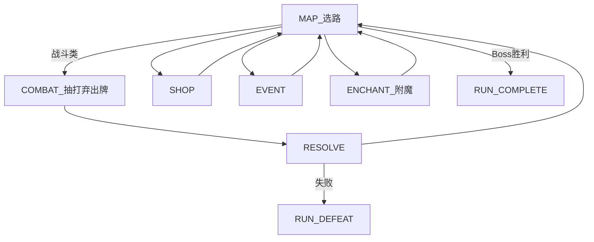
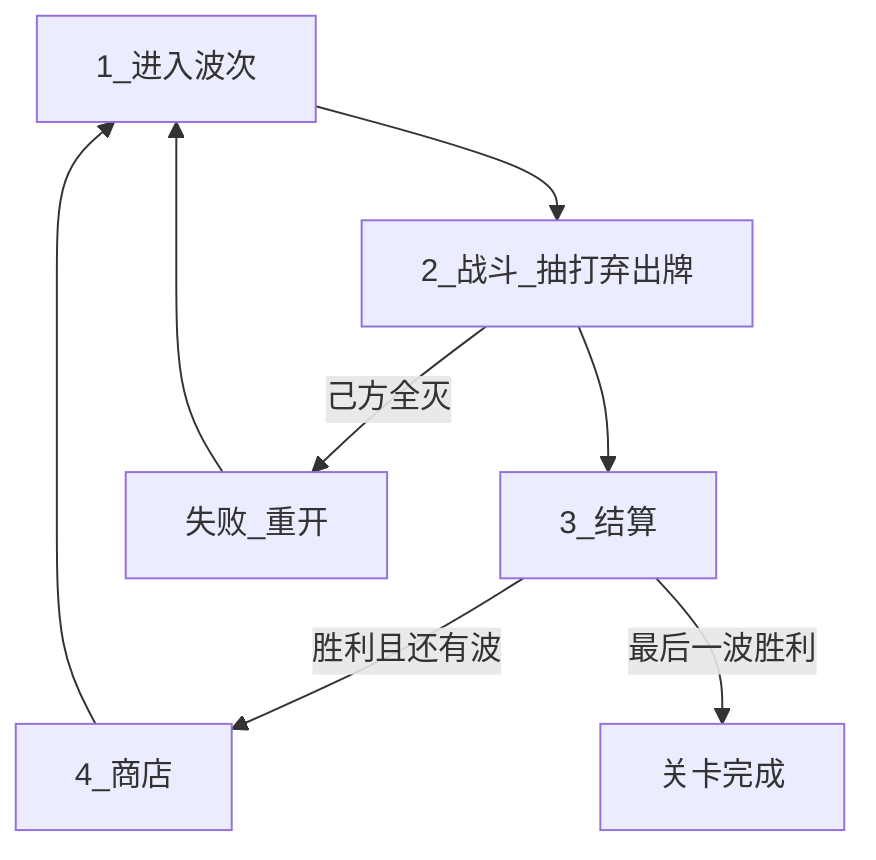

# 游戏愿景 — 中世纪幻想 2D 自走棋（PvE）

> 设计愿景与规则定稿入口。**胜负 / 乐趣支柱 / 主循环 / 敌情节奏 / 主题** 以本文为准。  
> **玩家拥有物与遭遇内牌流**（构筑库 / 手牌 / 弃牌堆、入手冷却、无人口）以 [Features/PLAYER.md](./Features/PLAYER.md) 为准。
>
> **【设定定稿 / 表现待迁移】** 主题为中世纪幻想；`resources/units` 与 roster 中的动物名/占位图为 As-Is，换皮另开切片。
>
> **【循环 To-Be】** 无准备预布阵、无人口硬顶、无部署时间；整份构筑库进入本场抽打弃循环；入手冷却；场上可多名同一角色。细则见 [Features/PLAYER.md](./Features/PLAYER.md)。  
> **【循环 As-Is】** 仍为准备预布阵 + 人口硬顶 + 一张牌一体 + 部署时间 + 本波抽子集 cycle；**文档 To-Be ≠ 已实现**。
>
> **【战场 As-Is】** Run 主路径为 2D 俯视竖屏 18×32、我下敌上、硬半场投放；开战后单位在连续坐标上实时移动与攻击（皇室战争式，无河/桥/塔），见 [Features/COMBATLEVEL.md](./Features/COMBATLEVEL.md)。
>
> **【本版范围】** 地图只实装战斗 / 精英 / Boss；商店、事件、附魔为占位节点，主路径暂无构筑入口。角色为 Content 十人基础兵种（无主技能），流派联动暂不可见。

## 一句话

玩家在 **竖屏 18×32 战场** 上构筑中世纪阵容：商店养成**构筑库**，战斗中从库轮转**手牌**出牌（入手冷却节拍、无人口硬顶）；上场单位自动实时作战，玩家不可拖动。清光本遭遇全部敌人则胜，己方全灭则败。

## 电梯稿

本作是 **关卡制 / 爬塔 PvE**：波次间 **商店构筑**，战斗中 **手牌轮转出牌**；单位靠内建技能自动联动。主流派（坚韧、冲锋）应一眼可认；跨技能涌现是加分，不作主门槛。美术与叙事为中世纪幻想（骑士、佣兵、据点与魔物），剪影可读优先。

**构筑深度** = 单位内建联动 + 站位 + 增益卡。v1 **不做**种族/职业羁绊。

### 胜负规则【设计定稿】

| 结果 | 条件 |
|------|------|
| **胜（遭遇）** | 清光本遭遇 **全部敌方单位** |
| **败（遭遇）** | **己方单位全部阵亡**（含生成的代理角色；细则见战斗 / 玩家篇） |
| **Run 通关** | 击败 Act Boss（及关卡完成条件） |
| **Run 失败** | 任一战斗遭遇失败 → **整局重置** |

---

## 核心体验支柱

1. **构筑 → 战斗出牌**【设计定稿方向 · 细则见玩家篇】  
   商店养成构筑库；进遭遇后直接战斗，用手牌轮转出牌。主乐趣仍是构筑质量与技能涌现；战中操作是节奏杠杆，不是微操主菜。

2. **空间与敌压**【设计定稿】  
   战场竖屏窄深、我下敌上、中线硬半场：敌从**敌半场**一次涌入，开战后天可越线交战；友方出牌只落**我半场**。压力来自半场涌入与越线，而非全盘抢空闲格。Boss：超高单体威胁。细则见 [Features/COMBATLEVEL.md](./Features/COMBATLEVEL.md)。

3. **中世纪幻想主题**【设定定稿】  
   兵种/魔物剪影可读；特效服务技能因果。表现迁移待实现。

**深度公式**：联动技能 + 站位 + 增益卡。  
商店与牌库见 [Features/PLAYER.md](./Features/PLAYER.md) 与本篇经济约定；增益见 [BUFF_SYSTEM.md](./BUFF_SYSTEM.md)；实现摘要见 [ARCHITECTURE.md](./ARCHITECTURE.md)。

---

## 主循环骨架【设计定稿方向】

玩家侧牌区与出牌节奏以 [Features/PLAYER.md](./Features/PLAYER.md) 为准。摘要：

| 层 | 含义 |
|----|------|
| **构筑库** | 一整局拥有的角色条目；张数可变；商店买/替/升级/挂增益 |
| **本场抽牌堆 / 手牌 / 弃牌堆** | 遭遇临时；开场由构筑库洗入抽牌堆；打出进弃牌；库空则弃牌洗回再抽 |

- **无**准备预布阵；**无**人口硬顶；**无**部署时间。  
- 手牌宽度默认 4；牌**进入手牌时**挂入手冷却（默认 1 秒占位）。  
- 场上允许出现多名同一角色（含同一牌库条目再次打出时先前体仍可在场）。  
- 上场单位 **自动战斗**；玩家 **不可** 移动已上场单位，不可点技能；向**我半场**合法落点打出。

### 借鉴（皇室战争）

借：**从自己的构筑库轮转手牌出牌**（开局若干上手、打出后补手）。  
不借圣水；不借场上人口硬顶；构筑库张数不锁 8。胜负仍是清波，不是推塔。

### 单局战斗时长【设计定稿】

体感对齐皇室战争量级，**常规遭遇约 1–3 分钟**；精英/Boss 可略长，仍靠威胁收束而非拖血。  
控时长旋钮：入手冷却与手牌宽度、刷怪节奏、Boss 血线（具体数值可配置，实现期调）。

---

## 流派与联动技能

玩家通过选角、出牌时机与落点，让「事件 → 效果」链在战斗中兑现。样板流派：**坚韧**、**冲锋**。

| 层级 | 数据 | 典型效果 |
|------|------|----------|
| **单位联动技能** | `AbilityData`（`EffectSpec`） | 受伤时自身 +X 攻击 |
| **增益卡** | `BuffCardData`（挂 `DeckEntry`） | 永久 +1 攻/血、死亡掉金等 |

主技能槽 `ability` 本版允许为空（基础单兵为纯属性单位）；可选 `passives`。目标可选 `self` / `adjacent_allies` / `all_allies` / `allies_with_tag`（技能筛选，非羁绊计数）。

波末清空战斗临时增益；Run 持久增益随 `DeckEntry` 保留。

**公式**：联动技能组合 + 站位（承伤/相邻）+ 增益卡。

---

## 核心对局循环

### 爬塔 Run（主模式）

主菜单 [`run_game.tscn`](../scenes/main/run_game.tscn)：Act 地图选路。第一版节点：起点 / 战斗 / 精英 / 商店 / 事件 / **附魔** / Boss。节点内 **准备 → 战斗 → 结算**；胜回地图；败整局重置。商店仅在地图商店节点。生命周期见 [Features/GAME_LOOP.md](./Features/GAME_LOOP.md)；节点细则见 [Features/MAP.md](./Features/MAP.md)。



数据：`RunMapConfig` + `MapGenerator` → `MapState`；单次战斗 `EncounterData.wave`。见 [ARCHITECTURE.md](./ARCHITECTURE.md) §3.1。

### 线性波次（开发用）

[`main.tscn`](../scenes/main/main.tscn) + [`dev_6x6.tres`](../resources/levels/dev_6x6.tres) 15 波；遭遇池在 [`resources/encounters/`](../resources/encounters/)。



### 阶段职责（To-Be）

| 步骤 | 阶段 | 玩家行为 | 系统行为 |
|------|------|----------|----------|
| 1 | 进入波次 / 遭遇 | 查看棋盘、金币、手牌 | 加载遭遇；由构筑库建抽牌堆并起手抽牌（见玩家篇） |
| 2 | 战斗 | 手牌出牌；可加速观看 | 刷怪；自动战斗；击杀掉金；牌流见玩家篇 |
| 3 | 结算 | 查看结果 | 波次金；敌全灭胜 / 己全灭败。线性关可重开；Run 失败整局重置 |
| 4 | 商店（线性关波间 / Run 地图节点） | 买角色/增益；刷新 | 扣费、Tier roll；满库替换 |
| 5 | 下一波 / 回地图 | — | `wave_index++`、回地图或关卡完成 |

线性关节拍 To-Be：`COMBAT → 商店 → COMBAT`（**无**准备阶段）。Run 模式商店在地图节点。**【As-Is】** 实现仍可能含 PREPARE。

### 经济（v1）

| 时机 | 来源 |
|------|------|
| 战斗内 | 击杀掉金 |
| 波次结算 | `WaveData.wave_gold_reward`（或默认波次金） |
| 商店出售 | 按 `DeckEntry.level` 退金（见实现 / 架构摘要） |

```
LEVEL_LOAD → COMBAT → RESOLVE → … → LEVEL_COMPLETE
                    ↘ DEFEAT → 重开或 RUN_DEFEAT
```

（As-Is 实现可能仍插入 PREPARE。）

---

## 关卡与棋盘

- Run 主路径战场：**18 列 × 32 行**逻辑格（只借皇室战争的比例），竖屏、我下敌上、中线对半；没有河、桥、塔。见 [Features/COMBATLEVEL.md](./Features/COMBATLEVEL.md)。  
- 格子只用于**投放吸附**：战斗中出牌落我半场格子中心；敌人开战一次刷出在敌半场。开战后单位在连续坐标上实时移动、可越线交战。  
- 旧线性开发关 [`dev_6x6.tres`](../resources/levels/dev_6x6.tres)（8×8）与沙盒仍是回合制格子工具环。

### 敌情节奏【设计定稿】

| 类型 | 体验 | 压力 |
|------|------|------|
| 小怪 | 清杂 + 验证构筑/补人节奏 | 敌半场涌入数量与越线压迫 |
| Boss / 精英 | 攻坚 | 超高单体威胁 |

胜负只看敌方是否清空 / 己方是否全灭。

---

## 术语表

玩家侧完整术语见 [Features/PLAYER.md](./Features/PLAYER.md)。此处仅列愿景摘要：

| 术语 | 含义 |
|------|------|
| 波次 / 遭遇 | 战斗 + 结算的一完整周期（To-Be 无准备阶段） |
| 构筑库 | 一整局角色条目集合（张数可变） |
| 手牌 / 抽牌堆 / 弃牌堆 | 遭遇临时牌区；打出进弃牌，库空洗回 |
| 入手冷却 | 牌进入手牌时不可立刻打出（默认 1 秒占位） |
| 空闲格 | 未占用且规则允许投放/刷怪的格 |
| 我半场 / 敌半场 | 画面下方 / 上方半区（玩家在下、敌方在上）；投放与刷怪分区见 [战斗关卡](./Features/COMBATLEVEL.md) |
| 硬半场（投放） | 出牌只许落己方半场；开战后天可越半场交战 |
| Tier | 商店强度档 1–6 |
| 牌库条目 | 角色 + 等级/经验 + 增益 |
| 联动技能 | Trigger + 目标 + Effect |
| 流派 | 以触发链与站位为核心的构筑方向 |
| 清波制 | 敌全灭胜 / 己全灭败 |

---

## 游戏模式

- **Roguelike Run**：[`run_game.tscn`](../scenes/main/run_game.tscn)
- **沙盒**：[`sandbox.tscn`](../scenes/main/sandbox.tscn)
- **线性波次（开发）**：[`main.tscn`](../scenes/main/main.tscn)

---

## 里程碑

| 阶段 | 目标 | 状态 |
|------|------|------|
| M1 | 可变棋盘 + 布阵 + 占格 | 已实现 |
| M2a–c | 刷怪、战斗框架、多波循环 | 已实现 |
| M3b | 牌库 + 角色/增益商店 + Tier | 已实现 |
| M4a | 本波抽牌 + 战斗 cycle 补人 | 已实现（旧循环；玩家篇 To-Be 待对齐） |
| M3.5 | EffectResolver + 样本技能 | 已实现 |
| M4 | 增益商店完善、更多技能、关卡 UI；半场 | 部分先行 |
| M5 | 多遭遇节奏、tooltip、平衡、美术音效 | — |
| — | 玩家篇：无准备 / 无人口 / 抽打弃 / 入手冷却 | 文档 To-Be |

技术拆解见 [ARCHITECTURE.md](./ARCHITECTURE.md)。

---

## 未决问题

仅列与当前循环直接相关、实现前需拍板的项：

- **满库替换是否退款**；增益是否可单独卸载（见 SHOP / BUFF）
- 敌半场内刷怪采样（均匀 / 权重）与越线后寻路邻接细节（半场划分见战斗关卡）
- 战斗 / 循环 / 单位篇正文尚未逐段对齐玩家篇（实现前须同步）

---

相关文档：[ARCHITECTURE.md](./ARCHITECTURE.md) · [BUFF_SYSTEM.md](./BUFF_SYSTEM.md) · [Features/PLAYER.md](./Features/PLAYER.md) · [Features/COMBATLEVEL.md](./Features/COMBATLEVEL.md) · [Features/GAME_LOOP.md](./Features/GAME_LOOP.md) · [Features/COMBAT.md](./Features/COMBAT.md) · [INDEX.md](./INDEX.md)
