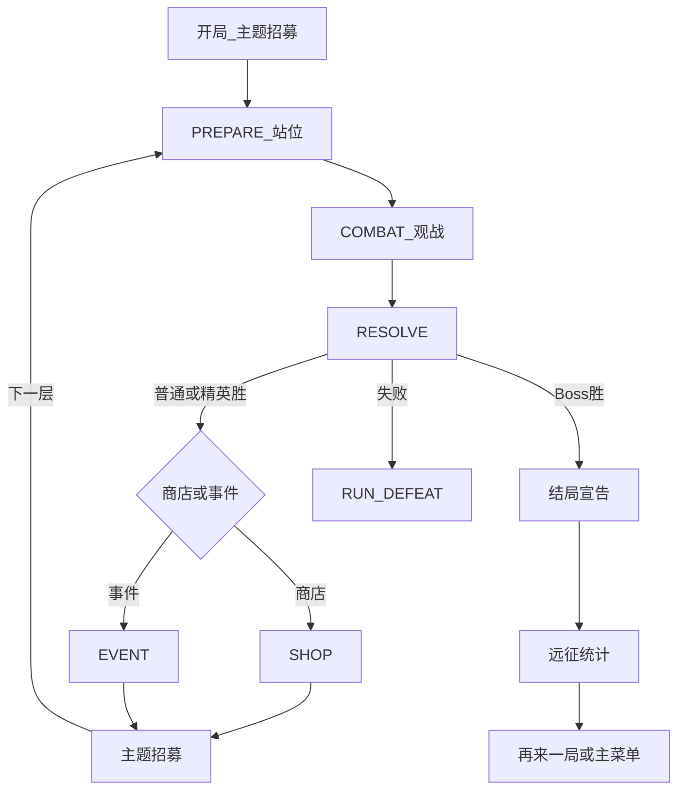

# 游戏愿景 — 中世纪幻想 2D 自走棋（PvE）

> 设计愿景与规则定稿入口。**胜负 / 乐趣支柱 / 主循环 / 敌情节奏 / 主题** 以本文为准。  
> **玩家拥有物与准备布阵**（队伍 / 上场席位上限 / **备战区** / 角色座位）以 [Features/PLAYER.md](./Features/PLAYER.md) 为准；**胜后招募**以 [Features/RECRUIT.md](./Features/RECRUIT.md) 为准。  
>
> **【设定定稿 / 表现待迁移】** 主题为中世纪幻想；`resources/units` 与 roster 中的动物名/占位图为 As-Is，换皮另开切片。  
>
> **【循环 To-Be · 用户新共识 2026-11-05】** **无地图选路**。线性**远征层**：开局主题承诺招募（**无赠送队**；开局金沿用现行 `starting_gold`；**不可跳过**；完成须 ≥1 已入座；品阶按第 **0** 层）→ 每层「准备（≥1 已入座可开战）→ 战斗 → **商店或事件二选一** → 主题承诺招募（主题盘重 roll **2** 金；招期间层号＝刚胜利层，离开后再 +1）」→ 本幕**恰好 1 层精英**（层号在 **6–12** 均匀随机）→ 终点 Boss（胜通关、不招；Boss **不计入**倒数 6 层品阶段）。有准备阶段；商店 / 招募养成**队伍**；已入座全体上场；备战可留人。开战后天**完全观战**。候选人**仅出主或辅匹配所选主题**。队伍内满三自动三合一。无号令；无遭遇内抽牌。本版主循环**不接入附魔**。细则见玩家 / 招募 / 循环篇。  
> **【循环 As-Is】** 主路径仍可能是地图选路 + 占位事件/商店节点；准备/招募/主题锁池可能未对齐文档 To-Be；**文档 To-Be ≠ 已实现**。  
>
> **【战场 To-Be】** 双方各有可见**角色座位**（默认 4 行 × 5 列，铺满半场）；友方入座人数 = 当前**已入座**成员数（≤ 上场席位上限）；备战区成员不上场。敌方占座与人数由关卡配置。开战后为**回合制自动战**：敌我**混排**进一条固定行动队列，每回合按同序**依次**行动；每一动尽量在同一段内完成「八向靠近 + 能打则出手」（一动内**落格顿步**、**一格一体**），可越半场。竖屏、我下敌上见 [Features/COMBATLEVEL.md](./Features/COMBATLEVEL.md)；推进细则见 [Features/COMBAT.md](./Features/COMBAT.md)。  
> **【战场 As-Is】** Run 主路径**战斗时钟已落地为回合制依次行动**（敌我混排队列；一动内八向格步）；座位几何部分已落地。准备/招募等循环仍可能未对齐文档 To-Be。  
>
> **【本版范围】** 线性远征层：普通 / 精英（层表插入）/ Boss；战后**商店或事件二选一**（商店见 [Features/MAP_SHOP.md](./Features/MAP_SHOP.md)：消耗品＋装备＋半场换座，**不含买人**）；事件为圣物等选项口；主题承诺招募见招募篇。角色为 Content 三十二人基础兵种；流派联动以资源挂载为准。

## 一句话

玩家在竖屏战场上构筑中世纪阵容：按层推进，用**主题承诺招募**与战后**商店或事件**养成**队伍**（上场 + 备战），进遭遇后在**准备阶段**微调座位，开战后天**回合制自动战斗**（单位依次行动、玩家只观战）。清光本遭遇全部敌人则胜，己方全灭则败。

## 电梯稿

本作是 **关卡制 / 爬塔 PvE**：**无地图选路**，按远征层线性推进；每层 **准备站位 → 开战观战 → 商店或事件二选一 → 主题承诺招募**；精英由层表插入；击败 Boss 通关。单位靠内建技能自动联动。主流派（坚韧、冲锋）应一眼可认；跨技能涌现是加分，不作主门槛。美术与叙事为中世纪幻想（骑士、佣兵、据点与魔物），剪影可读优先。

**构筑深度** = 单位内建联动 + 槽位站位 + 增益卡 + **主题羁绊**（上场凑同主题触发团队层；见 [Features/UNIT_THEME_BONDS.md](./Features/UNIT_THEME_BONDS.md)）+ **远征圣物**（整局行囊全局规则；见 [Features/EXPEDITION_RELICS.md](./Features/EXPEDITION_RELICS.md)）。

### 胜负规则【设计定稿】

| 结果 | 条件 |
|------|------|
| **胜（遭遇）** | 默认：**清光**本遭遇全部敌方单位（清波制） |
| **胜（Boss 遭遇例外）** | **首领死亡即胜**（斩首）；其余敌方**溃散**清除。细则见 [Features/BOSS.md](./Features/BOSS.md) |
| **败（遭遇）** | **己方单位全部阵亡**（含生成的代理角色；细则见战斗 / 玩家篇） |
| **Run 通关** | 击败 Act Boss（及关卡完成条件） |
| **Run 失败** | 任一战斗遭遇失败 → **整局重置** |

普通 / 精英仍清波；**仅 Boss 节点**用斩首例外。

---

## 核心体验支柱

1. **主题承诺养队 → 准备微调站位 → 观战 → 商店或事件 → 再招募**【设计定稿方向 · 细则见玩家篇 / 招募篇 / 循环篇】  
   开局与每层战后：先选主题再短名单招人；战斗胜利后在**商店**（消耗品/装备）与**事件**（含圣物等）之间二选一，再进入招募。进遭遇后载入持久占位与备战，准备可换座；开战后天只观战。主乐趣是主题承诺、队伍取舍与站位，不是地图选路或战中微操。

2. **空间与敌压**【设计定稿】  
   战场竖屏窄深、我下敌上、中线硬半场：双方在各自半场的**角色座位**上开战落点；开战后天按**固定混排行动队列**依次行动，每一动内八向靠近目标并可出手（一动内落格顿步、一格一体，可越线；非钉座对撞）。友方准备只入我半场空座位（**已入座**成员全体上场；备战不上场）；敌方按关卡占敌半场座位一次出齐。压力来自阵型、行动先后与越线。Boss：超高单体威胁；可有**足迹单位**（逻辑多格）与斩首胜负，见 [Features/BOSS.md](./Features/BOSS.md)。细则见 [Features/COMBATLEVEL.md](./Features/COMBATLEVEL.md)、[Features/COMBAT.md](./Features/COMBAT.md)。

3. **中世纪幻想主题**【设定定稿】  
   兵种/魔物剪影可读；特效服务技能因果（观战以**当前行动者**串行演出为主，见 [Features/COMBAT_FEEDBACK.md](./Features/COMBAT_FEEDBACK.md)）。表现迁移待实现。

**深度公式**：联动技能 + 槽位站位 + 增益卡 + 主题羁绊 + 远征圣物。  
队伍与准备见 [Features/PLAYER.md](./Features/PLAYER.md)；胜后招募见 [Features/RECRUIT.md](./Features/RECRUIT.md)；主题羁绊见 [Features/UNIT_THEME_BONDS.md](./Features/UNIT_THEME_BONDS.md)；远征行囊见 [Features/EXPEDITION_RELICS.md](./Features/EXPEDITION_RELICS.md)；增益见 [BUFF_SYSTEM.md](./BUFF_SYSTEM.md)；实现摘要见 [ARCHITECTURE.md](./ARCHITECTURE.md)。

---

## 主循环骨架【设计定稿方向】

玩家侧拥有物与准备节奏以 [Features/PLAYER.md](./Features/PLAYER.md) 为准。摘要：

| 层 | 含义 |
|----|------|
| **队伍** | 一整局拥有的友方角色 = **已入座** + **备战区**；同角色同星满 3（含备战）自动三合一 |
| **上场席位上限** | 当前最多**入座上场**的人数；**本版开局 5**，招募旗帜可扩（见玩家篇）；不等于总拥有上限 |
| **备战区** | 跨遭遇持久 **5** 格；不算上场；准备/招募可把备战与座位双向拖放（备战满则不能再拖入） |
| **角色座位** | 半场上可见的站位座位（默认 4×5 铺满半场）；几何见战斗关卡 |
| **友方持久占位** | 已入座成员占用哪个友方座位的整局状态；招募上区与战斗准备共用；准备换座写回 |

- **有**准备阶段；开战后天**不能**改阵；战斗阶段备战行**只读**，不能从备战补人。  
- **无**号令（战令）及号令费用；**无**遭遇内抽牌 / 手牌 / 弃牌 / 准备刷新手牌。  
- **座位网格默认 4×5（铺满半场）**；上场席位上限开局 5；空座位是站位选择，不要求填满全部座位。  
- **已入座**成员全体上场；备战不算上场；准备载入持久占位与备战，可换座、可将备战拖入空座写回。  
- **有**队伍侧自动三合一（同角色同星满 3 → 星 +1、攻血加总；最高 3 星；含备战）；细则见玩家篇。  
- 上场单位 **自动战斗**；玩家 **不可** 移动已上场单位，不可点技能。

### 单局战斗时长【设计定稿】

**常规遭遇约 1–3 分钟**；精英/Boss 可略长，仍靠威胁收束而非拖血。  
控时长旋钮：队伍席位上限、敌方占座配置、Boss 血线；以及**单动演出预算可压短**与**观战加速**（依次行动下加速为正式能力，见战斗 / 观战反馈）。具体秒数可配置，不在愿景定死。

---

## 流派与联动技能

玩家通过选角、入座站位，让「事件 → 效果」链在战斗中兑现。样板流派：**坚韧**、**冲锋**。

| 层级 | 数据 | 典型效果 |
|------|------|----------|
| **单位联动技能** | `AbilityData`（`EffectSpec`） | 受伤时自身 +X 攻击 |
| **增益卡** | `BuffCardData`（挂队伍成员） | 永久 +1 攻/血、死亡掉金等 |

主技能槽 `ability` 本版允许为空（基础单兵为纯属性单位）；可选 `passives`。目标可选 `self` / `adjacent_allies` / `all_allies` / `allies_with_tag`（技能筛选；**主题羁绊计数**见 [Features/UNIT_THEME_BONDS.md](./Features/UNIT_THEME_BONDS.md)，二者不同）。

波末清空战斗临时增益；Run 持久增益随队伍成员保留。

**公式**：联动技能组合 + 槽位站位（承伤/相邻）+ 增益卡 + 主题羁绊 + 远征圣物。

---

## 核心对局循环

### 爬塔 Run（主模式）

主菜单 [`run_game.tscn`](../scenes/main/run_game.tscn)：**【To-Be】** 线性远征层，**无地图选路**。生命周期见 [Features/GAME_LOOP.md](./Features/GAME_LOOP.md)；层进度见 [Features/MAP.md](./Features/MAP.md)；招募见 [Features/RECRUIT.md](./Features/RECRUIT.md)；队伍与准备见 [Features/PLAYER.md](./Features/PLAYER.md)。

```text
开局：主题三选一 → 主题锁池短名单招募
→ 重复一层：
     准备站位 → 战斗观战 → 结算发层金
     →（普通 / 精英胜）商店 或 事件（二选一，无保底）
     → 主题三选一 → 主题锁池招募
→ Boss 层：准备 → 战斗 → 胜通关（不进商店/事件/招募）/ 败整局重置
```



**【As-Is】** 仍可能走 `RunMapConfig` + `MapGenerator` 地图选路；单次战斗 `EncounterData.wave`。见 [ARCHITECTURE.md](./ARCHITECTURE.md) §3.1。

### 阶段职责（To-Be）

| 步骤 | 阶段 | 玩家行为 | 系统行为 |
|------|------|----------|----------|
| 0 | 开局招募 | 主题三选一（重 roll **2** 金）；短名单招人；不可跳过 | 无赠送队；开局金＝starting_gold；完成须 ≥1 已入座；品阶按第 0 层 |
| 1 | 进入本层遭遇 | 查看棋盘、金币、队伍 | 按层表加载普通或精英；带入当前队伍 |
| 2 | 准备 | 载入持久占位；换座 / 备战上座；≥1 已入座可开战 | 不要求全体入座；不推进战斗 |
| 3 | 战斗 | 观战（可加速）；不能改阵 | 敌方出齐；回合制依次自动战斗；**击杀不掉金** |
| 4 | 结算 | 查看结果 | **按远征层号发金**；敌全灭胜 / 己全灭败；败则整局重置 |
| 5 | 商店或事件（普通 / 精英胜） | **二选一**：进商店，或进事件 | 商店见地图商店篇；事件可含圣物三选一等；**无**强制进事件保底 |
| 6 | 主题招募（普通 / 精英胜） | 再主题三选一（重 roll **2** 金）；招人/替换；出售；刷新；跳过或完成 | 招期间层号＝刚胜利层；锁池招人；可三合一。Boss 胜跳过 5–6 |
| 7 | 下一层 / Boss | — | **离开招募后**层号 +1；层表到 Boss 则进终点战 |

**【As-Is】** 主路径可能仍为地图选路；准备/主题锁池招募可能未落地。

### 经济（v1）

| 时机 | 来源 |
|------|------|
| 战斗内 | **无**击杀掉金（击杀敌方不给金） |
| 战斗结算 | **按当前远征层发金**：第 1 层 +2、第 2 层 +3…（即层号 +1；**取代**原波次金；口径同原「地图层」） |
| 商店出售 | 按队伍成员星级 / 等级退金（细则见商店） |
| 招募出售 | 按角色原价退金（1★ 原价；三合一升星每档 ×3）；细则见招募篇 |

招募半场含候选人槽与道具行，见 [Features/RECRUIT_SHOP.md](./Features/RECRUIT_SHOP.md)。  
敌方配兵见 [Features/ENEMY_SPAWN_BUDGET.md](./Features/ENEMY_SPAWN_BUDGET.md)：普通/精英抽面孔与人数后，**攻血面板跟队均缩放**；普通关人数与**远征层**绑定；精英跟队伍人数；Boss 不吃真队、不跟人数、不做面板跟队。

```
开局招募 →（PREPARE → COMBAT → RESOLVE → 商店|事件 → 招募）×N → Boss → 通关
                              ↘ DEFEAT → RUN_DEFEAT
```

---

## 关卡与棋盘

- Run 主路径战场：竖屏、我下敌上、中线对半；没有河、桥、塔。见 [Features/COMBATLEVEL.md](./Features/COMBATLEVEL.md)。  
- **【To-Be】** 双方各有可见**角色座位**（默认 4×5 铺满半场）；友方席位内全体入座；敌方占座由关卡配置、开战一次出齐。开战后在 **5×8** 逻辑格网上走**回合制依次行动**（敌我混排固定序）；每一动内八向寻路、落格顿步、一格一体，可越线交战。  
- 旧网格工具环 [`main.tscn`](../scenes/main/main.tscn) + [`wfc_demo_8x8.tres`](../resources/levels/wfc_demo_8x8.tres) 仅本地烟测；**非** Run 主路径规格。

### 敌情节奏【设计定稿】

| 类型 | 体验 | 压力 |
|------|------|------|
| 小怪 | 清杂 + 验证队伍/站位 | 敌方占座阵型与越线压迫 |
| 精英 | 攻坚（本幕 1 层，层号在 6–12 随机） | 超高单体威胁；胜负仍清波 |
| Boss | 通关战 | 超高单体威胁；**斩首**胜负 + 机制差异（见 [Features/BOSS.md](./Features/BOSS.md)） |

普通 / 精英：敌方清空胜 / 己方全灭败。Boss：首领死亡胜（溃散其余敌方）/ 己方全灭败。

---

## 术语表

玩家侧完整术语见 [Features/PLAYER.md](./Features/PLAYER.md)。此处仅列愿景摘要：

| 术语 | 含义 |
|------|------|
| 波次 / 遭遇 | 准备 + 战斗 + 结算的一完整周期 |
| **队伍** | 一整局拥有的友方角色集合（已入座 + 备战） |
| **上场席位上限** | 当前最多入座上场的人数；本版开局 5（旗帜可扩） |
| **备战区** | 跨遭遇持久 5 格；不算上场 |
| **角色座位**（角色槽） | 半场可见站位座位；默认双方各 4×5 铺满半场；空座可选 |
| **友方持久占位** | 成员 ↔ 友方座位的整局映射；招募与准备共用 |
| **队伍成员** | 队伍中的一名角色（含星级 / 增益 / 占位）；同角色同星满 3 自动三合一（见玩家篇） |
| 空座位 | 尚未放入角色的角色座位 |
| 前排 / 后排座位 | 相对中线更近 / 更靠己方底的座位行；**仅开战落点差**，技能与索敌不认前后排标签 |
| 我半场 / 敌半场 | 画面下方 / 上方半区；投放与出兵分区见 [战斗关卡](./Features/COMBATLEVEL.md) |
| 硬半场（投放） | 准备入座只许在己方半场座位；开战后天可越半场交战 |
| Tier | 商店强度档 1–6 |
| 联动技能 | Trigger + 目标 + Effect |
| 流派 | 以触发链与站位为核心的构筑方向 |
| 清波制 | 敌全灭胜 / 己全灭败（普通 / 精英） |
| 斩首制 | Boss 遭遇：首领死亡即胜，其余敌方溃散（见 Boss 篇） |
| 足迹单位 | 可逻辑占用多格的单位（本版仅 Boss 2×2）；默认仍一格一体 |
| 行动队列 | 开战排一次的敌我混排固定序；每回合同序依次行动（见战斗篇） |
| 一动 | 轮到某单位时尽量「靠近并出手」演完的一段自动行动；Boss 可为策略三选一（见 Boss 篇） |

---

## 游戏模式

- **Roguelike Run**：[`run_game.tscn`](../scenes/main/run_game.tscn)
- **线性波次（开发）**：[`main.tscn`](../scenes/main/main.tscn)

---

## 里程碑

| 阶段 | 目标 | 状态 |
|------|------|------|
| M1 | 可变棋盘 + 布阵 + 占格 | 已实现 |
| M2a–c | 刷怪、战斗框架、多波循环 | 已实现 |
| M3b | 牌库 + 角色/增益商店 + Tier | 已实现（**文档 To-Be 已改为队伍**；实现待回摆） |
| M4a | 本波抽牌 + 旧战中补人 / 号令出牌 | 已实现（**待回摆**至准备站位观战） |
| M3.5 | EffectResolver + 样本技能 | 已实现 |
| M4 | 增益商店完善、更多技能、关卡 UI；半场 | 部分先行 |
| M5 | 多遭遇节奏、tooltip、平衡、美术音效 | — |
| — | 玩家篇：持久占位 / 备战区 5 / 上场席位上限 / 准备换座与备战上座 / 开战观战 | 文档 To-Be（实现未对齐） |
| — | 招募：短名单 + 出售 + 点买优先上场 + 上区即战斗占位 | 文档 To-Be（实现未对齐） |
| — | 队伍自动三合一（同角色同星满 3） | 文档 To-Be（代码有初版；占位规则待对齐） |

技术拆解见 [ARCHITECTURE.md](./ARCHITECTURE.md)。

---

## 未决问题

仅列与当前循环直接相关、实现前需拍板的项：

- 远征总层数与 Boss 插入层（配置填空）；精英已定为 6–12 随机一层
- 开局金已沿用 `starting_gold`（As-Is 默认 6）；主题盘重 roll 已定 **2** 金；候选人刷新费、招募单价等仍数值填空
- 商店：出售与增益挂载细则（见商店文档；玩家篇不写）
- 席位扩展途径（本版固定 5；另案）
- 三合一：攻血加总后的手感调参（功能规则见玩家篇）

---

相关文档：[ARCHITECTURE.md](./ARCHITECTURE.md) · [BUFF_SYSTEM.md](./BUFF_SYSTEM.md) · [Features/PLAYER.md](./Features/PLAYER.md) · [Features/RECRUIT.md](./Features/RECRUIT.md) · [Features/COMBATLEVEL.md](./Features/COMBATLEVEL.md) · [Features/GAME_LOOP.md](./Features/GAME_LOOP.md) · [Features/COMBAT.md](./Features/COMBAT.md) · [Features/BOSS.md](./Features/BOSS.md) · [INDEX.md](./INDEX.md)
