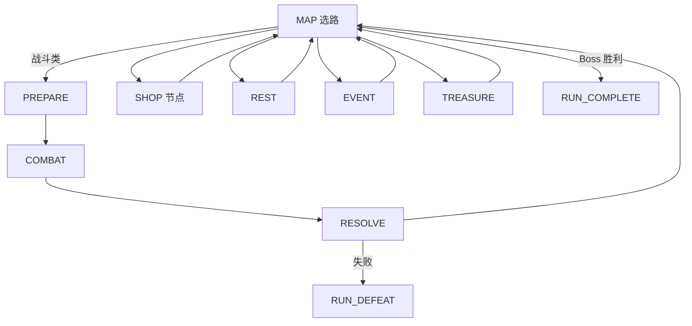
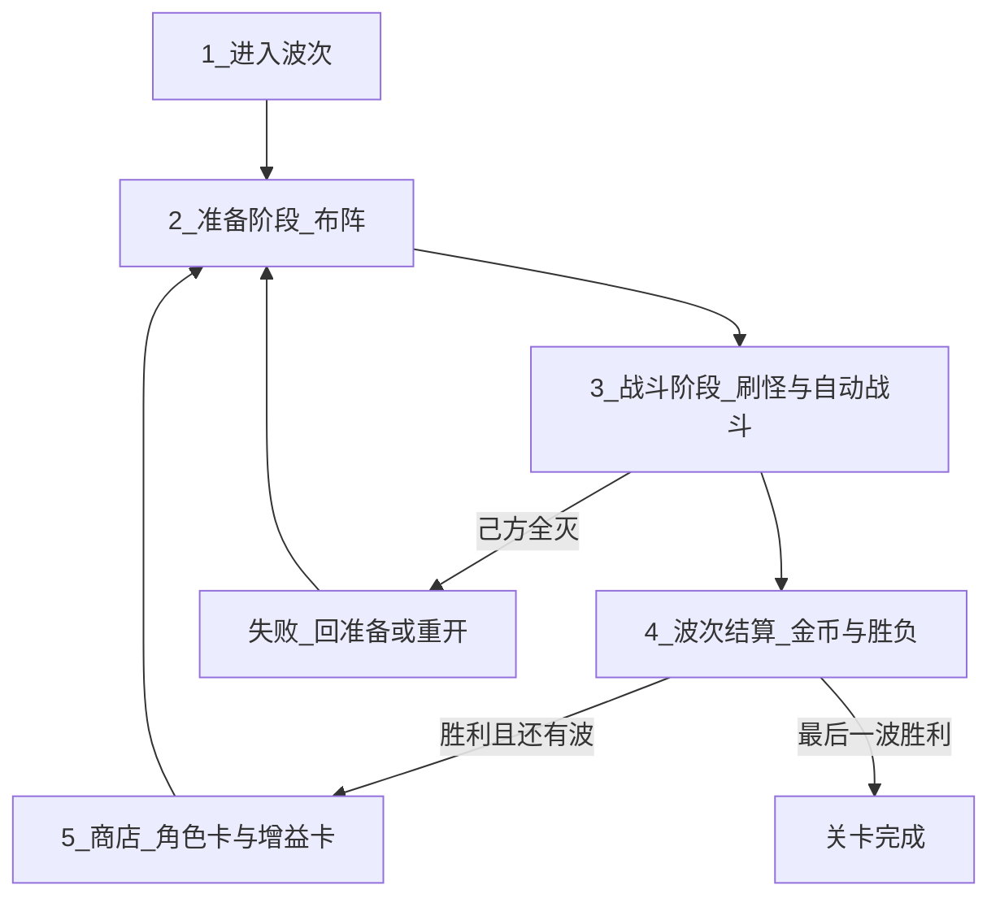

# 游戏愿景 — 中世纪幻想 2D 自走棋（PvE）

> 设计愿景与规则定稿入口；供策划与程序对齐。细节可随迭代修订，**胜负 / 乐趣支柱 / 敌情节奏 / 主题** 以本文【设计定稿】为准。
>
> **【设定定稿 / 表现待迁移】** 主题已定为中世纪幻想；`resources/units`、ABILITIES / UNITS_ROSTER 中的动物名与占位图为 **As-Is 资源标识**，换皮与重命名属后续实现切片，不得把文档主题更新写成美术已完成。

## 一句话

玩家在 **可变尺寸的 tile 棋盘** 上构筑中世纪阵容：商店买卡、手牌布阵，开战看单位联动兑现；战斗全自动。清光本遭遇全部敌人则胜，己方单位全滅则败；之后回到构筑或推进地图，直至通关或整局失败。

## 电梯稿

本作是 **关卡制 / 爬塔 PvE 自走棋**：玩家在波次（或地图遭遇）之间 **商店构筑 → 手牌布阵 → 开战**，战斗全自动。核心乐趣是 **构筑与站位在开战瞬间兑现为可观察的联动**；主流派（如坚韧、冲锋）应一眼可认，意外联动是彩蛋加分，不作主进度门槛。**美术与叙事基底为中世纪幻想（骑士、佣兵、据点与魔物），剪影清晰、可读优先；非写实血腥，亦非萌宠向。**

**定位灵感（非竞品规格）**：组合发现感来自单位技能在开战瞬间的碰撞与连锁；宏观节奏可参考 PvE 肉鸽爬塔的选路成长。仅作体验参照，不照搬对方规则或内容。

**v1 范围说明**：不做种族/职业等 **角色羁绊**（凑数量触发的团队增益）。构筑深度 = **单位内建联动 + 站位 + 增益卡**。羁绊仅作远期扩展，且须复用 `EffectSpec` / `EffectResolver`。

### 胜负规则【设计定稿】

| 结果 | 条件 | 说明 |
|------|------|------|
| **胜（遭遇 / 波次）** | 清光本关 / 本遭遇 **全部敌方单位** | **清波制定稿**；进入下一波、回地图或通关 |
| **败（遭遇 / 波次）** | **己方单位全部阵亡** | 不设基地 HP 作为 v1 胜负主轴 |
| **Run 通关** | 地图路线上击败 Act Boss（及关卡完成条件） | 见「爬塔 Run」 |
| **Run 失败** | 任一战斗遭遇判定失败 | **整局重置**（牌库、金币、地图） |

**非 v1 主轴**：基地 HP / 军旗耐久 /「撑过波次即胜」等基地制或混合制。若远期实验，须另开设计合同，不得默认为当前规则。

---

## 核心体验支柱

1. **构筑 → 布阵 → 开战看戏**【设计定稿】  
   商店购入角色卡与增益卡、牌库管理、每波抽牌布阵；开战观看联动链兑现。主流派（坚韧 / 冲锋等）剪影清晰；冷门组合成功时是惊喜，不是必做作业。

2. **空间与敌压**【设计定稿】  
   小怪段：清杂看戏 + 空闲格刷怪 **占格压缩** 布阵空间。Boss：超高 **单体威胁**（优先打爆前排），不是机制解谜主轴，也不是「血厚小怪潮」。

3. **中世纪幻想主题**【设定定稿】  
   单位与场景走中世纪幻想可读剪影（兵种/魔物一眼可辨）；特效服务技能因果，不追求写实肢解。**表现层迁移待实现**，当前仓库单位名可能仍为旧动物占位。

**深度公式（v1）**：联动技能组合 + 站位 + 增益卡；**无羁绊**。  
商店与牌库详见 [SHOP_SYSTEM.md](./SHOP_SYSTEM.md)、[BUFF_SYSTEM.md](./BUFF_SYSTEM.md)。

---

## 流派与联动技能

### 设计目标

玩家通过**选角与站位**，在单波战斗内让「事件 → 效果」链持续生效，形成可识别的**流派**（如越战越强、开战爆发、击杀连锁）。主流派应能在牌库与站位上被快速读懂（样板：**坚韧**、**冲锋**）；深度来自组合与站位，而非单个数值怪，也 **不依赖** 羁绊计数。跨流派的意外联动是彩蛋加分，不作构筑主门槛。

### 能力模型（v1）

| 层级 | 数据 | 典型效果 | 激活时机 |
|------|------|----------|----------|
| **单位联动技能** | `AbilityData`（含 `EffectSpec`） | 受伤时自身 +X 攻击 | 战斗内事件（受伤、击杀、普攻等） |
| **增益卡** | `BuffCardData`（挂 `DeckEntry`） | 永久 +1 攻/血、无法行走、死亡掉金等 | Run 持久 + 部分战斗钩子 |

每名单位**必须**有主技能（`ability`），可选被动（`passives`），均用 `EffectSpec` 描述。商店**增益卡**为构筑强化层，见 [BUFF_SYSTEM.md](./BUFF_SYSTEM.md)、[ARCHITECTURE.md](./ARCHITECTURE.md) §3.7。

### 远期：角色羁绊（非 v1）

种族/职业数量阈值、团队增益等 **Trait 系统** 暂不纳入实现；若后续加入，应复用 `EffectSpec` 与 `EffectResolver`，与联动技能共用效果管线。

### 联动与目标

一条联动技能 = **触发器（Trigger）** + **条件（可选）** + **目标选择** + **效果（Effect）**。目标可指向：

- `self` — 自身
- `adjacent_allies` — 相邻友军
- `all_allies` — 全体友方单位
- `allies_with_tag` — 带指定标签的友军（用于技能联动，**非**羁绊计数）

### 流派示例（设计向）

- **坚韧流**：多只单位带「受伤时 + 攻击 / 反伤」类触发，前排承伤、后排滚雪球。
- **冲锋流**：「开战时」或「击杀时」触发，追求前几秒爆发或收割连锁。

### 与 PvE 节奏的关系

- **准备阶段**：每波从牌库无放回抽 5 张，选择放置；即决定本波「谁上场、带哪些内建技能与增益、如何站位」。
- **战斗阶段**：只读技能配置，通过事件总线写入战斗内 Buff；波次结束清空战斗临时增益。

**流派构筑公式（v1）【设计定稿】**：联动技能组合 + 站位（承伤位、相邻触发）+ 增益卡。无种族/职业羁绊。

---

## 核心对局循环

### 爬塔 Run（主模式）

主菜单进入 [`run_game.tscn`](../scenes/main/run_game.tscn)：玩家在 **Act 地图** 上选路，节点类型含战斗 / 精英 / 商店 / 休息 / 事件 / 宝箱 / ? / Boss。单次节点内仍为 **部署 → 战斗 → 结算**；**战斗胜利后回地图**，商店仅出现在地图商店节点。失败则 **整局重置**（牌库、金币、地图）。



数据：`RunMapConfig` + `MapGenerator` → `MapState`；单次战斗用 `EncounterData.wave`（一节点一战）。详见 [ARCHITECTURE.md](./ARCHITECTURE.md) §3.1。

### 线性波次（开发 / 平衡用）

直接运行 [`main.tscn`](../scenes/main/main.tscn)（`linear_dev_mode`）：沿用原 **15 波** [`dev_6x6.tres`](../resources/levels/dev_6x6.tres)，每波战斗后进入商店。Encounter 池由 `wave_01`–`wave_15` 拆分为 [`resources/encounters/`](../resources/encounters/)。

单关内每一**波次**按下列六步推进；关卡加载后从第 1 步开始。



### 六步职责

| 步骤 | 阶段 | 玩家行为 | 系统行为 |
|------|------|----------|----------|
| 1 | 进入波次 | 查看波次序号、棋盘、金币 | 读取 `LevelData.waves[wave_index]`；首波在关卡加载后进入 |
| 2 | 准备 | 从牌库无放回抽 5 张，选择放置到棋盘 | 执行 `DrawService`；校验格占用；**禁止战斗**；点击「开始战斗」进入 COMBAT |
| 3 | 战斗 | 观看（可选加速） | 空闲格刷怪；固定 tick 自动战斗；击杀敌人**即时掉金** |
| 4 | 结算 | 查看结果 | 发放**波次固定收益**；清场；判定：敌方全灭 → 胜；己方全灭 → 败。线性关：败则回准备或重开本关（无基地 HP）。Run：败则整局重置 |
| 5 | 商店 | 购买角色卡（入牌库）/ 增益卡（附加到牌库角色）；刷新 | 扣费、Tier 池 roll（To-Be）；牌库满时角色**替换**；增益不占新槽 |
| 6 | 下一波 | 确认继续 | `wave_index++` 后回到步骤 1–2；无更多波则关卡完成 |

**节拍约定**：波次之间路径为 `COMBAT →（棋盘收起）→ 商店 →（棋盘浮入）→ PREPARE → COMBAT`；战斗结束后**自动**进入商店，无需手动点击「进入商店」。进入部署前棋盘在短暂停顿后**随机、近乎同时**浮入，战后以相同方式收起。步骤 5（商店）在 UI 上与步骤 2（抽牌布阵）分离：购买发生在结算发金之后；每波 PREPARE 开始时执行抽 5 张（见 [SHOP_SYSTEM.md](./SHOP_SYSTEM.md)）。

### 经济来源（v1）

| 时机 | 来源 | 说明 |
|------|------|------|
| 战斗内 | 击杀掉金 | `ON_KILL` 敌人时即时入账 |
| 波次结算 | 波次固定收益 | `WaveData.wave_gold_reward`（`-1` 则用 `EconomyConfig.default_wave_gold`） |
| 出售 | 卖单位 / 删库条目 | **未决**（旧 MVP 为场上出售；新设计见 SHOP_SYSTEM） |
| 远期 | 连胜/连败加成 | 非 v1 |

### 状态机对应

```
LEVEL_LOAD → PREPARE → COMBAT → RESOLVE → PREPARE（下一波）→ … → LEVEL_COMPLETE
                              ↘ DEFEAT（己方全灭）→ PREPARE（线性关可选重开）/ RUN_DEFEAT
```

---

## 关卡与棋盘

### 网格模型

- 棋盘为 `width × height` 的**整数方格**，尺寸**每关可配置**（如 6×6、8×8、10×10）。当前开发关 [`dev_6x6.tres`](../resources/levels/dev_6x6.tres) 为 **10×10**。
- 关卡数据（暂定 `LevelData`）定义：棋盘宽高、波次列表、刷怪表、障碍格（若有）、奖励等。

### 占用规则

- 每格同一时间至多一个**单位实体**（玩家单位或怪物）。
- 玩家在准备阶段布阵占用的格子，在当波刷怪时**不可**再生成敌人。
- 玩家单位与怪物**共享同一棋盘**，无固定「对手半场」。

### 刷怪规则（v1 约定）

1. **刷怪候选集** = 当前棋盘上所有**未被占用**的格子（不含障碍格，若关卡配置了不可通行格）。
2. 从候选集中按波次配置采样生成怪物，直至达到本批数量或候选耗尽。
3. **数量上限**：本批实际刷怪数 = `min(配置数量, 候选格数)`；候选不足时**少刷**，不挤占玩家单位所在格。
4. 若候选集为空：本批不刷或刷 0 只（实现期与策划确认，默认不刷）。

### 示意

```
波次开始前（玩家已布阵）     战斗刷怪后（怪物占空闲格）

[P][P][·][·][·]              [P][P][M][·][M]
[·][P][·][·][·]      →      [·][P][M][·][·]
[·][·][·][·][·]              [·][·][·][M][·]

P = 玩家单位    M = 怪物    · = 空格（可刷怪）
```

### 敌情节奏【设计定稿】

#### 小怪 / 常规波

- **体验**：清杂看戏——玩家验证本波构筑是否「转起来」。
- **压力来源**：数量与占格；敌人刷在 **空闲格**，压缩可布阵与走位空间。
- **非目标**：把常规波做成复杂机制关或纯数值墙。

#### Boss / 精英高峰

- **体验**：超高 **单体威胁**，典型行为是集火打爆前排，迫使玩家用坚韧、换位或爆发应对。
- **非目标**：以解谜式机制为主轴；或以大量高血小怪潮冒充 Boss 压力。

#### 与胜负的关系

遭遇胜负仍只看 **敌方是否清空** / **己方是否全灭**；敌情节奏影响「怎么打」，不另设基地血条胜负。

### 与「自走棋」的关系

保留自走棋式**构筑语言**：牌库、角色卡/增益卡、Tier 解锁、每波抽牌布阵、单位内建联动技能等（v1 不含种族/职业羁绊）。战斗阶段全自动，核心决策发生在波次间的经济、牌库构筑、流派与站位，而非实时操作。牌库 **SAP 式升级**（购买同名合并、Lv1–3、经验条）已接入（见 [SHOP_SYSTEM.md](./SHOP_SYSTEM.md) §2.4）。

---

## 术语表

| 术语 | 含义 |
|------|------|
| 波次（Wave） | 一次刷怪 + 自动战斗 + 结算的完整周期 |
| 关卡（Level） | 一组波次 + 棋盘尺寸 + 刷怪与奖励配置 |
| 空闲格 | 无单位占用、且可刷怪的格子 |
| 构筑 | 波次间通过商店、牌库与布阵强化阵容 |
| Tier | 商店商品强度档 **1–6**；默认 `cost == tier`；按波次 `2X-1` 解锁最高可 roll 档（见 SHOP_SYSTEM §2.6） |
| 费用 | 购买价，通常与 Tier 一致，可单卡覆盖 |
| 牌库（Deck） | Run 内玩家拥有的角色条目集合；默认 10 条、上限 20（可配置） |
| 牌库条目（DeckEntry） | 一名角色 + 等级/经验 + 商店附加的**增益** |
| 角色卡 | 商店可购；购买后加入牌库；单位**内建技能** |
| 增益卡 | 商店可购；购买后附加到牌库内某一角色条目（可多张叠加） |
| 技能卡（Legacy） | **已废弃**文档目标；代码仍为商店技能卡，待迁移增益 |
| 本波手牌 | 每波准备阶段从牌库无放回抽取的 5 张 |
| 备战席（Legacy） | **旧 MVP**：未上场单位暂存区；将被牌库 + 抽牌替代 |
| 牌库升级 | SAP 式：购买同名合并 + 经验 → Lv2/Lv3（**已实现**） |
| 触发器（Trigger） | 战斗事件类型，如受伤、击杀、开战 |
| 效果（Effect） | 对目标施加的数值或状态变化 |
| 联动技能 | Trigger + Effect + 目标选择组成的可配置能力 |
| 流派 | 以特定触发链与站位为核心的构筑方向（v1 不依赖羁绊）；主流派应一眼可认 |
| 清波制 | 清空本遭遇全部敌人即胜；己方全灭即败（**设计定稿**） |
| 主题（中世纪幻想） | 设定与美术方向定稿：中世纪幻想 PvE 自走棋；**不等于**当前 `resources` 已全部换皮 |
| 羁绊（Trait，远期） | 同种族/职业数量达阈值的团队增益；**v1 不实现** |

---

## 游戏模式

### v1（当前范围）

- **Roguelike Run（主入口）**：地图选路 + 多节点类型 + Act Boss；[`run_game.tscn`](../scenes/main/run_game.tscn)
- **沙盒模式（调试/试阵）**：主菜单进入 [`sandbox.tscn`](../scenes/main/sandbox.tscn)，手动放置友/敌单位、开战、战后清空棋盘
- **线性波次（开发）**：[`main.tscn`](../scenes/main/main.tscn) + `dev_6x6` 15 波，便于战斗平衡

### 远期（非 v1）

- **PvP**：镜像或实时匹配对战。
- **多 Act / 局外 meta**：Act 2/3、永久解锁。
- **角色羁绊（Trait）**：种族/职业数量阈值与团队增益。

---

## 里程碑

| 阶段 | 目标 |
|------|------|
| M0 | 文档 + 空工程 |
| M1 | 可变 `W×H` 棋盘 + 玩家布阵 + 格占用（**已实现**） |
| M2a | 单位属性、四邻格移动、空闲格刷怪、固定 tick 最简战斗 | **已实现** |
| M2b | `CombatArena`、`CombatEventBus`、`DamagePipeline`、`UnitBrain` 框架 | **已实现** |
| M2c | `PREPARE → COMBAT → RESOLVE → PREPARE` 多波循环 | **已实现**（dev 关卡 2 波） |
| M3 | 商店 / 击杀掉金 + 波次结算金（**旧 MVP 已实现**：备战席、购买、刷新、出售、点击布阵） |
| M3b | 牌库 + 角色/增益商店 + Tier + 满库替换 + 增益附加 UI（手牌 As-Is 整库；抽 5 To-Be） | **已实现（抽牌除外）** |
| M3.5 | `EffectResolver` + `EffectSpec` 框架 + 3 个样本技能 | **已实现** |
| M4 | 增益商店 + Tier 1–6 + 更多内建技能 + 关卡 UI | **文档先行** |
| M5 | 多关卡、多流派样板单位、技能 tooltip、平衡、美术与音效 |

实现顺序以本表为准；技术拆解见 [ARCHITECTURE.md](./ARCHITECTURE.md)。

---

## 未决问题

下列项仍待实现期或后续设计合同定稿。**胜负（清波制）、无羁绊、敌情节奏（小怪占格 / Boss 单体威胁）已定稿**，见上文，不再列为未决。

- **刷怪采样**：随机均匀 vs 权重区域 vs 靠近玩家（实现期定）
- **怪物移动**：是否移动、四邻格 vs 八邻格寻路
- **障碍与部署限制**：每关是否配置不可通行格、仅玩家可部署区等
- **装备 / 地形 / 天气**：可选系统，v1 可不包含
- **触发链深度**：反伤、再受伤等是否设上限（建议有 `max_chain_depth`）
- **Buff 叠加规则**：刷新持续时间 vs 数值叠加 vs 独立实例
- **开战前触发**：单位联动技能默认仅战斗内；是否允许 PREPARE 结束触发（远期 Trait 可能用到）
- **牌库抽牌**：牌库 < 5 时的抽牌策略；手牌是否必须全部放置（见 [SHOP_SYSTEM.md](./SHOP_SYSTEM.md) §8）
- **满库替换 / 增益卸载**：替换是否退款；已附加增益是否可单独移除
- **Tier 与波次计数**：`shop_wave` 是否与 SAP 回合完全一致（见 SHOP_SYSTEM §2.6、§8）

---

相关文档：[ARCHITECTURE.md](./ARCHITECTURE.md) · [SHOP_SYSTEM.md](./SHOP_SYSTEM.md) · [BUFF_SYSTEM.md](./BUFF_SYSTEM.md) · [INDEX.md](./INDEX.md)
