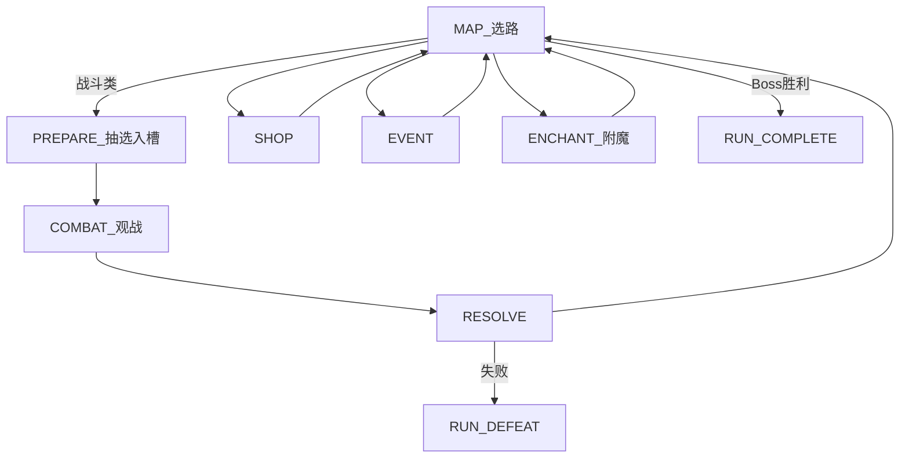
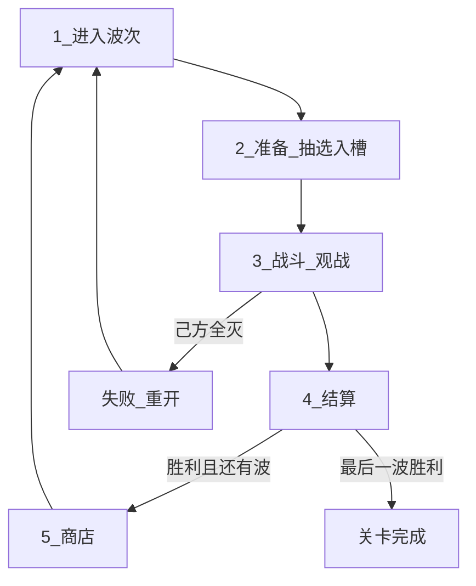

# 游戏愿景 — 中世纪幻想 2D 自走棋（PvE）

> 设计愿景与规则定稿入口。**胜负 / 乐趣支柱 / 主循环 / 敌情节奏 / 主题** 以本文为准。  
> **玩家拥有物与遭遇内准备牌流**（构筑库 / 手牌 / 弃牌堆、角色座位、上场人数上限、刷新）以 [Features/PLAYER.md](./Features/PLAYER.md) 为准。  
>
> **【设定定稿 / 表现待迁移】** 主题为中世纪幻想；`resources/units` 与 roster 中的动物名/占位图为 As-Is，换皮另开切片。  
>
> **【循环 To-Be】** 有准备阶段：从构筑库抽候选手牌，选入**角色座位**上场（座位网格多于上场人数上限；手牌宽度默认 4）；可免费刷新未入槽手牌（上限 3，旧牌回抽牌堆）；点开战后天**完全观战**，不能出牌。无人口、无号令（战令）及号令费用。细则见 [Features/PLAYER.md](./Features/PLAYER.md)。  
> **【循环 As-Is】** 实时主路径仍为无准备、战中抽打弃 + 号令；**文档 To-Be ≠ 已实现**。  
>
> **【战场 To-Be】** 双方各有可见**角色座位**（默认 2 行 × 5 列）；友方入座受**本场上场人数上限**约束（默认 4）；敌方占座与人数由关卡配置。开战后单位在 **9×16 逻辑格网**上以**八方向**寻路靠近目标（**格心取样**、表现可插值滑动；**一格一体**），可越半场交战。竖屏、我下敌上见 [Features/COMBATLEVEL.md](./Features/COMBATLEVEL.md)。  
> **【战场 As-Is】** Run 主路径仍多为连续坐标即时寻路（非八向格步）；座位几何部分已落地。文档 To-Be ≠ 已实现。  
>
> **【本版范围】** 地图只实装战斗 / 精英 / Boss；商店、事件、附魔为占位节点，主路径暂无构筑入口。角色为 Content 十人基础兵种；流派联动以资源挂载为准。

## 一句话

玩家在竖屏战场上构筑中世纪阵容：商店养成**构筑库**，进遭遇后在**准备阶段**从抽到的角色卡中选人放入**角色座位**，开战后天自动实时作战、玩家只观战。清光本遭遇全部敌人则胜，己方全灭则败。

## 电梯稿

本作是 **关卡制 / 爬塔 PvE**：波次间 **商店构筑**，战斗节点内 **准备选人入槽 → 开战观战**；单位靠内建技能自动联动。主流派（坚韧、冲锋）应一眼可认；跨技能涌现是加分，不作主门槛。美术与叙事为中世纪幻想（骑士、佣兵、据点与魔物），剪影可读优先。

**构筑深度** = 单位内建联动 + 槽位站位 + 增益卡。v1 **不做**种族/职业羁绊。

### 胜负规则【设计定稿】

| 结果 | 条件 |
|------|------|
| **胜（遭遇）** | 清光本遭遇 **全部敌方单位** |
| **败（遭遇）** | **己方单位全部阵亡**（含生成的代理角色；细则见战斗 / 玩家篇） |
| **Run 通关** | 击败 Act Boss（及关卡完成条件） |
| **Run 失败** | 任一战斗遭遇失败 → **整局重置** |

---

## 核心体验支柱

1. **构筑 → 准备入槽 → 观战**【设计定稿方向 · 细则见玩家篇】  
   商店养成构筑库；进遭遇后抽候选手牌，选入角色座位（可刷新）；开战后天只观战。主乐趣是构筑质量、抽选取舍与站位，不是战中出牌或微操。

2. **空间与敌压**【设计定稿】  
   战场竖屏窄深、我下敌上、中线硬半场：双方在各自半场的**角色座位**上开战落点；开战后天在逻辑格网上**八方向**靠近目标、可越线交战（格心取样，非钉座对撞）。友方准备只入我半场空座位（且不超过上场人数上限）；敌方按关卡占敌半场座位一次出齐。压力来自阵型对冲与越线。Boss：超高单体威胁。细则见 [Features/COMBATLEVEL.md](./Features/COMBATLEVEL.md)。

3. **中世纪幻想主题**【设定定稿】  
   兵种/魔物剪影可读；特效服务技能因果（观战反馈见 [Features/COMBAT_FEEDBACK.md](./Features/COMBAT_FEEDBACK.md)）。表现迁移待实现。

**深度公式**：联动技能 + 槽位站位 + 增益卡。  
商店与牌库见 [Features/PLAYER.md](./Features/PLAYER.md) 与本篇经济约定；增益见 [BUFF_SYSTEM.md](./BUFF_SYSTEM.md)；实现摘要见 [ARCHITECTURE.md](./ARCHITECTURE.md)。

---

## 主循环骨架【设计定稿方向】

玩家侧牌区与准备节奏以 [Features/PLAYER.md](./Features/PLAYER.md) 为准。摘要：

| 层 | 含义 |
|----|------|
| **构筑库** | 一整局拥有的角色条目；张数可变；商店买/替/升级/挂增益 |
| **本场抽牌堆 / 手牌 / 弃牌堆** | 遭遇临时；开场由构筑库洗入抽牌堆；**仅服务准备抽选与刷新** |
| **角色座位** | 半场上可见的站位座位（默认 2×5）；几何见战斗关卡 |
| **本场上场人数上限** | 本场最多入座的友方人数（默认 **4**）；与座位数分离 |

- **有**准备阶段；开战后天**不能**出牌。  
- **无**人口系统、**无**号令（战令）及号令费用。  
- **座位网格 ≠ 上场人数上限**：空座位是站位选择，不要求填满。  
- 手牌宽度默认 **4**（与上场人数上限同值）；选人取舍来自构筑库抽选 / 刷新与座位布局，不要求手牌张数大于座位数。  
- 准备可免费刷新未入槽手牌，上限 **3**；刷新时这些牌**回抽牌堆**。  
- 上场单位 **自动战斗**；玩家 **不可** 移动已上场单位，不可点技能。

### 单局战斗时长【设计定稿】

**常规遭遇约 1–3 分钟**；精英/Boss 可略长，仍靠威胁收束而非拖血。  
控时长旋钮：上场人数上限、手牌宽度、刷新次数、敌方占座配置、Boss 血线（具体数值可配置）。

---

## 流派与联动技能

玩家通过选角、入槽站位，让「事件 → 效果」链在战斗中兑现。样板流派：**坚韧**、**冲锋**。

| 层级 | 数据 | 典型效果 |
|------|------|----------|
| **单位联动技能** | `AbilityData`（`EffectSpec`） | 受伤时自身 +X 攻击 |
| **增益卡** | `BuffCardData`（挂 `DeckEntry`） | 永久 +1 攻/血、死亡掉金等 |

主技能槽 `ability` 本版允许为空（基础单兵为纯属性单位）；可选 `passives`。目标可选 `self` / `adjacent_allies` / `all_allies` / `allies_with_tag`（技能筛选，非羁绊计数）。

波末清空战斗临时增益；Run 持久增益随 `DeckEntry` 保留。

**公式**：联动技能组合 + 槽位站位（承伤/相邻）+ 增益卡。

---

## 核心对局循环

### 爬塔 Run（主模式）

主菜单 [`run_game.tscn`](../scenes/main/run_game.tscn)：Act 地图选路。第一版节点：起点 / 战斗 / 精英 / 商店 / 事件 / **附魔** / Boss。节点内 **准备入槽 → 开战观战 → 结算**；胜回地图；败整局重置。商店仅在地图商店节点。生命周期见 [Features/GAME_LOOP.md](./Features/GAME_LOOP.md)；节点细则见 [Features/MAP.md](./Features/MAP.md)。准备牌流见 [Features/PLAYER.md](./Features/PLAYER.md)。



数据：`RunMapConfig` + `MapGenerator` → `MapState`；单次战斗 `EncounterData.wave`。见 [ARCHITECTURE.md](./ARCHITECTURE.md) §3.1。

### 线性波次（开发用）

[`main.tscn`](../scenes/main/main.tscn) + [`dev_6x6.tres`](../resources/levels/dev_6x6.tres) 15 波；遭遇池在 [`resources/encounters/`](../resources/encounters/)。



### 阶段职责（To-Be）

| 步骤 | 阶段 | 玩家行为 | 系统行为 |
|------|------|----------|----------|
| 1 | 进入波次 / 遭遇 | 查看棋盘、金币 | 加载遭遇；由构筑库建抽牌堆并起手抽牌（见玩家篇） |
| 2 | 准备 | 手牌入槽 / 收回；可选刷新（≤3）；点开战 | 校验槽位；不推进战斗 |
| 3 | 战斗 | 观战（可加速）；不能出牌 | 敌方按已配置座位出齐；自动战斗；击杀掉金 |
| 4 | 结算 | 查看结果 | 波次金；敌全灭胜 / 己全灭败。线性关可重开；Run 失败整局重置 |
| 5 | 商店（线性关波间 / Run 地图节点） | 买角色/增益；刷新商店 | 扣费、Tier roll；满库替换 |
| 6 | 下一波 / 回地图 | — | `wave_index++`、回地图或关卡完成 |

**【As-Is】** 实时主路径仍可能跳过准备、战中出牌。

### 经济（v1）

| 时机 | 来源 |
|------|------|
| 战斗内 | 击杀掉金 |
| 波次结算 | `WaveData.wave_gold_reward`（或默认波次金） |
| 商店出售 | 按 `DeckEntry.level` 退金（见实现 / 架构摘要） |

```
LEVEL_LOAD → PREPARE → COMBAT → RESOLVE → … → LEVEL_COMPLETE
                              ↘ DEFEAT → 重开或 RUN_DEFEAT
```

---

## 关卡与棋盘

- Run 主路径战场：竖屏、我下敌上、中线对半；没有河、桥、塔。见 [Features/COMBATLEVEL.md](./Features/COMBATLEVEL.md)。  
- **【To-Be】** 双方各有可见**角色座位**（默认 2×5）；友方入座受上场人数上限约束；敌方占座由关卡配置、开战一次出齐。开战后单位在 **9×16** 逻辑格网上八方向寻路、格心取样、一格一体，可越线交战。  
- 旧线性开发关 [`dev_6x6.tres`](../resources/levels/dev_6x6.tres)（8×8）与沙盒仍是回合制格子工具环（走法身份 / 行动轮；**非**本篇八向格步主路径）。

### 敌情节奏【设计定稿】

| 类型 | 体验 | 压力 |
|------|------|------|
| 小怪 | 清杂 + 验证构筑/站位 | 敌方占座阵型与越线压迫 |
| Boss / 精英 | 攻坚 | 超高单体威胁 |

胜负只看敌方是否清空 / 己方是否全灭。

---

## 术语表

玩家侧完整术语见 [Features/PLAYER.md](./Features/PLAYER.md)。此处仅列愿景摘要：

| 术语 | 含义 |
|------|------|
| 波次 / 遭遇 | 准备 + 战斗 + 结算的一完整周期 |
| 构筑库 | 一整局角色条目集合（张数可变） |
| 手牌 / 抽牌堆 / 弃牌堆 | 遭遇临时牌区；服务准备抽选与刷新 |
| **角色座位**（角色槽） | 半场可见站位座位；默认双方各 2×5；空座可选 |
| **本场上场人数上限** | 友方本场最多入座人数（默认 4）；**不等于**座位数 |
| **刷新** | 准备阶段重抽未入槽手牌（≤3；回抽牌堆） |
| 空座位 | 尚未放入角色牌的角色座位 |
| 前排 / 后排座位 | 相对中线更近 / 更靠己方底的座位行；**仅开战落点差**，技能与索敌不认前后排标签 |
| 我半场 / 敌半场 | 画面下方 / 上方半区；投放与出兵分区见 [战斗关卡](./Features/COMBATLEVEL.md) |
| 硬半场（投放） | 准备入座只许在己方半场座位；开战后天可越半场交战 |
| Tier | 商店强度档 1–6 |
| 牌库条目 | 角色 + 等级/经验 + 增益 |
| 联动技能 | Trigger + 目标 + Effect |
| 流派 | 以触发链与站位为核心的构筑方向 |
| 清波制 | 敌全灭胜 / 己全灭败 |

---

## 游戏模式

- **Roguelike Run**：[`run_game.tscn`](../scenes/main/run_game.tscn)
- **沙盒**：[`sandbox.tscn`](../scenes/main/sandbox.tscn)
- **线性波次（开发）**：[`main.tscn`](../scenes/main/main.tscn)

---

## 里程碑

| 阶段 | 目标 | 状态 |
|------|------|------|
| M1 | 可变棋盘 + 布阵 + 占格 | 已实现 |
| M2a–c | 刷怪、战斗框架、多波循环 | 已实现 |
| M3b | 牌库 + 角色/增益商店 + Tier | 已实现 |
| M4a | 本波抽牌 + 旧战中补人 / 号令出牌 | 已实现（**待回摆**至准备入槽观战） |
| M3.5 | EffectResolver + 样本技能 | 已实现 |
| M4 | 增益商店完善、更多技能、关卡 UI；半场 | 部分先行 |
| M5 | 多遭遇节奏、tooltip、平衡、美术音效 | — |
| — | 玩家篇：准备入槽 / 刷新 / 开战观战 / 无号令无人口 | 文档 To-Be（实现未对齐） |

技术拆解见 [ARCHITECTURE.md](./ARCHITECTURE.md)。

---

## 未决问题

仅列与当前循环直接相关、实现前需拍板的项：

- **满库替换是否退款**；增益是否可单独卸载（见 SHOP / BUFF）
- 上场人数上限是否随 Act / 遭遇变化（功能开关；默认整局固定 4）

---

相关文档：[ARCHITECTURE.md](./ARCHITECTURE.md) · [BUFF_SYSTEM.md](./BUFF_SYSTEM.md) · [Features/PLAYER.md](./Features/PLAYER.md) · [Features/COMBATLEVEL.md](./Features/COMBATLEVEL.md) · [Features/GAME_LOOP.md](./Features/GAME_LOOP.md) · [Features/COMBAT.md](./Features/COMBAT.md) · [INDEX.md](./INDEX.md)
