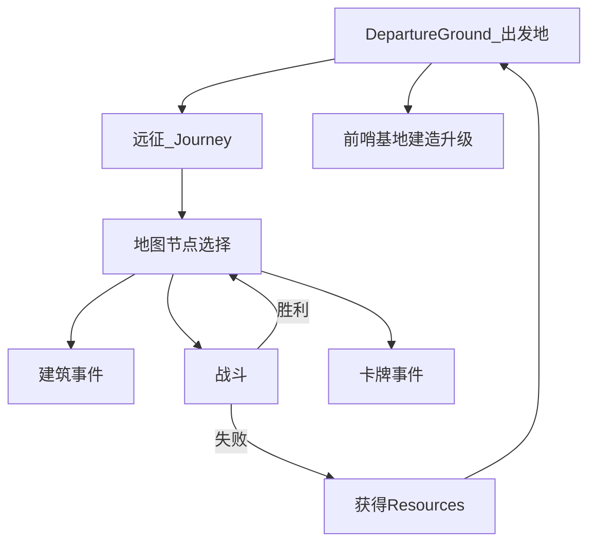

# 弈战征途（Master of Piece）参考

> 外部游戏资料汇总，供策划对照；**非**本项目实现规格。
> 数据来源：[Steam 商店页](https://store.steampowered.com/app/3009310/) · [itch.io 官方页](https://imgame-official.itch.io/master-of-piece) · 收录范围：**Steam EA（2026-02-04）** · 数据快照：**2026-06-07**
>
> **收录说明**：公开渠道无完整圣物/佣兵 Wiki；本文以**机制与系统**为主，已知条目做部分数据表。无公开来源的数值标注「待游戏内确认」。

相关文档：[INDEX.md](../INDEX.md) · [GAME_VISION.md](../GAME_VISION.md) · [SUPER_AUTO_PETS.md](./SUPER_AUTO_PETS.md) · [RISK_OF_RAIN_2.md](./RISK_OF_RAIN_2.md)

---

## 1. 概述

| 项 | 内容 |
| --- | --- |
| **中文名** | 弈战征途 |
| **英文名** | Master of Piece |
| **韩文名** | 마스터 오브 피스 |
| **开发商** | I M GAME, I M fine |
| **类型** | Roguelike 牌组构筑 + 回合制对冲战棋 |
| **平台** | PC（Steam / Mac）· 支持简体中文 |
| **EA 上线** | 2026-02-04（预计 EA 6–12 个月） |
| **题材** | 黑暗哥特中世纪；黑雾笼罩的世界，寻找「龙珠」/ 揭开黑暗秘密 |
| **对标体验** | 评测常比 Darkest Dungeon（meta + 出发地）× Into the Breach（回合战棋）；非纯自走棋 |

**一句话**：招募佣兵棋子构筑牌库，在 Roguelike 地图上选路成长，以回合制对冲战斗摧毁敌方军旗；通过双特性组合、圣物、谣言与指挥官技能叠出协同。

---

## 2. 术语对照

| 英文 | 中文 | 说明 |
| --- | --- | --- |
| Mercenary | 佣兵 / 棋子 | 牌库单位；招募的是棋子而非传统卡牌 |
| Trait | 特性 | 战斗被动技能；每佣兵最多 **2** 个 |
| Rumor | 谣言 / 传闻 | 弱被动词条；与特性、属性升级独立 |
| Upgrade | 升级 | 属性强化（攻/血/速）；每佣兵最多 **2** 次 |
| Relic | 圣物 / 遗物 | Run 内持久被动；显示于画面左侧 |
| Item | 道具 / 物品 | 消耗品；默认最多携带 **3** 个 |
| Commander | 指挥官 | 选角决定佣兵池、主动技能与风格 |
| Flag | 军旗 | 胜负判定目标；耐久归零则失败 |
| Garrison | 前哨基地 | 局外 meta 建筑系统 |
| Guild | 公会 | 预组起始佣兵对、圣物、技能 |
| Ordeal | 试炼 | 通关后解锁的难度修正 |
| Resources | 资源 | 远征结束获得的 meta 货币 |
| Journey | 远征 | 单次 Run |
| Departure Ground | 出发地 | 主菜单 hub（前哨、档案、公会等） |
| Building Event | 建筑事件 | 地图上的功能性建筑节点 |
| Card Event | 卡牌事件 | 短故事二选一随机事件 |
| Dice | 骰子 | 用于 Bootcamp 等随机改属性 |
| Silver / Gold | 银币 / 金币 | 地图内购买货币（节点消费） |

---

## 3. 宏观系统

### 3.1 整体循环



| 阶段 | 玩家行为 | 系统行为 |
| --- | --- | --- |
| **出发地** | 选指挥官、公会预组、查看档案/成就、建造前哨 | 持久化 meta 进度 |
| **远征** | 选地图节点、战斗部署/移动、管理牌库 | 随机路线、敌人、事件 |
| **战斗** | 每回合部署或移动佣兵；可选指挥官技能/道具 | 按速度自动行动、对冲推进 |
| **远征结束** | — | 成功通关或失败；发放 Resources |
| **Meta** | 用 Resources 升级前哨（5 选 4） | 永久强化后续远征 |

### 3.2 出发地（Departure Ground）

| 区域 | 功能 |
| --- | --- |
| **Hall of Fame** | 成就展示；成就在建筑内以实体物件呈现 |
| **Archive** |  lore 阅读、历史远征统计 |
| **Garrison** | 前哨基地建造与升级（见 §3.4） |
| **Guild** | 解锁后配置：起始佣兵对、起始圣物、指挥官主动技能 |

首次远征以 **西格蒙德 Sigmund**（骑士）开始；通关或进度解锁 **利维乌斯 Livius**。正式版计划第三人 **Serila**。

### 3.3 远征地图（Roguelike）

- **结构**：线性节点地图；**4 个区域**，每区末尾 **Boss 战**（EA 共 **8 个 Boss**）
- **选路策略**：战斗节点 vs 建筑事件 vs 卡牌事件的权衡；错误路线可能导致「无论操作多好都无法取胜」
- **胜利**：打通第 4 区最终 Boss，远征完成
- **失败条件**（满足其一）：
  1. **军旗耐久**归零
  2. **佣兵耗尽**——牌库/手牌/场上无可用佣兵（**敌方无此限制**，可能出现 Boss 无棋但仍有单位可打玩家残局的情况）

### 3.4 前哨基地（Garrison）

最多建造 **4** 座（从 **5** 种中选）。用远征获得的 **Resources** 建造与升级；走得越远，Resources 越多。

| 建筑 | 英文 | 升级效果摘要 |
| --- | --- | --- |
| 工坊 | Workshop | 击败 Boss 后军旗耐久恢复 **+3 / +4 / +5 / +6** |
| 风车 | Windmill | 远征开始时额外骰子 **+2 / +4 / +6 / +8** |
| 仓库 | Warehouse | 道具槽 **+1 / +2**；满级后进入新区获得 **1** 个随机道具 |
| 指挥中心 | Command Center | 获得 **Pioneer's Compass**（先锋罗盘）圣物，远征中可用 **1 / 2** 次 |
| 兵营 | Barracks | 战斗奖励佣兵自动带升级，持续 **1 / 2 / 3** 场遭遇 |

指挥官等级提升后，前哨可选建筑池扩展（机核攻略：最多放置其中四个）。

### 3.5 公会（Guild）

随指挥官进度解锁，允许预组：

- **起始佣兵对**（2 名有特性佣兵）
- **起始圣物**
- **指挥官主动技能**

多数成功 Run 的核心棋子来自公会预选或基于其特性的衍生培养。

### 3.6 指挥官（Commander）

| 指挥官 | 风格 | 备注 |
| --- | --- | --- |
| **西格蒙德 Sigmund** | 骑士；偏 **坦克 / 防反** | 可组极高生存阵容；EA 通关难度相对较低 |
| **利维乌斯 Livius** | 偏 **激进速攻** | 适合快攻拆旗；佣兵池与西格蒙德完全不同 |
| **Serila** | — | 正式版计划；EA 未实装 |

**已知指挥官能力**：

| 能力 | 说明 |
| --- | --- |
| **Lantern of Will**（意志之灯） | 指挥官主动技能之一；与 **Crystal Necklace**（水晶项链）圣物有联动（Patch 1.5.53 修复激活 bug） |
| **战斗限一次技能**（试玩版） | 对目标敌人造成 **2** 点伤害；每局战斗限 **1** 次 |

### 3.7 试炼（Ordeals）

首次用某指挥官通关后解锁该指挥官的 Ordeals。共 **7** 档，可叠加，提升难度与 Resources/XP 收益。

| 序号 | 修正（摘要） |
| --- | --- |
| 1 | 敌人棋子升级 |
| 2 | 敌方军旗耐久与 Boss HP 增加 |
| 3 | 单场战斗棋子数量增加 |
| 4–7 | 后续档（具体数值待游戏内确认） |

---

## 4. 战斗机制

### 4.1 战场布局

棋盘 **4×3**（试玩版 / EA 评测一致）：

```
[ 敌方备战区 ]  ← 红色
[   交战区   ]  ← 可含障碍物（树木、拒马：有耐久、不攻击）
[ 我方备战区 ]  ← 蓝色
[   军旗     ]  ← 场外；被攻击扣耐久
```

- 开战前可预览战场信息（障碍位置等）
- 普通战：摧毁对方**军旗**即胜
- **Boss 战**：Boss **即**军旗单位；每回合 Boss 会移动到两侧空格

### 4.2 单回合流程

战斗分为 **备战阶段** 与 **交战阶段**。

**备战阶段**（每回合）：

| 步骤 | 规则 |
| --- | --- |
| 1 | 敌方将 **1** 名佣兵放入备战区 |
| 2 | 玩家从牌库 **抽 1** 名佣兵入手牌 |
| 3 | 玩家从手牌 **部署 1** 名到备战区，或 **移动** 已在场佣兵至相邻格 |
| 4 | 部署/移动消耗 **行动点（AP）**；EA 常见为 **2 AP/回合**（VJGamer）；部分强化可降低消耗 |
| 5 | 可选：发动指挥官主动技能；使用消耗道具 |
| 6 | 点击「战斗开始」进入交战阶段 |

**交战阶段**：

| 步骤 | 规则 |
| --- | --- |
| 1 | 全场单位按 **速度** 从高到低依次行动 |
| 2 | 同速则 **Roll 点**（骰子）决定先后 |
| 3 | 行动时：前方有敌人 → **攻击**（造成等于攻击力的伤害）；已在交战区且前方无敌 → 攻击 **敌方军旗** |
| 4 | 攻击后：若前方为交战区空格 → **前进 1 格** |
| 5 | 默认行为：向前移动并攻击前方敌人；**特性** 可改变此逻辑（远程、特殊移动等） |
| 6 | 本回合所有单位行动完毕后，回到备战阶段 |

**默认单位行为**（无特殊特性时）：绝大多数棋子「攻击正前方敌人」；与经典自走棋类似，但玩家**每回合**持续决策而非一次布阵。

### 4.3 速度博弈

- **小数值设计**：先动不一定占优
- **相距 2 格**：先手单位可能因够不到敌人而 **空过**；后手反而先打到先手 → 「后发制人」
- **策略**：低速单位 **沉底** 可限制对方推进节奏；需警惕敌方 **远程** 特性
- **竞速胜**：即使己方军旗濒危，若本回合速度足够在对方破旗前先破对方旗 → **仍判胜**

### 4.4 障碍物

- 交战区可出现 **树木、拒马** 等
- 有 **耐久度**，可被攻击消耗；**不会**主动攻击
- Steam 成就 **Strategist**：单场战斗用障碍物击败 **≥3** 名敌人

### 4.5 与自走棋 / 本项目的差异

| 维度 | Master of Piece | 本项目（Project Autochess） |
| --- | --- | --- |
| 战斗决策 | 每回合部署 + 移动 | 准备阶段布阵，战斗全自动 |
| 棋盘 | 4×3 对冲；双方从备战区推进 | 可变尺寸共享棋盘；敌人刷空闲格 |
| 单位能力 | 0–2 **特性** + 谣言 | 内建 **Ability** + 商店 **增益卡** |
| Run 被动 | **圣物**（左侧栏，可多件） | **增益卡**挂 `DeckEntry` |
| 消耗品 | **道具**（限 3 槽，一次性） | v1 无装备/消耗品 |
| 胜负 | 摧毁军旗 / Boss | 清光全部敌人胜 / 己方全灭败（清波制定稿；基地/军旗非 v1 主轴） |

---

## 5. 佣兵与构筑

### 5.1 基础属性

| 属性 | 英文 | 说明 |
| --- | --- | --- |
| 攻击 | Attack Power | 单次攻击伤害 |
| 生命 | Health | 归零则死亡；本场战斗移出 |
| 速度 | Speed | 行动顺序；同速 Roll 点 |

### 5.2 特性、升级与谣言

| 系统 | 规则 |
| --- | --- |
| **特性 Trait** | 每佣兵 **0–2** 个；战斗被动；构筑核心 |
| **升级 Upgrade** | 每佣兵最多 **2** 次属性升级；任意分配攻/血/速 |
| **谣言 Rumor** | 每佣兵 **0–1** 个；弱于特性；战斗后有概率获得 |
| **组合** | 双特性 + 圣物 + 指挥官技能 → 主要协同来源 |

### 5.3 成长途径

| 途径 | 英文 | 效果 |
| --- | --- | --- |
| 萨满房 | Shaman's Hut | 二选一强化三维；**失败可能移除**该佣兵 |
| 训练营 | Bootcamp | 随机改变基础三维 + 获得 Upgrade 或 Rumor |
| 绞刑架 | Gallows | **处决**一名佣兵，将其 **特性** 转移给另一名 |
| 灰烬坟场 | Ash Graveyard | 三维 **一增一减**（机核攻略） |
| 酒馆 | Tavern | 支付银币 **消除** 或 **重 roll** 谣言 |
| 判断表 | Judgment Table | 移除一名佣兵；若有正面特性可选另一名 **继承** |
| Boss 奖励 | — | 选择一名佣兵的 **特性升级** |
| 特性店 | Trait Shop | 二选一获得新特性 |
| 骰子 | Dice | Bootcamp 等随机改属性；Windmill 前哨增加起始骰子 |

### 5.4 牌库与「兵王」培养

- **初始**：2 名有特性侍从 + 3 名无特性侍从（机核攻略）
- **指挥官池**：EA 每位指挥官 **28** 名佣兵（含 **3** 名无技能初始单位）
- **牌库权衡**：
  - **铺场**：大量弱棋耗敌、人海硬抗
  - **精锐**：绞刑架转移特性 + Boss 点升级，培养 1–2 名「兵王」
- **培养流程示例**（机核）：目标单位先升级 → 绞刑架吊死供特性者 → 特性移植给主培养角色 → 下一 Boss 点升级主特性

### 5.5 已知佣兵与特性示例（收录不全）

以下为公开攻略中出现的名称；**非**完整 roster。

| 佣兵 | 特性 / 机制 | 构筑方向 |
| --- | --- | --- |
| 哨兵 | 速度转化为攻击与生命 | 速度献祭流 |
| 伏击者 | 踏风：提升自身攻防 | 速度献祭（作副特性移植） |
| 牧师 | 提高全队其他佣兵速度 | 速度辅助 |
| 流放者 | 回合结束消耗 1 火焰，按速度对随机目标多段伤害 | 小李飞刀流 |
| 瘟疫医生 | 麻痹：为其他单位附加速度 | 小李飞刀（利维乌斯池） |
| 斗殴者 | 高频率攻击 | 狂暴攻击流 |
| 屠戮者 | 清理全体杂兵 | 狂暴攻击流 |
| 苦刑修士 | 修行代价：增加攻击与附火 | 狂暴攻击（副特性） |
| 传道者 | 忠诚：按火焰数为队友加攻 | 狂暴攻击流 |
| 驯兽师 | 狩猎回报：恢复生命 | 防反肉盾 |
| 圣骑士 | 以牙还牙：基于当前生命反击 | 防反肉盾 |
| 祭司 | 亵渎之光：死亡 AOE | 死亡赋能 |
| 行刑者 | （与牧师小 combo） | 死亡赋能辅助 |
| 墓地守卫 | 为队友收尸叠火焰/攻/血 | 人海流（利维乌斯 + 意志之戒） |
| 赤色长袍 | 死亡触发回血（攻略提及 bug 联动） | 死亡防反 |

### 5.6 公开攻略流派摘要

| 流派 | 核心思路 |
| --- | --- |
| **速度献祭** | 哨兵主特性 + 伏击者踏风副特性 + 牧师全队加速 + 骰子堆速 |
| **小李飞刀** | 流放者 + 瘟疫医生麻痹 + 速度投资 |
| **狂暴攻击** | 斗殴者 + 屠戮者 + 苦刑修士副特性 + 传道者忠诚 |
| **防反肉盾** | 驯兽师狩猎回报 + 圣骑士以牙还牙 + 守护之盾抬临时生命 + 祭司死亡 AOE |
| **人海铺场** | 意志之戒全体附火 + 墓地守卫收尸成长 + **先锋军旗** 让核心第一回合上场 + **裂纹之钟** |

---

## 6. 道具与收藏品

### 6.1 圣物（Relic）

- **定位**：Run 内 **持久被动**；显示于画面左侧；可收集多件（成就 **Hoarder**：≥9 件）
- **获取**：精英战奖励、Relic Shop、Card Event、Command Center 前哨等
- **部分圣物**带 **CD**（数回合冷却，VJGamer）
- **规模**（来源不一，见 §8）：EA 约 **30–32**；itch 宣传 **60–80**

#### 已知圣物表（收录不全）

| 英文名 | 中文（以游戏内为准） | 效果摘要 | 来源 |
| --- | --- | --- | --- |
| Iron Cross | 铁十字 | 每回合末：随机 **1 攻** 友方（**仅战场**，Patch 后）获得 **+2 / +3** 攻 | Steam Patch 1.5.53 |
| Crystal Necklace | 水晶项链 | 与 **Lantern of Will** 联动；具体数值待确认 | Steam Patch 1.5.53 |
| Strategist's Compass | 战略家罗盘 | 激活建筑事件时可 **查看圣物描述** | Steam Patch |
| Pioneer's Compass | 先锋罗盘 | 指挥中心前哨获得；远征中可用 **1 / 2** 次 | Phrasemaker 评测 |
| Vanguard Banner | 先锋军旗（攻略译名） | 首回合部署关键；人海流核心 | 机核攻略 |
| Cracked Bell | 裂纹之钟（攻略译名） | 铺场 / 人海增强 | 机核攻略 |
| Ring of Will | 意志之戒（攻略译名） | 全体单位 **附火**；利维乌斯核心 | 机核攻略 |
| Hourglass | 沙漏 | 可 **重置战场**（前哨相关，机核附录） | 机核攻略 |
| Combat Readiness | 战备（特性名/圣物名待确认） | 与 Iron Cross 均在「第一回合前」触发顺序相关（bugfix 提及） | Steam Community |

> 完整圣物表需游戏内图鉴或社区 Wiki 补充。

### 6.2 消耗品（Item）

| 规则 | 说明 |
| --- | --- |
| 携带上限 | 默认 **3** 个；Warehouse 前哨可 **+1 / +2** |
| 使用 | 战斗中或备战阶段消耗；用后消失 |
| 获取 | Bookstore、道具店、宝箱、Warehouse 满级进新区等 |
| EA 规模 | 评测约 **9** 种 |

| 效果类型 | 示例 |
| --- | --- |
| 复活 | 复活战死佣兵 + 追加 **2** 行动点（VJGamer） |
| 其他 | 具体名称与效果待游戏内图鉴补充 |

### 6.3 其他资源

| 资源 | 用途 |
| --- | --- |
| **银币** | 地图节点：旅店招募、酒馆洗谣言、商店购买等 |
| **骰子** | Bootcamp 随机改属性；Windmill 增加起始数量 |
| **Resources** | 远征结束 meta 货币；前哨建造升级 |
| **火焰** | 部分特性资源（如流放者、传道者、意志之戒附火体系） |

---

## 7. 地图节点与事件

### 7.1 战斗节点

| 节点 | 英文 | 奖励 / 说明 |
| --- | --- | --- |
| 街头斗殴 | Enemy Battle | 胜利获得 **1** 名佣兵 |
| 精英之战 | Elite Battle | 胜利获得 **1** 件圣物 |
| 首领战斗 | Boss Battle | 区域终点；特性升级；通关区域 |

### 7.2 建筑事件

EA 约 **14** 种（itch.io）；后续区域或有未公开节点。

| 节点 | 英文 | 功能 |
| --- | --- | --- |
| 特性店 | Trait Shop | 二选一获得特性 |
| 萨满房 | Shaman's Hut | 赌强化三维（失败可能失去佣兵） |
| 文物店 | Relic Shop | 二选一圣物 |
| 绞刑架 | Gallows | 处决佣兵并 **转移特性** |
| 酒馆 | Tavern | 支付消除或重 roll 谣言 |
| 训练营 | Bootcamp | 随机改属性 + Upgrade / Rumor |
| 书店 | Bookstore | 获得道具 |
| 旅店 | Hotel | 花银币招募（至多 **2** 名） |
| 道具店 | Item Shop | 购买消耗品（至多 **2**） |
| 判断表 | Judgment Table | 移除佣兵；正面特性可继承 |
| 灰烬坟场 | Ash Graveyard | 三维一增一减 |

试玩版另含：**宝箱**（随机佣兵/圣物/银币）、**新兵训练营**（二选一佣兵）等；EA 节点池可能扩展。

### 7.3 卡牌事件（Card Event）

- **形式**：短故事 + **二选一**；选择直接影响奖励或军旗耐久
- **规模**：itch 宣传 **400+**；EA 评测约 **22** 种（可能为区域子集或 EA 裁剪）
- **典型权衡**：用 **军旗耐久** 换更高奖励；或无损恢复耐久但放弃奖励
- **注意**：Patch 提及部分经 Card Event 获得的圣物效果未正确激活（已修复类 bug）

---

## 8. 内容规模与版本差异

各渠道宣传数字不一致；整理时勿混用。

| 内容 | Steam EA 商店页 (2026-02) | Phrasemaker EA 评测 | itch.io 官方页 |
| --- | --- | --- | --- |
| 佣兵 + 特性 | 100+ | **28 / 指挥官** | 140+ |
| 圣物 | 30 | 32 | 60–80 |
| 卡牌事件 | 20 | 22 | 400+ |
| 区域 / Boss | 4 区域 / 8 Boss | 4 区域 | — |
| 指挥官 | 2（+1 计划） | 2 | — |
| 建筑事件 | — | — | 14+ |
| 敌人种类 | — | 60（4×15） | — |
| 消耗品 | — | 9 | — |

**EA 当前内容**（Steam EA 说明）：四区域、八 Boss、两名指挥官、前哨、特性与圣物组合游玩。

---

## 9. 策划对照（本项目）

| Master of Piece | 本项目近似 / 差异 |
| --- | --- |
| 佣兵 + 双特性组合 | `UnitData.ability` + `passives`；商店 **增益卡** 而非第二特性移植 |
| 绞刑架特性转移 | 无等价；SAP 式同名合并升级 |
| 圣物（Run 被动，多件） | `BuffCardData` 挂 `DeckEntry`；9 种增益 |
| 消耗品（3 槽） | v1 未实现 `resources/items/` |
| 谣言（随机词条） | 无等价 |
| 对冲 4×3 + 军旗 | 共享棋盘 + 波次刷怪 + 清波制（无军旗/基地胜负） |
| 每回合部署/移动 | PREPARE 布阵 + COMBAT 全自动 |
| 指挥官主动技能 | 无指挥官层；远期未定 |
| 前哨 meta 建筑 | 无 meta 进度（GAME_VISION 标远期） |
| 卡牌事件 / 地图选路 | 关卡制线性波次 |

---

## 10. 资料来源

| 来源 | URL | 用途 |
| --- | --- | --- |
| Steam 商店页 | https://store.steampowered.com/app/3009310/ | 官方描述、EA 范围 |
| itch.io 官方页 | https://imgame-official.itch.io/master-of-piece | 内容规模宣传 |
| GameRes 产品分析 | https://www.gameres.com/909347.html | 试玩版战斗/地图规则 |
| Phrasemaker EA 评测 | https://thephrasemaker.com/2026/02/04/master-of-piece-review-an-enticing-roguelike-deckbuilder-that-stands-out/ | 前哨、节点、EA 数量 |
| 机核「兵王修炼手册」 | https://www.gcores.com/articles/210559 | 流派、佣兵名、灰烬坟场 |
| VJGamer 介绍 | https://www.vjgamer.com.hk/articles/2026/02/02/102888/master-of-piece | AP、消耗品示例 |
| 巴哈姆特 GNN | https://gnn.gamer.com.tw/detail.php?sn=298911 | 背景、EA 信息 |
| Steam Community | https://steamcommunity.com/app/3009310/ | Patch notes（Iron Cross 等） |

---

## 11. 维护说明

- 新增圣物/佣兵条目：优先从游戏内简体中文确认译名，更新 §5.5、§6.1
- 正式版（1.0）发布后：核对 §8 数量表，补充 Serila 与完整 roster
- 本文档与 [SHOP_SYSTEM.md](../SHOP_SYSTEM.md)、[BUFF_SYSTEM.md](../BUFF_SYSTEM.md) 等 **自研规格** 分离存放，勿混为项目实现需求
