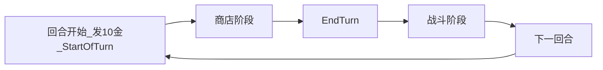
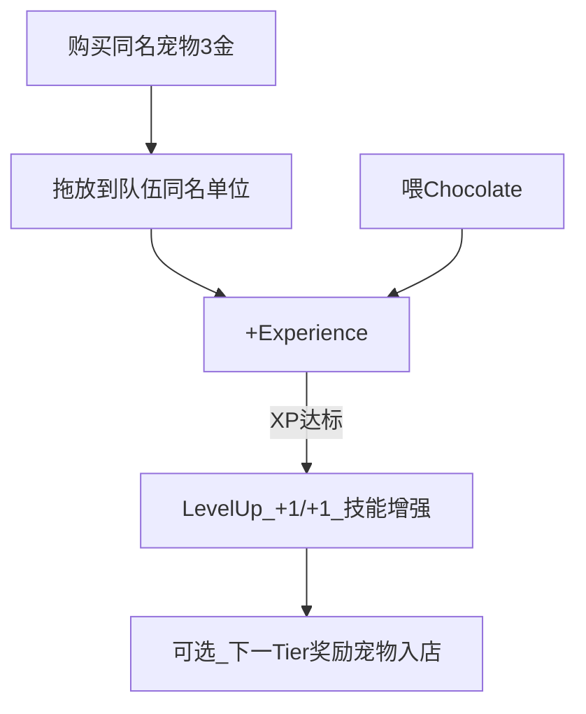

# Super Auto Pets 商店系统参考 — Turtle Pack

> 外部游戏资料汇总，供策划对照；**非**本项目实现规格。
> 数据来源：[SAP Wiki](https://superautopets.wiki.gg/) · [Roll Chances](https://superautopets.fandom.com/wiki/Roll_Chances) · 收录范围：**Turtle Pack** · 数据快照：**2026-05-29**

相关文档：[INDEX.md](../INDEX.md) · [SUPER_AUTO_PETS.md](./SUPER_AUTO_PETS.md) · [GAME_VISION.md](../GAME_VISION.md) · [ARCHITECTURE.md](../ARCHITECTURE.md)

单位/食物数据表见 [SUPER_AUTO_PETS.md](./SUPER_AUTO_PETS.md)；本文档专注 **商店阶段机制**。

---

## 1. 术语

| 英文 | 中文 | 说明 |
|------|------|------|
| Turn | 回合 | 一次 Shop Phase + 一次 Battle Phase |
| Shop Phase | 商店阶段 | 花金购宠/购食、Roll、Freeze、布阵 |
| Gold | 金币 | 商店阶段唯一货币 |
| Tier | 档位 | 宠物/食物强度档（T1–T6） |
| Roll | 刷新 | 重新随机商店槽位内容 |
| Freeze | 锁定 | 保留槽位内容跨 Roll / 跨回合 |
| Level | 等级 | 宠物 Lv1–Lv3（合成升级） |
| Experience | 经验 | 合成或 Chocolate 获得；达标升 Level |

---

## 2. 商店在对局中的位置

每回合分为两阶段：**商店阶段** → **战斗阶段**。商店阶段亦称 **Turn**。

| 节点 | 行为 |
|------|------|
| 回合开始 | 发放 **10 金**；**免费 Roll** 刷新商店（不扣金）；`Start of turn` 技能触发 |
| 商店阶段 | 购买、出售、Roll、Freeze、喂食、合成、调整站位 |
| End Turn | 玩家确认后进入战斗（Versus / With Friends 有计时器；Arena 无） |
| 战斗结束 | 进入下一回合；`End turn` 技能在回合末触发 |

---

## 3. 经济系统

| 规则 | SAP 数值 |
|------|----------|
| 每回合基础收入 | **10 金**（默认；**无**利息机制） |
| 购买宠物 | **3 金** |
| 购买食物 | **3 金**（Sleeping Pill 等例外 **1 金**） |
| 手动 Roll | **1 金** |
| 回合初免费 Roll | **0 金** |
| 出售宠物 | **售价 = 等级**（Lv1→1，Lv2→2，Lv3→3） |

**例外**：Pig 等 `Sell` 技能可额外获得金币；Cake Perk 可提升出售价值。详见 [SUPER_AUTO_PETS.md](./SUPER_AUTO_PETS.md) §3。

**与本项目差异**：本项目金币来自 **击杀即时掉金 + 波次结算**（见 [GAME_VISION.md](../GAME_VISION.md) §经济），而非 SAP 的固定 10 金/回合。

---

## 4. 商店布局与槽位

### 4.1 UI 分区

- **左下**：宠物区（Pet offers）
- **右下**：食物区（Food offers）
- 宠物与食物 **分开展示**，不在同一行混合 roll

### 4.2 队伍（Team）

| 规则 | 数值 |
|------|------|
| 队伍格数上限 | **5** |
| 第 1 回合购宠上限 | **3**（之后可满 5） |
| 满员 | 不可再买宠物 |

### 4.3 商店展示槽

| 区域 | 说明 |
|------|------|
| 宠物区 | 随回合增长，最多约 **6 格**；升级奖励宠物需有空槽才会出现 |
| 食物区 | 通常 **1 格** |
| 冻结项 | 占用对应区域槽位，排在区域 **最左侧** |

槽位总数影响 Roll 概率计算（见 §6.4）。Wiki 对逐回合槽位数的记载不完全统一，**以游戏内表现为准**。

---

## 5. 核心操作

### 5.1 购买

- **宠物**：扣 3 金 → 加入队伍空位；触发 `Buy` 技能（如 Otter、Cow）
- **食物**：扣费 → 拖拽到目标宠物
  - **Stat boost**：直接 +攻/+血（如 Apple、Pear）
  - **Food Perk**：赋予持久增益槽；每只宠物 **至多 1 个 Perk**，新食物 **覆盖** 旧 Perk

### 5.2 出售

- 将队伍内宠物拖出 → 按等级返还金币
- 触发 `Sell` 技能（如 Beaver、Pig、Duck、Pigeon）

### 5.3 Roll（刷新）

- 消耗 **1 金**（或 Free Roll 次数）
- **未冻结** 的槽位全部 re-roll
- 回合开始的免费 Roll **不扣金**
- 部分宠物提供 **Free Roll**（如 Bigfoot、Marmoset）；按钮显示剩余次数

### 5.4 Freeze（锁定）

- 点击冻结宠物或食物 → **跨 Roll 与跨回合保留**
- 冻结项占槽，减少本轮可选数量
- 购买或手动解冻后释放槽位

### 5.5 站位

- 队伍内拖拽调整顺序
- 战斗攻击顺序：己方 **右 → 左**，敌方 **左 → 右**（见 [SUPER_AUTO_PETS.md](./SUPER_AUTO_PETS.md) §2）

---

## 6. Tier 池解锁与 Roll 逻辑

### 6.1 Tier 解锁时间表

公式：**第 `2X - 1` 回合解锁 Tier X**（奇数回合升档）

| 回合 | 可购最高 Tier |
|------|---------------|
| 1–2 | 1 |
| 3–4 | 2 |
| 5–6 | 3 |
| 7–8 | 4 |
| 9–10 | 5 |
| 11+ | 6 |

- 第 11 回合后商店档位 **维持 T6** 直至对局结束
- 已解锁的低 Tier **仍可出现**；池子累积变大 → 单卡出现率下降

### 6.2 Roll 权重

- 同 Tier 内各宠物 / 食物 **等权重**（无单独权重表）
- 每个槽位 **独立 roll**：从当前已解锁 Tier 池中均匀抽取
- **Sloth** 等为彩蛋低概率宠物，不计入常规模拟

### 6.3 升级奖励宠物（Level-up Bonus）

合成或 Chocolate 使宠物 **Level up** 时：

| 效果 | 说明 |
|------|------|
| 属性 | +1 攻、+1 血 |
| 经验 | Lv2 需 **2 XP**；Lv3 再需 **3 XP** |
| 奖励宠物 | **首次**升到某级时，商店额外出现 **1 只** 来自 **下一 Tier** 的宠物（需有空槽） |
| 例外 | **Lv2 + Lv2 → Lv3** 合并 **不** 触发奖励宠物 |

**策略提示**：奇数回合升档 + 同时升级，可抢先获得高 Tier 宠物。

### 6.4 Turtle Pack 出现概率

数据来源：[Roll Chances](https://superautopets.fandom.com/wiki/Roll_Chances)（Turtle Pack，57 只宠物 / 档）。

- **Single Space Chance**：该 Tier 的 **单只** 宠物出现在 **任意一个** 槽位的概率
- **Entire Shop Chance**：该 Tier 的 **单只** 宠物出现在 **至少一个** 槽位的概率
- **Level up**：通过升级奖励进入商店的概率
- 注：概率指 **单只宠物**，非整个 Tier；各 Pack 宠物数量不同会导致概率略有差异

#### Single Space Chance（%）

| Tier | 回合 1–2 | 3–4 | 5–6 | 7–8 | 9–10 | 11+ |
|------|----------|-----|-----|-----|------|-----|
| 1 | 10.0 | 5.0 | 3.3 | 2.5 | 2.0 | 1.7 |
| 2 | 10.0 | 5.0 | 3.3 | 2.5 | 2.0 | 1.7 |
| 3 | — | 5.0 | 3.3 | 2.5 | 2.0 | 1.7 |
| 4 | — | — | 3.3 | 2.5 | 2.0 | 1.7 |
| 5 | — | — | — | 2.5 | 2.0 | 1.7 |
| 6 | — | — | — | — | — | 1.7 |

#### Entire Shop Chance（%）

| Tier | 回合 1–2 | 3–4 | 5–6 | 7–8 | 9–10 | 11+ |
|------|----------|-----|-----|-----|------|-----|
| 1 | 27.1 | 14.3 | 12.7 | 9.6 | 9.6 | 8.1 |
| 2 | 27.1 | 14.3 | 12.7 | 9.6 | 9.6 | 8.1 |
| 3 | — | 14.3 | 12.7 | 9.6 | 9.6 | 8.1 |
| 4 | — | — | 12.7 | 9.6 | 9.6 | 8.1 |
| 5 | — | — | — | 9.6 | 9.6 | 8.1 |
| 6 | — | — | — | — | — | 8.1 |

#### Level-up Bonus 出现概率（%）

| Tier | 条件 |
|------|------|
| 2 | 回合 3–4 起：**9.1** |
| 3 | 回合 5–6 起：**9.1** |
| 4 | 回合 7–8 起：**12.5** |
| 5 | 回合 9–10 起：**9.6** |
| 6 | 回合 9+ 起：**11.1** |

---

## 7. 合成与经验（商店内构筑）

| 方式 | 花费 | 经验 | 触发 Buy |
|------|------|------|----------|
| 合并 | 3 金（等同购买） | +1 XP | 是 |
| Chocolate | 3 金 | +1 XP | 否 |

- 最高 **Lv3**；技能数值随等级缩放
- 攻 / 血上限通常 **50**（Behemoth 等特殊单位例外，本文不展开）
- 首次 Lv3 某宠物可解锁对应 Achievement

---

## 8. 商店修饰效果（Turtle Pack 索引）

完整技能文本见 [SUPER_AUTO_PETS.md](./SUPER_AUTO_PETS.md) §3–§4。按 **商店相关** 类别索引：

| 类型 | 示例 | 效果摘要 |
|------|------|----------|
| 当次 Roll buff | Duck（Sell） | 出售时给商店宠物 +血（当次 Roll） |
| 永久商店 buff | Canned Food（T4 食物） | 当前及未来商店宠物 +1/+1 |
| 食物折扣 | Squirrel（Start of turn） | 全店食物 -1 / -2 / -3 金 |
| 替换食物区 | Cow（Buy） | 食物区变为 2 份免费 Milk |
| 库存食物 | Worm（Start of turn） | Stock 指定 Apple 入店 |
| 库存食物 | Pigeon（Sell） | Stock 免费 Bread Crumbs |
| 额外金币 | Swan（Start of turn） | 回合开始 +1 / +2 / +3 金 |
| 额外金币 | Pig（Sell） | 出售时 +1 / +2 / +3 金 |

### 商店食物 Tier 速查

Turtle Pack 共 **18** 种商店食物（T1–T5），完整表见 [SUPER_AUTO_PETS.md](./SUPER_AUTO_PETS.md) §4：

| Tier | 食物 |
|------|------|
| 1 | Apple、Honey |
| 2 | Cupcake、Meat Bone、Sleeping Pill |
| 3 | Cake、Garlic、Salad Bowl、Squash |
| 4 | Canned Food、Pear、Chili、Chocolate、Sushi |
| 5 | Melon、Mushroom、Pizza、Steak |

---

## 9. 与本项目对照

对照表仅供设计参考，**不**暗示必须对齐 SAP。

| 维度 | SAP | 本项目（见愿景 / 架构摘要与实现） |
|------|-----|--------------------------------------------------------|
| 商店食物 / 强化 | **Food**（食物） | **增益卡**（[BUFF_SYSTEM.md](../BUFF_SYSTEM.md)）— 非宠物技能 |
| 宠物技能 | 宠物 **Lv1/2/3 技能**（随等级） | 单位**内建** `UnitData.ability`（[ABILITIES.md](../ABILITIES.md)） |
| 商品类型 | 宠物 + 食物 | 角色卡 + **增益卡**（代码仍为技能卡 Legacy） |
| 构筑载体 | 5 格队伍（即时上场） | 牌库 Deck（上限 20）+ 每波抽 5 |
| 金币来源 | 固定 10 金/回合 | 击杀掉金 + 波次结算 + 增益亡者遗金等 |
| 刷新 | 1 金；回合初免费 Roll | `EconomyConfig.refresh_cost` |
| 锁定 | Freeze | **远期** |
| Tier 解锁 | 回合 `2X-1` 解锁 Tier X | **To-Be**：`shop_wave = wave_index + 1`（见 `TierUnlock`） |
| 3 合 1 / 升星 | 核心机制 | **已实现**牌库 Lv1–3 购买合并（见架构摘要） |
| 满员处理 | 不可再买 | 牌库满 → **替换流**；增益不占槽 |
| 部署 | 队伍即上场 | PREPARE 抽 5 张选放棋盘 |

---

## 10. 外部链接

- [The Basics](https://superautopets.wiki.gg/wiki/The_Basics)
- [Shop (Fandom)](https://superautopets.fandom.com/wiki/Shop)
- [Roll Chances](https://superautopets.fandom.com/wiki/Roll_Chances)
- [Food](https://superautopets.wiki.gg/wiki/Food)
- [Food Perks](https://superautopets.wiki.gg/wiki/Food_Perks)
- [Turtle Pack](https://superautopets.wiki.gg/wiki/Turtle_Pack)
