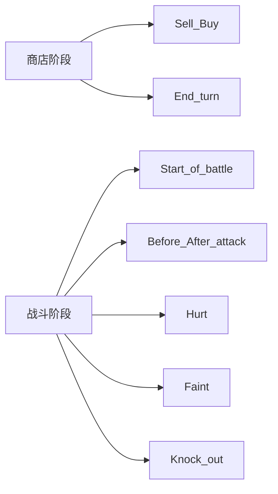

# Super Auto Pets 参考 — Turtle Pack

> 外部游戏资料汇总，供策划对照；**非**本项目实现规格。
> 数据来源：[SAP Wiki](https://superautopets.wiki.gg/) · 收录范围：**Turtle Pack** · 数据快照：**2026-05-29**

相关文档：[INDEX.md](../INDEX.md) · [GAME_VISION.md](../GAME_VISION.md) · [SAP_SHOP_SYSTEM.md](./SAP_SHOP_SYSTEM.md)（商店机制）

---

## 1. 术语对照

| SAP | 中文 | 本项目近似概念 |
|-----|------|----------------|
| Pet | 宠物 / 单位 | `UnitData`（角色卡） |
| Food | 食物 | 暂无直接对应（远期可类比消耗型强化） |
| Food Perk | 食物增益 | 宠物身上持久 Buff 槽（可被覆盖） |
| Tier | 费用档 | `UnitData.cost` |
| Level 1/2/3 | 等级（3 合 1 升级） | 本项目牌库等级见架构摘要 / 实现 |

## 2. 核心机制摘要

- **购买价格**：宠物与食物均为 **3 金**（Turtle Pack 惯例）
- **阵容上限**：5 只宠物（第 1 回合最多 3 只）
- **攻击顺序**：己方从**右到左**，敌方从**左到右**
- **增益槽**：每只宠物至多一个 Food Perk；新食物可覆盖旧 Perk

商店流程、经济、Tier 解锁、Roll / Freeze、合成与概率详见 [SAP_SHOP_SYSTEM.md](./SAP_SHOP_SYSTEM.md)。

## 3. 宠物（按 Tier 1–6）

共收录 Turtle Pack **57** 只可玩宠物。经典包设计为每档 10 只共 60 只；当前版本已移除 Shrimp、以 Pigeon 替代 Mouse 等，部分宠物在版本迭代中调整过商店档位。

### Tier 1

| 英文名 | 中文名 | 攻/血 | 触发器 | Lv1 技能 | Lv2 技能 | Lv3 技能 |
|--------|--------|-------|--------|----------|----------|----------|
| Ant | 蚂蚁 | 2/2 | Faint | Faint → Give one random friend +1 attack and +1 health. | Faint → Give one random friend +2 attack and +2 health. | Faint → Give one random friend +3 attack and +3 health. |
| Beaver | 河狸 | 3/2 | Sell | Sell → Give two random friends +1 attack. | Sell → Give two random friends +2 attack. | Sell → Give two random friends +3 attack. |
| Cricket | 蟋蟀 | 1/3 | Faint | Faint → Summon one 1/1 Zombie Cricket. | Faint → Summon one 2/2 Zombie Cricket. | Faint → Summon one 3/3 Zombie Cricket. |
| Duck | 鸭子 | 2/3 | Sell | Sell → Give shop pets +1 health. | Sell → Give shop pets +2 health. | Sell → Give shop pets +3 health. |
| Fish | 鱼 | 2/3 | Level up | Level up → Give two friends +1 attack and +1 health. | Level up → Give two friends +2 attack and +2 health. | No ability. |
| Horse | 马 | 2/1 | Friend summoned | Friend summoned → Give it +1 attack until end of battle. | Friend summoned → Give it +2 attack until end of battle. | Friend summoned → Give it +3 attack until end of battle. |
| Mosquito | 蚊子 | 2/2 | Start of battle | Start of battle → Deal 1 damage to one random enemy. | Start of battle → Deal 1 damage to two random enemies. | Start of battle → Deal 1 damage to three random enemies. |
| Otter | 水獭 | 1/3 | Buy | Buy → Give one random friend +1 health. | Buy → Give two random friends +1 health. | Buy → Give three random friends +1 health. |
| Pig | 猪 | 4/1 | Sell | Sell → Gain +1 gold. | Sell → Gain +2 gold. | Sell → Gain +3 gold. |
| Pigeon | 鸽子 | 3/1 | Sell | Sell → Stock one free Bread Crumbs. | Sell → Stock two free Bread Crumbs. | Sell → Stock three free Bread Crumbs. |

### Tier 2

| 英文名 | 中文名 | 攻/血 | 触发器 | Lv1 技能 | Lv2 技能 | Lv3 技能 |
|--------|--------|-------|--------|----------|----------|----------|
| Crab | 螃蟹 | 4/1 | Start of battle | Start of battle → Copy 50% of health from the most healthy friend. | Start of battle → Copy 100% of health from the most healthy friend. | Start of battle → Copy 150% of health from the most healthy friend. |
| Flamingo | 火烈鸟 | 3/2 | Faint | Faint → Give the two nearest friends behind +1 attack and +1 health. | Faint → Give the two nearest friends behind +2 attack and +2 health. | Faint → Give the two nearest friends behind +3 attack and +3 health. |
| Hedgehog | 刺猬 | 4/2 | Faint | Faint → Deal 2 damage to all. | Faint → Deal 4 damage to all. | Faint → Deal 6 damage to all. |
| Kangaroo | 袋鼠 | 2/3 | Friend ahead attacks | Friend ahead attacks → Gain +1 attack and +1 health. | Friend ahead attacks → Gain +2 attack and +2 health. | Friend ahead attacks → Gain +3 attack and +3 health. |
| Peacock | 孔雀 | 2/5 | Hurt | Hurt → Gain +4 attack. | Hurt → Gain +8 attack. | Hurt → Gain +12 attack. |
| Rat | 老鼠 | 3/6 | Faint | Faint → Summon one 1/1 Dirty Rat up front for the opponent. | Faint → Summon two 1/1 Dirty Rats up front for the opponent. | Faint → Summon three 1/1 Dirty Rats up front for the opponent. |
| Snail | 蜗牛 | 2/2 | End turn | End turn → If you lost last battle, give the three nearest friends ahead +1 attack. | End turn → If you lost last battle, give the three nearest friends ahead +2 attack. | End turn → If you lost last battle, give the three nearest friends ahead +3 attack. |
| Spider | 蜘蛛 | 2/2 | Faint | Faint → Summon one level 1 tier 3 pet as a 2/2. | Faint → Summon one level 2 tier 3 pet as a 4/4. | Faint → Summon one level 3 tier 3 pet as a 6/6. |
| Swan | 天鹅 | 1/2 | Start of turn | Start of turn → Gain +1 gold. | Start of turn → Gain +2 gold. | Start of turn → Gain +3 gold. |
| Worm | 蠕虫 | 1/3 | Start of turn | Start of turn → Stock one 2-gold Apple. | Start of turn → Stock one 2-gold Better Apple. | Start of turn → Stock one 2-gold Best Apple. |

### Tier 3

| 英文名 | 中文名 | 攻/血 | 触发器 | Lv1 技能 | Lv2 技能 | Lv3 技能 |
|--------|--------|-------|--------|----------|----------|----------|
| Badger | 獾 | 6/3 | Faint | Faint → Deal 50% attack damage to adjacent pets. | Faint → Deal 100% attack damage to adjacent pets. | Faint → Deal 150% attack damage to adjacent pets. |
| Blowfish | 河豚 | 3/6 | Hurt | Hurt → Deal 3 damage to one random enemy. | Hurt → Deal 6 damage to one random enemy. | Hurt → Deal 9 damage to one random enemy. |
| Camel | 骆驼 | 3/4 | Hurt | Hurt → Give the nearest friend behind +1 attack and +2 health. | Hurt → Give the nearest friend behind +2 attack and +4 health. | Hurt → Give the nearest friend behind +3 attack and +6 health. |
| Deer | 鹿 | 2/2 | Faint | Faint → Summon one 5/3 Bus with Chili. | Faint → Summon one 10/6 Bus with Chili. | Faint → Summon one 15/9 Bus with Chili. |
| Elephant | 大象 | 3/7 | After attack | After attack → Deal 1 damage to the nearest friend behind. | After attack → Deal 1 damage to the nearest friend behind. Triggers 2 times. | After attack → Deal 1 damage to the nearest friend behind. Triggers 3 times. |
| Giraffe | 长颈鹿 | 1/2 | End turn | End turn → Give the nearest friend ahead +1 attack and +1 health. | End turn → Give the nearest two friends ahead +1 attack and +1 health. | End turn → Give the nearest three friends ahead +1 attack and +1 health. |
| Ox | 公牛 | 1/3 | Friend ahead faints | Friend ahead faints → Gain Melon perk and +1 attack. Works 1 time per turn. | Friend ahead faints → Gain Melon perk and +1 attack. Works 2 time per turn. | Friend ahead faints → Gain Melon perk and +1 attack. Works 3 time per turn. |
| Penguin | 企鹅 | 1/3 | End turn | End turn → Give two level 2 or higher friends +1 attack and +1 health. | End turn → Give two level 2 or higher friends +2 attack and +2 health. | End turn → Give two level 2 or higher friends +3 attack and +3 health. |
| Rabbit | 兔子 | 1/2 | Friendly ate food | Friendly ate food → Give them +1 health. Works 4 times per turn. | Friendly ate food → Give them +2 health. Works 4 times per turn. | Friendly ate food → Give them +3 health. Works 4 times per turn. |
| Sheep | 绵羊 | 2/2 | Faint | Faint → Summon two 2/2 Rams. | Faint → Summon two 4/4 Rams. | Faint → Summon two 6/6 Rams. |

### Tier 4

| 英文名 | 中文名 | 攻/血 | 触发器 | Lv1 技能 | Lv2 技能 | Lv3 技能 |
|--------|--------|-------|--------|----------|----------|----------|
| Bison | 野牛 | 4/4 | End turn | End turn → If this has a level 3 friend, gain +1 attack and +2 health. | End turn → If this has a level 3 friend, gain +2 attack and +4 health. | End turn → If this has a level 3 friend, gain +3 attack and +6 health. |
| Hippo | 河马 | 4/5 | Knock out | Knock out → Gain +3 attack and +3 health. | Knock out → Gain +6 attack and +6 health. | Knock out → Gain +9 attack and +9 health. |
| Parrot | 鹦鹉 | 4/2 | End turn | End turn → Copy ability from the nearest pet ahead as level 1 until end of battle. | End turn → Copy ability from the nearest pet ahead as level 2 until end of battle. | End turn → Copy ability from the nearest pet ahead as level 3 until end of battle. |
| Turtle | 乌龟 | 2/5 | Faint | Faint → Give Melon Perk to the nearest friend behind. | Faint → Give Melon Perk to the two nearest friends behind. | Faint → Give Melon Perk to the three nearest friends behind. |
| Skunk | 臭鼬 | 3/5 | Start of battle | Start of battle → Reduce the highest health enemy by 33% health. | Start of battle → Reduce the highest health enemy by 66% health. | Start of battle → Reduce the highest health enemy by 99% health. |
| Squirrel | 松鼠 | 2/5 | Start of turn | Start of turn → Discount all shop food by 1 gold. | Start of turn → Discount all shop food by 2 gold. | Start of turn → Discount all shop food by 3 gold. |
| Whale | 鲸鱼 | 3/7 | Start of battle | Start of battle → Swallow the nearest friend ahead and release it at level 1 on fainting. | Start of battle → Swallow the nearest friend ahead and release it at level 2 on fainting. | Start of battle → Swallow the nearest friend ahead and release it at level 3 on fainting. |
| Armadillo | 犰狳 | 2/6 | Start of battle | Start of battle → Give ALL pets +8 health. | Start of battle → Give ALL pets +16 health. | Start of battle → Give ALL pets +24 health. |
| Scorpion | 蝎子 | 1/1 | Summoned | Summoned → Gain Peanut perk. | Summoned → Gain Peanut perk. | Summoned → Gain Peanut perk. |
| Seal | 海豹 | 3/8 | Eats food | Eats food → Give three random friends +1 attack. | Eats food → Give three random friends +2 attack. | Eats food → Give three random friends +3 attack. |

### Tier 5

| 英文名 | 中文名 | 攻/血 | 触发器 | Lv1 技能 | Lv2 技能 | Lv3 技能 |
|--------|--------|-------|--------|----------|----------|----------|
| Turkey | 火鸡 | 3/4 | Friend summoned | Friend summoned → Give it +3 attack and +1 health. | Friend summoned → Give it +6 attack and +2 health. | Friend summoned → Give it +9 attack and +3 health. |
| Cow | 奶牛 | 4/6 | Buy | Buy → Replace food shop with two free Milk. | Buy → Replace food shop with two free Better Milk. | Buy → Replace food shop with two free Best Milk. |
| Shark | 鲨鱼 | 2/2 | Friend faints | Friend faints → Gain +2 attack and +2 health. | Friend faints → Gain +4 attack and +4 health. | Friend faints → Gain +6 attack and +6 health. |
| Crocodile | 鳄鱼 | 8/4 | Start of battle | Start of battle → Deal 8 damage to the last enemy. | Start of battle → Deal 8 damage to the last enemy. Triggers 2 times. | Start of battle → Deal 8 damage to the last enemy. Triggers 3 times. |
| Rhino | 犀牛 | 6/9 | Knock out | Knock out → Deal 4 damage to the first enemy. Double against tier 1 pets. | Knock out → Deal 8 damage to the first enemy. Double against tier 1 pets. | Knock out → Deal 12 damage to the first enemy. Double against tier 1 pets. |
| Rooster | 公鸡 | 6/4 | Faint | Faint → Summon one Chick with 1 health and 50% attack of this. | Faint → Summon two Chicks with 1 health and 50% attack of this. | Faint → Summon three Chicks with 1 health and 50% attack of this. |
| Monkey | 猴子 | 1/2 | End turn | End turn → Give front-most friendly pet +2 attack and +2 health. | End turn → Give front-most friendly pet +4 attack and +4 health. | End turn → Give front-most friendly pet +6 attack and +6 health. |
| Boar | 野猪 | 10/6 | Before attack | Before attack → Gain +4 attack and +2 health. | Before attack → Gain +8 attack and +4 health. | Before attack → Gain +12 attack and +6 health. |
| Cat | 猫 | 4/5 | — | Food gives double health and attack. Works 2 times per turn. | Food gives triple health and attack. Works 2 times per turn. | Food gives quadruple health and attack. Works 2 times per turn. |
| Dragon | 龙 | 6/8 | Tier 1 friend bought | Tier 1 friend bought → Give friends +1 attack and +1 health. | Tier 1 friend bought → Give friends +2 attack and +2 health. | Tier 1 friend bought → Give friends +3 attack and +3 health. |

### Tier 6

| 英文名 | 中文名 | 攻/血 | 触发器 | Lv1 技能 | Lv2 技能 | Lv3 技能 |
|--------|--------|-------|--------|----------|----------|----------|
| Fly | 苍蝇 | 5/5 | Friend faints | Friend faints → Summon one 4/4 Zombie Fly in its place. Works 3 times per turn. | Friend faints → Summon one 8/8 Zombie Fly in its place. Works 3 times per turn. | Friend faints → Summon one 12/12 Zombie Fly in its place. Works 3 times per turn. |
| Gorilla | 大猩猩 | 7/10 | Hurt | Hurt → Gain Coconut 1 time per battle. | Hurt → Gain Coconut 2 times per battle. | Hurt → Gain Coconut 3 times per battle. |
| Leopard | 豹 | 10/4 | Start of battle | Start of battle → Deal 50% attack damage to one random enemy. | Start of battle → Deal 50% attack damage to two random enemy. | Start of battle → Deal 50% attack damage to three random enemy. |
| Mammoth | 猛犸 | 4/12 | Faint | Faint → Give all friends +2 attack and +2 health. | Faint → Give all friends +4 attack and +4 health. | Faint → Give all friends +6 attack and +6 health. |
| Snake | 蛇 | 6/6 | Friend ahead attacks | Friend ahead attacks → Deal 5 damage to one random enemy. | Friend ahead attacks → Deal 10 damage to one random enemy. | Friend ahead attacks → Deal 15 damage to one random enemy. |
| Tiger | 虎 | 6/4 | — | The friend ahead repeats their ability in battle as if they were level 1. | The friend ahead repeats their ability in battle as if they were level 2. | The friend ahead repeats their ability in battle as if they were level 3. |
| Wolverine | 狼獾 | 5/4 | Four friends hurt | Four friends hurt → Remove 2 health from all enemies. | Four friends hurt → Remove 4 health from all enemies. | Four friends hurt → Remove 6 health from all enemies. |

## 4. 食物与增益（按 Tier 1–5）

SAP「增强卡」对应 **Food（食物）**；部分食物会赋予 **Food Perk（食物增益）**。 Turtle Pack 共 **18** 种商店食物。

### Tier 1

| 英文名 | 中文名 | 购买效果 | Perk 效果 | 备注 |
|--------|--------|----------|-----------|------|
| Apple | 苹果 | Give one pet +1 attack and +1 health. | — | 出售老鼠也可获得 |
| Honey | 蜂蜜 | Give one pet the Honey Perk. | Faint → Summon one 1/1 Bee. | 产生 Honey 增益 |

### Tier 2

| 英文名 | 中文名 | 购买效果 | Perk 效果 | 备注 |
|--------|--------|----------|-----------|------|
| Cupcake | 纸杯蛋糕 | Give one pet +3 attack and +3 health until end of battle. | — | 仅本场战斗 |
| Meat Bone | 肉骨 | Give one pet the Meat Bone Perk. | Attack with +3 damage. | 产生 Meat Bone 增益 |
| Sleeping Pill | 安眠药 | Make one pet faint. | — | 始终特价；可主动送走单位 |

### Tier 3

| 英文名 | 中文名 | 购买效果 | Perk 效果 | 备注 |
|--------|--------|----------|-----------|------|
| Cake | 蛋糕 | Give one pet the Cake Perk. | End turn → Increase sell value by 1 gold. | 产生 Cake 增益 |
| Garlic | 大蒜 | Give one pet the Garlic Perk. | Take 2 less damage. | 产生 Garlic 增益 |
| Salad Bowl | 沙拉碗 | Give two random pets +1 attack and +1 health. | — | 无 Perk |
| Squash | 南瓜 | Give one pet the Squash Perk. | Before attack → Remove 6 health from target, once. | 产生 Squash 增益 |

### Tier 4

| 英文名 | 中文名 | 购买效果 | Perk 效果 | 备注 |
|--------|--------|----------|-----------|------|
| Canned Food | 罐头 | Give all current and future shop pets +1 attack and +1 health. | — | 永久强化商店 |
| Pear | 梨 | Give one pet +2 attack and +2 health. | — | 无 Perk |
| Chili | 辣椒 | Give one pet the Chili Perk. | Attack second enemy for 5 damage. | 产生 Chili 增益 |
| Chocolate | 巧克力 | Give one pet Experience. | — | 升级用；出售乌鸦也可获得 |
| Sushi | 寿司 | Give three random pets +1 attack and +1 health. | — | 无 Perk |

### Tier 5

| 英文名 | 中文名 | 购买效果 | Perk 效果 | 备注 |
|--------|--------|----------|-----------|------|
| Melon | 西瓜 | Give one pet the Melon Perk. | Take 20 less damage, once. | 产生 Melon 增益 |
| Mushroom | 蘑菇 | Give one pet the Mushroom Perk. | Faint → Come back as a 1/1. | 产生 Mushroom 增益 |
| Pizza | 披萨 | Give two random pets +2 attack and +2 health. | — | 无 Perk |
| Steak | 牛排 | Give one pet the Steak Perk. | Attack with +20 damage, once. | 产生 Steak 增益 |

## 5. 触发器速查

| 英文 | 中文 | 说明 |
|------|------|------|
| Buy | 购买 | 从商店购入该宠物时 |
| Sell | 出售 | 将该宠物卖出时 |
| Level-up | 升级 | 该宠物合成升级时 |
| Start of turn | 回合开始 | 每回合开始（商店阶段） |
| End turn | 回合结束 | 每回合结束（商店阶段） |
| Start of battle | 开战 | 战斗开始时 |
| Before attack | 攻击前 | 该宠物发起攻击前 |
| After attack | 攻击后 | 该宠物攻击后 |
| Hurt | 受伤 | 该宠物受到伤害时 |
| Faint | 死亡 | 该宠物生命值归零时 |
| Friend summoned | 友方召唤 | 友方召唤单位时 |
| Friend faints | 友方死亡 | 友方宠物死亡时 |
| Knock out | 击倒 | 该宠物击倒敌人时 |
| Eats food | 吃食物 | 该宠物被喂食时 |
| Friendly ate food | 友方吃食物 | 友方被喂食时 |

## 6. 外部链接

- [Pets](https://superautopets.wiki.gg/wiki/Pets)
- [Food](https://superautopets.wiki.gg/wiki/Food)
- [Food Perks](https://superautopets.wiki.gg/wiki/Food_Perks)
- [Turtle Pack](https://superautopets.wiki.gg/wiki/Turtle_Pack)
