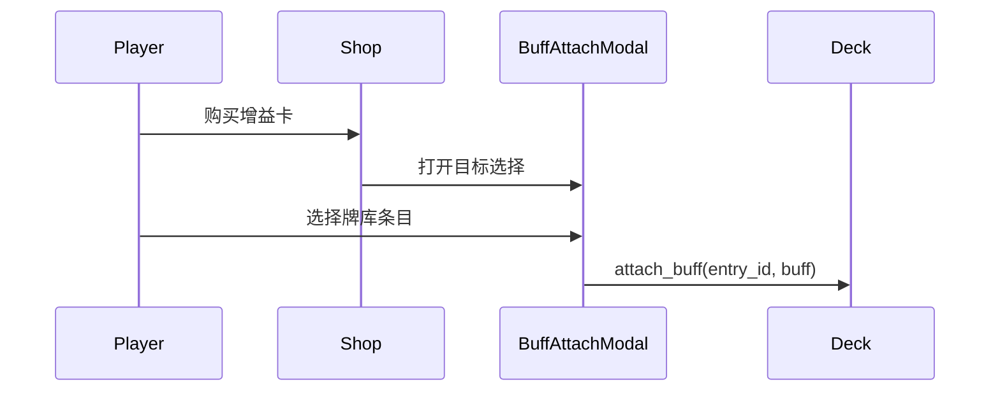

# 商店与牌库系统

> 策划与程序对齐文档。**M3b 已实现**（牌库、角色卡 + 增益卡、满库替换、增益附加、Tier 解锁）。**每波抽牌 + 战斗 cycle 补人（无冷却队列）已实装**；冷却队列 / 可见窗默认 4 仍为 To-Be。商店阶段手牌仍展示整库（出售）；准备/战斗为底部本波手牌。
>
> **已实现（2026-05）**：`buff_pool` / `BuffAttachModal` / `attached_buffs` / Tier 解锁（`TierUnlock` + `shop_wave`）。

相关文档：[BUFF_SYSTEM.md](./BUFF_SYSTEM.md) · [GAME_VISION.md](./GAME_VISION.md) · [Features/GAME_LOOP.md](./Features/GAME_LOOP.md)（何时进商店）· [ARCHITECTURE.md](./ARCHITECTURE.md) · [Reference/SAP_SHOP_SYSTEM.md](./Reference/SAP_SHOP_SYSTEM.md)

---

## 1. 概述

**商店在循环中的位置（先读这个）**

| 模式 | 何时能进商店 |
|------|----------------|
| **主模式（爬塔）** | **仅地图商店节点**（战斗胜利后回地图，不强制进商店）。何时进出见 [游戏基础循环](./Features/GAME_LOOP.md) |
| **线性开发关** | 波次结算之后、下一波准备之前（下文「步骤 5」描述的是这条工具环） |

下文购买规则、牌库与品阶对两种模式共用；**不要**把「每波必商店」读成爬塔主循环。玩家**仅能购买**：

| 卡种 | 简述 |
|------|------|
| **角色卡** | 加入**构筑牌库**；单位内建技能（见 [ABILITIES.md](./ABILITIES.md)） |
| **增益卡** | 附加到牌库内某一角色条目（见 [BUFF_SYSTEM.md](./BUFF_SYSTEM.md)） |

牌库在准备阶段抽样为 **本波 cycle 手牌**；战斗中可滚动补人（见 §4、愿景主循环）。


---

## 2. 商店商品

### 2.1 角色卡

- **数据**：对应 `UnitData`（或包装为 `CharacterCardData`，内含 `UnitData` 引用）
- **技能**：每只 `UnitData` **必须**配置 `ability`（`passives` 可选）；**不再**从商店购买技能
- **购买后**：在牌库中新增一条 `DeckEntry`（或同名合并，见 §2.4）
- **价格**：默认 `UnitData.cost`；文档约定 **默认 `cost == tier`**（1–6），可 per-unit 覆盖
- **Tier**：`UnitData.tier`（1–6），参与商店 roll（见 §2.6）
- **牌库未满**：扣费后直接加入牌库
- **牌库已满**：弹出**替换选择** UI，玩家必须指定一条现有 `DeckEntry` 被移出，新角色卡方可入队

### 2.2 增益卡

- **数据**：`BuffCardData`（见 [BUFF_SYSTEM.md](./BUFF_SYSTEM.md)）
- **购买后**：**不**作为独立条目进入牌库列表
- **玩家操作**：购买成功后打开**增益附加** UI（文档目标名 `BuffAttachModal`），从牌库内选一条 `DeckEntry` 附加
- **生效**：永久属性写入 `bonus_*` / 规则 flag；战斗触发类在实例化或 `EffectResolver` 侧处理
- **叠加**：**允许多张增益**叠在同一条目

### 2.3 商店槽位与刷新

- 商店 UI **分区展示**：**角色卡区**与**增益卡区**独立排列
- 槽位数量可在 `ShopPoolConfig` 中配置（To-Be 命名）：
  - `character_slot_count`（默认 **5**）：从 `character_pool` / `pool` roll 角色卡
  - `buff_slot_count`（默认 **2**）：从 `buff_pool` roll 增益卡
- **刷新**：消耗金币同时 re-roll 两个区域（沿用 `EconomyConfig.refresh_cost`）
- **锁定**：远期；非当前文档范围
- **购买失败**：金币不足时拒绝；角色卡满库走替换流；**增益卡不占新槽位，牌库满仍可购买**

### 2.4 牌库升级（SAP 式，已实现）

- **数据**：`DeckEntry.level`（1–3）、`experience`、`bonus_attack` / `bonus_max_hp`；阈值见 `LevelConfig`（默认 Lv2 需 2 XP、Lv3 再需 3 XP）
- **购买合并**：商店购买**同名**角色卡时，若牌库存在未满级同名条目 → 扣费并 **+1 经验**（不占新槽位）；合并到**等级最低**的同名条目
- **升级**：经验达标 → `level++`，永久 **+1 攻、+1 血**（可配置）
- **满级**：牌库中该单位全部 Lv3 时，拒绝再购买同名（不扣费）
- **新卡**：无同名可合并时，仍 `add_entry`（Lv1）；牌库满则走替换流
- **出售**：退款 = **当前等级**（`RunEconomy.get_sell_price(entry)` → `entry.level` 金）
- **战斗**：上场实例继承等级与永久加成；**内建技能** `EffectAction` 数值 × 持有者 `level`（召唤类除外）
- **远期**：牌库内双条目手动合并、Chocolate 加经验、升级奖励高 Tier 入店

### 2.5 出售角色（商店阶段）

- **时机**：仅 `MatchStateMachine.Phase.SHOP`（商店阶段）；部署阶段不可出售
- **操作**：底部牌库列表每张角色卡显示「出售 (N)」按钮；点击后该 `DeckEntry` 移出牌库
- **退款**：`N = entry.level`（SAP 式，Lv1→1 金、Lv2→2 金、Lv3→3 金）；经 `RunEconomy.get_sell_price(entry)` / `grant()`
- **附加增益**：`attached_buffs` 随条目一并移除，**不**单独退款
- **Sell 触发器**：猪 / 河狸 / 鸭子 / 鸽子等商店阶段技能已实现（见 [ABILITIES.md](./ABILITIES.md) §3 `OnSell`）
- **弹窗互斥**：满库替换、增益附加弹窗打开时不可出售

### 2.6 Tier 系统（To-Be，未实现）

对齐 [SAP_SHOP_SYSTEM.md](./Reference/SAP_SHOP_SYSTEM.md) §6.1：将 SAP「回合」映射为本项目 **Run 内进入商店的波次序号** `shop_wave = wave_index + 1`（与 [GAME_VISION.md](./GAME_VISION.md) 六步循环一致；首波战斗前若已购物，该序号与 `wave_index` 同步递增）。

**解锁公式**：第 `2X - 1` 波（SAP 回合语义）解锁 **Tier X** 为可 roll 的**最高档位**；低 tier 商品仍可出现。

| 波次 `shop_wave`（= wave_index + 1） | 可 roll 最高 Tier |
|-------------------------------------|------------------|
| 1–2 | 1 |
| 3–4 | 2 |
| 5–6 | 3 |
| 7–8 | 4 |
| 9–10 | 5 |
| 11+ | 6 |

**Roll 规则**（细节见 SAP §6.2）：

- 每个角色槽 / 增益槽**独立** roll
- 从池中 `tier <= max_unlocked_tier(shop_wave)` 的条目**等权重**抽取
- PvE 暂无 Sloth 彩蛋
- 池配置：`ShopPoolConfig` 按 tier 分池，或条目带 `tier` 字段过滤

**与 cost 关系**：文档约定默认 **`cost == tier`**（1–6），避免与旧 1–5 费混用两套语义；单卡可覆盖。

**实现状态**：`TierUnlock` 已按上表解锁最高可 roll 档；池内容见 [`dev_shop_pool.tres`](../resources/shop/dev_shop_pool.tres)，权重与条目可继续迭代。

---

## 3. 牌库（Deck）

### 3.1 配置

| 属性 | 默认值 | 配置项 |
|------|--------|--------|
| 初始内容 | 10 × 基础占位角色 | `DeckConfig.starting_units` |
| 容量上限 | 20 | `DeckConfig.max_size` |
| 每波抽牌数 | 5 | `DeckConfig.draw_count` |

关卡 / Run 开始时，按 `starting_units` 注入牌库；每条为独立的 `DeckEntry`（即使同名单位也各占一条）。

### 3.2 牌库条目（DeckEntry）

```
DeckEntry
├── unit: UnitData          # 角色本体（含内建 ability）
├── level: int              # 1–3
├── experience: int         # 当前等级段内经验
├── bonus_attack / bonus_max_hp  # 升级永久加成
├── attached_buffs: []      # 商店购买的增益卡（BuffCardData）
└── rule_flags: Dictionary  # 可选，如 cannot_move
```

牌库是 Run 内**持久**的构筑载体：波次间保留；通过商店购买、满库替换、**商店阶段出售**变更。

### 3.3 满库替换规则

购买**角色卡**且 `deck.size >= max_size` 时：

1. 扣费前或扣费后（实现期定）打开 `DeckReplaceModal`
2. 展示当前牌库全部条目（角色名 + 已有增益摘要）
3. 玩家选择**一条**被替换条目；该条目移出牌库
4. 新 `DeckEntry` 加入牌库

被替换条目是否返还金币：**未决**（见 §8）。

---

## 4. 每波抽牌、预布阵与战斗 cycle【设计定稿 / To-Be】

> As-Is：`HandPanel` 展示整库，仅 PREPARE 可放置，开战锁阵。下列为目标规格。

### 4.1 两层模型

| 层 | 何时变 | 职责 |
|----|--------|------|
| **构筑牌库** | 商店买/替/升级/挂增益 | Run 长期资产 |
| **本波 cycle 手牌** | PREPARE 从牌库无放回抽子集；COMBAT 内滚动 | 本波谁能上、何时补 |

战斗中**不**从构筑牌库新抽；波末 cycle 解散。

### 4.2 准备抽牌

- **时机**：进入 PREPARE（含首波）
- **规则**：从完整牌库无放回抽 **`draw_count`（默认 5）** 条 `DeckEntry`
- 牌库小于 `draw_count` 时：抽 `min(draw_count, deck.size)`（推荐默认）
- **不跨波保留**

### 4.3 预布阵与战斗补人

- **PREPARE**：可从本波手牌预布阵到空格；受 **人口上限**（默认 5）约束
- **COMBAT**：
  - 已上场单位 **不可移动/换位**
  - 剩余/滚回的手牌可向空格 **即时补人**（仍受人口与空格约束）
  - 打出后进入本波冷却队列，再滚入可见窗（可见张数默认 4）
  - **死亡腾人口**，可即时再补
  - 同一 `DeckEntry` 同时仅一体在场
- 波末未使用的 cycle 手牌清空（对构筑牌库无副作用）

人口、时长与借鉴边界见 [GAME_VISION.md](./GAME_VISION.md)「主循环骨架」。

### 4.4 与棋盘

- 预布阵与战中落子均占格，影响刷怪空闲格
- 首波：初始化牌库 → PREPARE 抽牌 → 预布阵 → COMBAT

---

## 5. 增益卡附加流

完整规格见 [BUFF_SYSTEM.md](./BUFF_SYSTEM.md) §2。



- **附加范围**：牌库内任意 `DeckEntry`
- **实例化**：`UnitInstance.from_deck_entry` 合并 `bonus_*`、规则 flag；内建技能仅来自 `unit.ability` / `passives`
- **战斗触发类增益**（如亡者遗金）：不默认并入 `get_all_effect_specs()`，由 Run 经济或专用监听器处理

---

## 6. 与旧 MVP 的差异

| 旧 MVP / 当前代码 | 新设计（本文档） |
|-------------------|----------------|
| 购买 → `BenchState` 备战席 | 购买角色卡 → `DeckState` 牌库 |
| 备战席选中 → 点击棋盘上场 | 每波抽本波子集 → 预布阵 + 战斗 cycle 补人 |
| 商店 `UnitData` + `AbilityData` 技能卡 | 角色卡 + **增益卡** |
| `skill_pool` / `attached_skills` | `buff_pool` / `attached_buffs` |
| 备战席容量 8 | 牌库上限 20（可配置） |
| 备战席满则无法购买 | 牌库满 → 替换流；增益不占槽 |

Legacy 模块：`BenchState`、`BenchPanel` — **已移除**（M3b）。Legacy 商店技能 — **待迁移为增益商店**。

---

## 7. 数据与模块（To-Be）

| 模块 / 资源 | 职责 |
|-------------|------|
| `DeckConfig` | `starting_units`、`max_size`、`draw_count` |
| `DeckEntry` | 运行时条目：`unit` + `attached_buffs[]` + `rule_flags` |
| `DeckState` | 牌库增删、满库替换、`attach_buff` |
| `DrawService` | 每波 PREPARE 无放回抽 `draw_count` 张，形成 cycle 牌组；**已实装** |
| `ShopOffer` | 枚举 `CHARACTER \| BUFF` + payload |
| `ShopService` | roll 槽位、购买、刷新；`get_max_tier(shop_wave)` |
| `ShopPoolConfig` | 角色池、增益池、槽位数、**按 tier 分池或 tier 字段** |
| `BuffCardData` | 增益卡资源（见 BUFF_SYSTEM） |
| `TierUnlockService`（可选） | 封装 `max_unlocked_tier = f(shop_wave)` |

### UI 场景（建议）

| 场景 | 职责 |
|------|------|
| `ShopPanel` | 角色卡区 / 增益卡区分区槽位、购买、刷新 |
| `DeckReplaceModal` | 满库时选择被替换条目 |
| `BuffAttachModal` | 购买增益卡后选择牌库目标（由 `SkillAttachModal` 迁移） |
| `HandPanel` | As-Is 整库；To-Be 为本波 cycle 可见窗 + 战中可打出 |
| `DeckView`（可选） | 浏览构筑牌库 |

实现细节与依赖关系见 [ARCHITECTURE.md](./ARCHITECTURE.md) §3.2、§3.3。

---

## 8. 未决问题

| 议题 | 说明 |
|------|------|
| 满库替换 | 被替换条目是否返还金币 |
| 增益卸载 | 是否可单独移除增益（见 BUFF_SYSTEM） |
| 同 id 增益叠加 | 重复购买上限 |
| Tier 与波次计数 | Run 商店节点的 `shop_wave` 递增规则 |
| 商店配比 | 角色槽 vs 增益槽权重 |

---

## 9. 里程碑（M3b）

| 项 | 说明 |
|----|------|
| `DeckState` + `DeckConfig` | 初始 10 占位、上限 20 |
| 双卡种 `ShopService` | 角色卡入队、增益卡附加 |
| Tier 解锁 | `TierUnlock` 已实现 |
| `DrawService` / 战斗 cycle | 每波抽牌 + 战中补人（**已实装**；冷却窗 To-Be） |
| UI | 替换弹窗、增益附加弹窗、手牌面板 |
| 牌库升级 | `LevelConfig`、`DeckUpgradeService`、购买合并、等级/经验条 UI |
| 迁移 | 已替换 `BenchState` 主流程 |

与 [GAME_VISION.md](./GAME_VISION.md) 里程碑 M3b / M4 同步。
